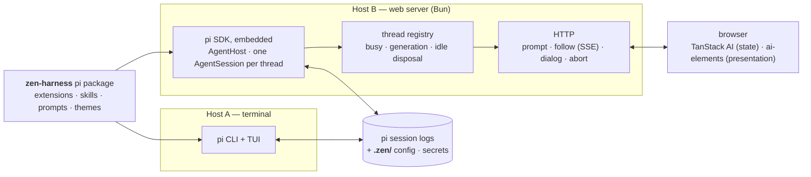
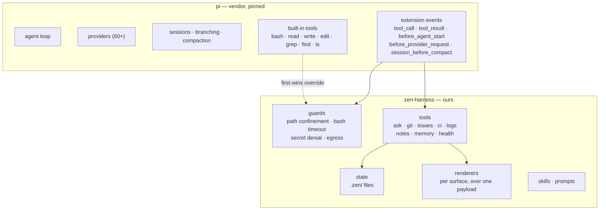
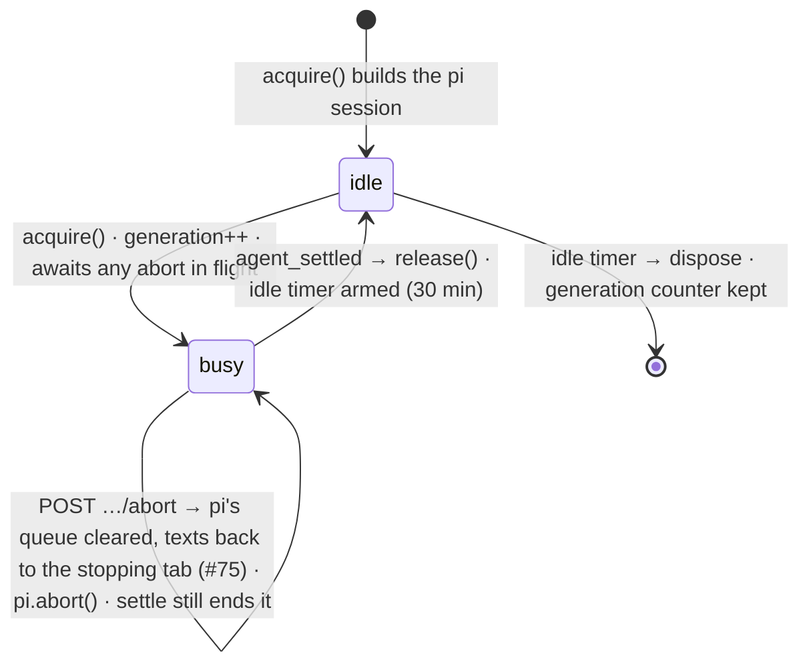
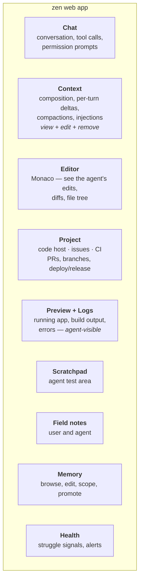
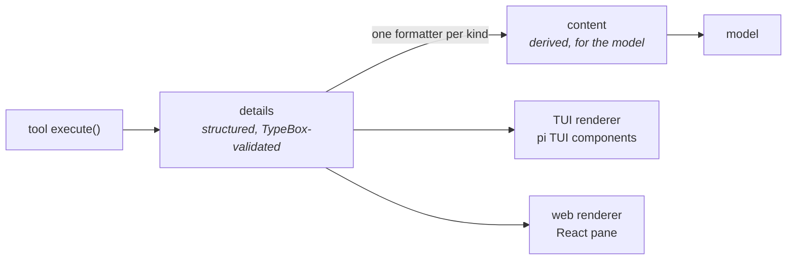

# zen-harness — vision and architecture

**Status:** foundational. Written 2026-09-03; runtime and control-plane sections rewritten 2026-09-09
after the #103 freeze, from the code (#102). This is the document a fresh session reads first.

Research that informs these decisions lives in [`concepts/`](./concepts/) — documents on boundaries,
tooling, failure modes, prompt caching, support systems, provider auth, and what to harvest from prior
projects. This document is the *shape*; those are the *why*.

---

## What this is, in one paragraph

zen-harness is a **pi package** that provides **two surfaces over one agent loop**. pi owns the loop,
the providers, sessions, and compaction. zen-harness adds tools, guards, state, and skills as
extensions, and presents them through a terminal UI and a web application. Neither surface has its own
brain; both are clients of the same package running against the same pi.

---

## The stance that everything else follows from

**pi owns the loop. There is no second agent.**

Every temptation to build a competing loop — in the web backend, in a worker, in the chat framework —
is refused. The web app is a client. The TUI is a client. An extension is a participant in pi's loop,
never a replacement for it.

This is what makes the whole plan tractable: features are written once as extensions and work in both
surfaces, because they talk to pi's event and tool APIs rather than to a UI.

---

## Runtime shape

Two hosts, one package, shared on-disk state.



**Why the web host embeds the SDK rather than driving pi over a chat protocol (#69, #112).** The context
pane has to read the entry array; a run has to outlive the request that started it; a second tab has to
see the first tab's run. Chat protocols (ACP, AG-UI) carry chat, tool calls and interrupts — not
entries, partial tool output, mode, usage or queue state. So the backend embeds pi and speaks its own
wire; the browser derives whatever its renderer wants in memory. Details under *The control plane*.

**Why state is files, not a service.** pi's session log is the durable record and both hosts read it;
`.zen/` holds harness config and secrets. A service later becomes an optimisation for push (live
alerts) rather than a migration — see *Persistence* below for the one rule this imposes today.

---

## Ownership boundary



**Guards override built-ins by name.** pi resolves tools **first-wins** (`runner.ts`,
`getAllRegisteredTools`), so a guarded `write` declared before any vendor extension cannot be silently
replaced. Load order is therefore a security property — see *Decided constraints*.

**The boundary is enforced twice, by two sensors.** The vendor gate (`test/vendor-gate.test.ts`, #145)
reads *text*: `@earendil-works/*` is imported, and a vendor extension is named, only under `web/src/host/`
and `harness/extensions/`. `.fallowrc.jsonc` → `boundaries` (#173) reads the *import graph*: the zone
table below is the target layout of the re-cut (workstream 9), and a crossing it reports is either a
planned move or a numbered leak. The graph catches what a text scan cannot — a re-export chain, a
type-only import, a barrel that leaks a zone; the text scan catches what a graph cannot — a vendor's
*name* in a string. Neither replaces the other. A zone is a directory glob, so "may import the
runtime" is not a zone rule; that stays the text scan's. `allowTypeOnly` is granted nowhere: a
type-only crossing is still a dependency.

| Zone | Directory | May import (ours) |
|---|---|---|
| `core` | `packages/core/src/` | nothing |
| `harness-core` | `packages/harness/core/` | `core` |
| `harness-extensions` | `packages/harness/extensions/` | `core`, `harness-core` |
| `host` | `packages/web/src/host/` | `core` |
| `server` | `packages/web/src/server/` | `core`, `host` |
| `browser` | `packages/web/src/` (all else) | `core` |
| `scripts` | `scripts/` | `core` |
| `test` | `test/`, `packages/web/e2e/` | anything |

Every owned source file must fall in a zone (`coverage.requireAllFiles`; `index.html` is the one
excused file). The storage seam is a forbidden call: `SessionManager.*` from `server` or `browser`
is a finding, beside `no-duplicate-paths`. Severity is `error`: the day-one list (five crossings, all in
`rpc/`, recorded on #173) was emptied by moving the files, not by widening a rule.

---

## The control plane

The human-facing layer that creates, inspects, switches between and manipulates pi-backed threads
while pi stays authoritative for execution (#103). Proven viable 2026-09-09 (two receipt runs, second
clean) and frozen; this section is written from the code that passed.

### Nouns

One id, and a strict rule about what to call it. **`thread`** is the noun for the id everywhere it
crosses — routes, browser, wire types. **`session`** is reserved for pi's durable log and pi's own
types (`SessionManager`, `AgentSession`). Before this was written the word carried four
meanings; the zen-owned names that said "session" and meant "thread" were renamed in #165, and
`test/glossary-gate.test.ts` keeps them from coming back.

[`glossary.md`](./glossary.md) is the authority for every word (#161): this table is the identity
half of its *Thread* domain, kept here because the control plane is read from this page. Its six
domains — Thread, Control, Permission, Observation, Record, Surface — follow invariant 2 below (a
route tells the runtime; the feed ends the run); the renames owed are its *Retired* table; the map
from our words to the vendors' is its vendor map, the one place it names them.

| Noun | Meaning | Id | Minted by | Owner, lifetime |
|---|---|---|---|---|
| **project** | the cwd pi reads and writes | path | server startup (`ZenServerOptions.cwd`), never a request | the server process; one project, many threads |
| **thread** | one conversation | `threadId`, UUID-shaped (`isZenThreadId`) | the browser (`crypto.randomUUID()`), or reused from a stored log on resume | the registry's `ThreadEntry` while live; the id outlives it |
| **pi session** | pi's append-only log, and the live `AgentSession` over it | **the same string as `threadId`** (#95) | pi, under the browser's id | 1:1 with the thread; the log outlives everything |
| **run** | one acquisition of a thread: prompt admission → `agent_settled`. Not one prompt — prompts during a run queue into it (#75) | `generation`, per thread, monotonic for the server's lifetime | `acquire()` | the lease; released by the settle observer, never by a route |
| **generation** | the run's number: the stale-lease fence, and the receipt the browser compares against | integer, memory only — **resets when the server restarts**, which is what "lost session" means | server | — |
| **follow** | one browser subscription to a thread: snapshot, then observations with `seq`, then status | none; per page, per thread | `createFollowConnection` | the page |
| **messageId** | one prompt admission; how a `prompt-rejected` names its prompt | UUID | the prompt route | one receipt |
| **dialog** | a question pi is blocked on | `id` from the asking extension | pi | pi's `openDialogs()`; the browser holds one slot (#114) |
| **branch** | pi's root→leaf entry chain, carried verbatim | entry `id`/`parentId` | pi | pi |
| **fork** | pi's `/fork`: a new log whose header names `parentSession` | pi session id | pi | pi |

The comparison with deepseek-harness's vocabulary (#102, #109) lives in the glossary's vendor map.

### Lifecycles

**A thread on the server** (`thread-registry.ts`). Two states while live, and a parked question is
*busy* — there is no third state, matching dsh's `idle | running` with questions beside it.



**A run in the browser** (`follow-connection.ts`). Opened by a receipt (own prompt) or by a status
frame that says busy with no run to match (another tab's — `external-<generation>`). Closed by the
feed's `settled` + `status`, never by a click or a returning POST. A dropped follow is said as a chunk
(`follow-ended`) so the page can say so; the next follow's snapshot is the resync (#103, #114).

**A dialog.** pi blocks; the follow carries a blocking `extension-ui-request`; an answer is `POST …/dialog`, validated
against the question (#112); every settle path — answered, cancelled, timeout, abort — emits
`dialog-settled` from the host so every follower drops the card (#114). The snapshot lists every open
question so a reconnect renders the card at once.

### Invariants — the sentences every receipt was checked against

1. **The feed is the only writer of run state in the browser.** No click, no returning POST, no timer
   closes a run. This is why abort (#116), dialogs (#113, #114) and resume (#95) landed without
   regressions: each added a unary route and changed nothing about how a run ends.
2. **A route tells pi; the feed ends the run.** `prompt` answers at admission (202 + receipt), `abort`
   answers 204 when pi was told, `dialog` answers 204 when the question was spent. Their effects
   arrive on the follow for every follower alike.
3. **The snapshot is the resync.** Nothing is replayed by cursor; a follow opens with the thread as of
   `asOfSeq` and continues from there.
4. **One live writer per pi session id.** pi appends with no lock. Within the web server the registry
   serialises writers (one `ThreadEntry` per id). Across processes — TUI and web resuming the same id
   in the same cwd — nothing does, and each process's in-memory branch would fork the log silently.
   Rule, not code, until it is needed.
5. **Never present a control as working when it is not.** A stop button that stops nothing is removed
   rather than left (#103 receipt); a mode select that is unsure says `unknown`; a debug pane names a
   MISMATCH between what the page believes and what the server holds instead of hiding one.

### Persistence

**The storage seam is `AgentHost`** (`packages/web/src/host/agent-host.ts`): the only file that
touches `SessionManager` or the session-file layout (`listSessions`, `readTranscript`, `createSession`).
`@zen/core` and the browser never see a path except as debug text. Keep it so — this is the state
abstraction #102 §1 asks for, and it costs one test.

What is durable, and where:

| Artefact | Key | Writer | Read |
|---|---|---|---|
| pi session log, `<timestamp>_<threadId>.jsonl` under pi's session dir | thread id | pi — **lazily**: `sessionFile` is null until pi's first flush | live from the hosted session when the thread is live; cold from the file otherwise; messages are rebuilt from entries on every cold read, so a mapper change applies retroactively |
| picc's `modes` custom entry in that log | — | picc, on `/mode` | `persistedPermissionMode(branch)`: last entry wins, deliberately uncached because `/tree` and `/fork` move the leaf (#84, #95) |
| `zen.config.json` at the repo root | — | committed | once, at extension load; fails closed (#59) |
| `.zen/secrets.env` | — | operator | per call by the extension that needs it; quarantined from `process.env` |
| `.zen/pi-agent/provider-failover.json` | — | seeded at host creation | pi's multi-account extension |

Not durable, by design: `ZenObservation` (derived from pi events in memory, never written); AG-UI
(derived in the adapter, never on the wire); `generation` and the rest of the registry's `ThreadEntry`
(`packages/web/src/server/thread-registry.ts` — busy, idle timer, abort in flight, the sent tail).

**Run provenance (#102 §3).** pi's log already carries `SessionHeader {id, cwd, timestamp,
parentSession}`, `model_change {provider, modelId}`, `thinking_level_change`, and picc's mode — so a
fork point's session, entry, model, mode, cwd and parent are recorded today. Not recorded: project
revision (git HEAD), a context-manifest hash, active rules, active skills, configuration. Decided: when
those are recorded they go **into pi's log as zen custom entries**, the way picc records mode — one
canonical log, and a fork inherits them by construction. Deferred to the lineage phase.

### Presentation

The browser is two layers with a fixed seam (#31, #121). **TanStack AI is the state layer** — client,
`createChatHook` slots, the `SubscribeConnectionAdapter` our follow adapter implements. **ai-elements
is the presentation layer**, ported file by file from `vercel/ai-elements` (pinned commit, provenance
header, `Modified:` list, every `import from "ai"` retyped) under `components/ai-elements/`. Rule:
before building a presentation component, check upstream; hand-rolling needs its reason in the file
header. State, the dialog renderer (#27) and the tool-result descriptor renderer (#18) stay ours and
never migrate into that directory.

---

## The end state we are building toward

Two surfaces. The TUI reaches parity with what pi, Claude Code and omp already give. The web app is the
reason the project exists.



Pane provenance, so intent is not lost: **Chat** takes its shape from deepseek-harness. **Context** takes
its interface from `dsh-context` and its data from our own backend, with editing added. **Health** takes
its signal catalogue from Magpie (`concepts/archive/magpie-harvest.md`), carrying the field verdicts rather than
the weights. **Project** is three interfaces, not one.

---

## Phasing

The sequence is deliberate: assemble from what exists, prove the control plane, **then** consolidate —
and only then expand. The original plan put consolidation last, as a backfill once feature-rich; #102
moved it forward so MVP debt does not compound into architectural debt.

```mermaid
graph LR
  P0["<b>Phase 0</b> ✓<br/>Guards + package skeleton<br/><i>Tier 0 of pi-immediate-needs</i>"]
  P2["<b>Phase 2</b> ✓<br/>Web control plane<br/>chat · modes · dialogs · resume · stop"]
  F["<b>Freeze</b> ✓ 2026-09-09<br/>#103's receipt, twice<br/>then feature stop"]
  C["<b>Consolidate</b> ✓ #102<br/>vocabulary · lifecycle · docs<br/>storage seam · renames"]
  H["<b>Hardening</b> ✓ #125<br/>receipts became tests<br/>then the blocker tail + seam gates"]
  L["<b>Lineage</b> ◀ here<br/>durable identity · fork manifests"]
  X["<b>Expansion</b><br/>context · skills · rules experiments<br/>then analysis + rubric"]
  P0 --> P2 --> F --> C --> H --> L --> X
```



**The three gates were each invoked, and each is dated on its issue** — the reason to write them here
is that a phase diagram nobody can check against the record is how a project loses track of which
phase it is in (this section said the opposite a commit ago, and was wrong):

| Gate | Invoked | Receipt |
|---|---|---|
| Freeze (#103) | 2026-09-09 | the MVP procedure run twice clean; *"Frozen now. Feature work stops except correctness/security blockers."* |
| Consolidate (#102) | after the freeze | the cut landed at `07a4eba` |
| Hardened (#125) | 2026-09-09 | a one-run receipt on `main` @ `2b19245`, three headless tabs, the `?debug` drawer read at each step |

**The freeze's one allowed class ran to the end after #125 closed**, before Lineage opened: the
nested-shell guard bypass (#57 — a `-c` payload re-parsed to a depth of 3, with a floor under the raw
scan that refuses unparseable constructs by name); the URL as the thread's source of truth (#142); the
debug records a triage cannot work without (#144 slice 1 — `pid`/`startedAt` per process, time to
first token, the provider's `request-id`); and value-level secret redaction at write (#139).

Beside it, the **seam gates**, because a seam that is not enforced is a seam that has already moved:
`test/vendor-gate.test.ts` (#145 — only the host and the pi extensions may name pi, and the allowlist
is the leak inventory), `test/presentation-gate.test.ts` (#121 — every ported file carries its pin and
none imports the state layer), beside the logging, naming, no-lint-suppressions and coverage-manifest
gates already there. ⚠ Every one of them is a matcher over lines, and every review of one has found the
same failure mode: a spelling the pattern did not cover (`\b` against `PICC_`, a relative path against
the `@/` alias, a bare specifier against a subpath) or an ordering it got wrong (first-match against
longest-match, which truncated a redaction). Each gate now carries a test for its matcher, not only for
its verdict — the pattern is the thing that rots.

Phase 1 (TUI features: ask · notes · memory · git · health) was not run as a phase; the TUI has what pi
and the guards give it, and TUI features accrue as extensions when the web surface needs the same
thing. Backfill — replacing vendored parts with our own — is no longer a phase; it happens per part
when a part is outgrown, under the rule that a port is preferred to a rewrite (#121).

**Lean on off-the-shelf parts wherever they fit** — vendor extensions, omp code where it lifts cleanly
(`conflict-detect.ts` at 815 lines and two local imports is the cheap one; `ast-edit.ts` at 27 imports
including the Rust core is not). The goal is a whole system early, accepting that pieces change
underneath; starting as a package rather than a fork is what keeps that cheap — omp forked, which is
exactly why its features are hard to lift.

---

## Package structure

Three workspaces. The harness is the pi package; core is the shared shapes; web is outside the manifest.

```
zen-harness/
  zen.config.json           # the ONE committed harness config (#59)
  packages/
    core/                   # @zen/core — every TypeBox schema and shared type, one place
    harness/                # the pi package
      package.json          #   pi manifest: extensions declared EXPLICITLY, guards first
      core/                 #   guard logic, shell segmentation, egress, web-search
      extensions/           #   guards · web-fetch · web-search
      skills/ prompts/ themes/
    web/                    # the web app — outside the pi manifest
      src/server/           #   routes (prompt · follow · dialog · abort), thread registry
      src/host/             #   AgentHost: the storage seam, pi events → observations, dialogs
      src/rpc/              #   observation → AG-UI adapter and the zen.* custom-event names (browser)
      src/components/       #   ai-elements (ported) · shadcn ui
      src/__tests__/        #   tests beside their subjects (also src/*/__tests__/); fakes under server/__tests__/
      e2e/                  #   Playwright, against the real dev server
  scripts/                  # gate, coverage floor, docs generators (scripts/docs/), zen-thread / zen-logs
  test/                     # the gates: text scans over the tree (vendor, glossary, naming, logging, docs, …)
  docs/
    architecture.md         # this file: why
    glossary.md             # what a word means (gated)
    verification.md         # how the repo proves itself
    seams/                  # one page per contract, source verbatim, drift-checked
    reference/              # generated tables (core exports, decisions, observations, routes, …)
    concepts/               # the live design notes; concepts/archive/ the pre-build ones
  .fallowrc.jsonc           # fallow: entries, baseline, duplicates, architecture boundaries (the zones)
  .zen/                     # secrets, pi agent dir (gitignored)
```

Every path in this tree exists — `test/docs-gate.test.ts` checks the ones it can name, so a move
or deletion fails the docs before it fails a reader.

`web/` sits outside the manifest deliberately: pi packages carry only `extensions`, `skills`, `prompts`
and `themes`, and pi does nothing with a frontend. Settings likewise live outside — see `pi-share` for
the pattern of exporting and importing a settings bundle.

---

## The shared core

**All schemas are TypeBox, in `@zen/core`.** One schema library, no bridge, no conversion step.

The reason is not preference — it is where schemas have to travel. Three destinations:

| Destination | Requirement |
|---|---|
| pi's tool API | `registerTool<TParams extends TSchema>` — **TypeBox is mandatory**, pi does not depend on Zod at all |
| HTTP contract, backend to browser, OpenAPI | JSON Schema is the wire format, and **a TypeBox schema literally is a JSON Schema object** |
| SQL queries, if state graduates from files | **Kysely** needs only TypeScript types, and TypeBox produces them via `Static<>` — derived, not duplicated |

TypeBox 1.3.x is zero-dependency, `Schema.Compile()` produces a JIT validator that accepts TypeBox types
or native JSON Schema, and `Parse()` is the equivalent of Zod's `.parse()`.

**Adapter boundaries use explicit mapping, not schema transforms.** A GitHub response is validated for
shape, then translated by a named function — `toIssue(raw): Issue` — rather than transformed inside the
schema. Zod's `.transform()` is convenient and it buries the translation in the schema definition, which
is the wrong place for it when the entire point of the interface is a swappable provider. Validation and
translation stay separate.

⚠ **Unverified, check before relying on it.** TypeBox's handling of coercion, custom error messages and
refinements was not confirmed when this was written; the package exports a `./value` entry point that
likely covers coercion and decode. If one of those becomes load-bearing, confirm rather than assume.

### Persistence, when state outgrows files

**Kysely**, not an ORM and not a schema-first generator. It is a typed SQL query builder that needs only
TypeScript types, which means TypeBox remains the single source for shape:

```ts
// @zen/core — the shape, once
export const SessionRow = Type.Object({ id: Type.String(), started_at: Type.String(), /* … */ })

// the query layer consumes the derived type
interface Database { sessions: Static<typeof SessionRow> }
```

Three artefacts, and only one of them is authored twice — which is the point:

| Concern | Source | Duplicated? |
|---|---|---|
| Shape | TypeBox schema in `@zen/core` | no |
| Query types | `Static<typeof Schema>` fed to Kysely's `Database` | derived |
| DDL / migrations | hand-written SQL via Kysely migrations | **yes, deliberately** |
| Runtime row validation | TypeBox `Parse()` at boundaries where rows arrive from outside | optional |

⚠ Not entirely friction-free: columns with defaults or differing insert-vs-select types need Kysely's
`Generated<T>` / `ColumnType<S, I, U>` wrappers, so the derived interface is annotated rather than a
bare `Static<>`. Small, and local to the `Database` interface.

**Why this beats the schema-first alternative** (`zqlite`, previously top of the harvest list): generated
DDL is the part that fails first. It is fine until the first migration that needs a backfill, a column
rename with data movement, or an index built concurrently — at which point you are hand-writing SQL
anyway, against a generator that thinks it owns the schema. Kysely treats migrations as hand-written from
the start, which is honest about where control is actually needed.

### Tool results: one payload, many renderers

pi's tool contract already separates data from presentation — `{ content, details, isError, usage }`
plus optional `renderCall` / `renderResult`. That is what makes a single feature work in both surfaces.



Three rules:

1. **`details` is the contract; `content` is derived from it, never authored separately.** One formatter
   per kind. Otherwise a tool reports "3 open PRs" while `details` holds four, and nothing catches it.
   This also covers the unattended surface, where no renderer exists and `content` is the only channel.
2. **A discriminator on `details` from day one** — `kind`, an open string, no union behind it yet.
   Adding schemas per kind later is additive; retrofitting a discriminator across twenty tools is not.
3. **Every entity carries `id` and `url`.** `url` makes "open the real thing" one click; `id` lets a
   renderer key and diff across updates. And **`truncated` is explicit** whenever a result is bounded —
   a bounded result that does not say so produces confident wrong claims
   (`concepts/archive/agent-failure-modes.md`).

---

## Seams

The contracts the decisions protect: one implementation on each side, a fake for tests, a gate that
names the boundary. One page per seam under [`seams/`](./seams/README.md) — the source verbatim,
who implements and consumes it, what fences it, what crosses it that should not, and what a pivot
costs. This table is read off those pages (`scripts/docs/seams-table.ts`): the leak column is each
page's own lead sentence, so it cannot say a leak is open after the page says it closed.

<!-- generated-block: scripts/docs/seams-table.ts -->
| Seam | Domain | Gate | What crosses it that should not (the page’s own words) |
|---|---|---|---|
| [the dialog vocabulary](./seams/dialog.md) | Control | extension-UI-context tests | The four kinds are the runtime's extension-UI method names — kept, by decision. |
| [the guards](./seams/guards.md) | Permission | `tool-call-participants`; analyzer contract test | L5 — the tool names are the runtime's, and the guard is the runtime's extension. |
| [logging](./seams/logging.md) | Record | logging gate | The substrate is vendored, by decision, and it shows in exactly three files. |
| [the observation vocabulary](./seams/observation.md) | Observation | kinds sweeps over `@zen/core/observation-kinds`; `observations.md` generated | Nothing, since #162 workstream 5. |
| [the permission mode](./seams/permission-mode.md) | Permission | vendor gate; `code-offenders` stale-row check | Nothing. |
| [presentation](./seams/presentation.md) | Surface | presentation gate; `ported-provenance.md` generated | Nothing of the vendor kind. |
| [storage](./seams/storage.md) | Thread, Record | `no-duplicate-paths`; boundaries (the forbidden-call rule) | Nothing of the runtime's persistence format, since L2 |
| [the thread runtime](./seams/thread-runtime.md) | Thread, Control | vendor gate; glossary gate; boundaries | Nothing of the runtime's event shape, since L2 |
| [the tool result descriptor](./seams/tool-result.md) | Surface | — | Nothing of ours leaks. |
| [web providers](./seams/web-providers.md) | Permission (egress), Control | vendor gate | L6 — the model API's types, at the provider seam. |
<!-- /generated-block -->

---

## Decided constraints

Settled. Each carries its reason so a later session can tell when the reason has expired.

| Decision | Reason |
|---|---|
| pi owns the loop; both surfaces are clients | One brain. Features written once work in both. |
| Start as a **package**, never a fork | A package cannot entangle. omp forked and its features are now hard to lift. |
| **One package, multiple extensions** | Vendored and custom side by side, one install, one version. |
| Extensions **enumerated explicitly**, guards first | Load order is first-wins, so it is a security property. A directory glob orders by filename, which is incidental. |
| Assert guard integrity at startup | `write`/`bash`/`read` must resolve to our implementations, failing loudly otherwise. |
| **All schemas TypeBox in `@zen/core`** | One library, no bridge. TypeBox is mandatory at pi's tool API and *is* JSON Schema at the HTTP boundary — two of three destinations, zero conversion. |
| Adapter boundaries map explicitly, never via schema transforms | Keeps validation separate from translation, which is what makes a provider swappable. |
| **Durable state is pi's session log plus `.zen/` files, never process memory only** | Both surfaces read the same files; a service later is optional. The one cost: one live writer per session id (control plane, invariant 4). |
| Web app **embeds the pi SDK** (#69); no chat protocol between server and pi | The context pane needs the entry array; a run must outlive its request; a second tab must see the first's run. ACP and AG-UI carry none of that. |
| The server↔browser wire is **`ZenObservation`** (`@zen/core` `follow.ts`); AG-UI is a browser-side view, never on the wire, never stored | The ACP reason at the other seam (#112): AG-UI carries chat, tool calls and interrupts — not entries, partial tool output, mode, usage or queue state. A wire that lacks our nouns forces a side channel for every one of them (the `zen.*` CUSTOM chunks) and made the run the HTTP response, which is where parking (#27) and the no-progress cutoff (#99) came from. TanStack connects through its `SubscribeConnectionAdapter`, whose `send`/`subscribe` split is exactly prompt/follow; the adapter derives AG-UI in memory if a renderer wants it. |
| Context overlays keyed by **entry id**, persisted via `appendEntry()` | Survives restarts and compaction; `session_before_compact` hands `branchEntries`. |
| ⚠ Context edits are **batched, tail-biased** | Prefix-match caching: editing an early entry invalidates everything after it. Measured elsewhere at ~37 reads per cached token. See `concepts/prompt-cache-architecture.md`. |
| **Three git interfaces**, not one — code host · issues · CI | Teams split these routinely. GitHub only now, swappable later. |
| Nothing outside the GitHub adapter imports Octokit types | The only discipline that keeps swappability real. |
| Log wiring ships with **explicit per-source consent**, no filtering | Redaction damages troubleshooting and costs on hot paths. Consent is honest; a partial filter is not. |
| Ingested logs **do not persist in the transcript** by default | The exposure is not the agent seeing a line, it is the line landing in the transcript, the cache, and any session store. |
| Re-anchoring uses a **turn-scoped system message**, never a system-prompt rewrite | Rewriting the prompt per turn invalidates the entire cache. |
| **Prompt/follow split** (#112): every route is unary, the follow is the one stream | The run is not an HTTP response, so nothing parks (#27) and no cutoff kills a slow tool (#99). Snapshot then observations; the snapshot is the resync. |
| **The feed is the only writer of run state in the browser** | Abort (#116), dialogs (#114) and resume (#95) each added a route and changed nothing about how a run ends. |
| **The URL names the thread; the page follows it** (#142) | `?thread=<id>` is the active pane's source of truth — the id IS pi's session id (#95), checked with the same `isZenThreadId` as the server. Boot adopts a named thread from `/history` before showing a pane and mints (and `replaceState`s) otherwise; the rail pushes; `popstate` walks the same adopt path. Plain `history`, no router: a router is deferred until the query surface grows. |
| **Images cross as bytes, never as a URL** (#68) | `ZenPromptBody.images` is `{mimeType, data}`; the schema has no `url` field, so a server-side fetch cannot be asked for — `web_fetch`'s allowlist stays the only sanctioned fetch (#54). The browser refuses a URL-sourced part by name before posting. Redaction and caps live where the bytes are counted: 5 MB decoded per image, 20 per prompt, the body read stops at the derived wire cap. pi stores the images in the session's user entry, so the snapshot is where the transcript gets them back — the file is the record, and a snapshot with the user's images is a truthful one (measured 1.7 MB for a 1.2 MB PNG; accepted). |
| **Abort is by thread, not by lease** (#116) | The lease that took the run lives in the prompt route's closure; an operator's stop is "whatever runs now". The stale-lease fence stays on `release`. |
| **A stop hands the queue back — clear-and-restore** (#75) | Daniel's call: stop by accident and what was queued returns to the composer, never delivered unasked on the next turn, never dropped — pi's TUI's behaviour. So the queue must be ours to drain: prompts during a run go to pi (not TanStack's browser queue, invisible to other tabs), `POST …/abort` clears pi's queue before telling it to abort and answers with the texts. |
| **Tool results carry `isError` in the field TanStack reads** (#130) | `state: "output-error"` on `TOOL_CALL_RESULT`; a refused or aborted call reads `error` live exactly as a resumed log does. A call with no result once its run has ended reads `aborted`, never `running…`. |
| **One thread id, pi's session id** (#95) | The browser mints it, pi stores under it, the rail finds it again after a restart. Validated as a filename component at every entry point. |
| **`AgentHost` is the storage seam** | The only file that touches `SessionManager` or the session-file layout. Keeps a later store a one-file change. |
| **Run provenance lives in pi's log as custom entries**, never a side file | picc's `modes` entry is the pattern; a fork inherits provenance by construction. Fields beyond what pi records are deferred to the lineage phase. |
| **Logging is one file for the harness, off the loop, and the file is the export** (#132) | LogTape under a typed `zenLogger`; every process appends to the same day's `.zen/logs/zen-YYYY-MM-DD.jsonl` (`process` on every record; dated so nothing is ever renamed under another writer — measured with two processes, 800 lines, none torn), unbuffered (measured: the buffered sink held the last record until the next one), redacted by field name **at write** — the canonical record this harness never rewrites is pi's session log, and a file that is safe at rest is what a user can hand over. A record is an event with properties (`threadId`, `generation`, `toolCallId`), never a sentence with the values baked in. Three tiers on one knob: `info` is the spine (runs, tool calls, guard verdicts, questions, failures), `debug` every observation as a compact line, `trace` with payloads — `ZEN_LOG_LEVEL`, per subtree if wanted; a bad value is a startup error. `test/logging-gate.test.ts` holds the line: no production `console.*`, `@logtape/*` named only where the schema and the configurator live; the configurator is a subpath export (`@zen/core/log-process`) because `@logtape/file` is not tree-shakable and took the page down from the barrel. The browser is a layer like the others: its problems are records first and notices second (one site each), its `info`+ ships to `POST /api/logs` and lands in the same file as `process: browser` with the page's own clock as `at`; the rest stays in a ring the drawer shows. The log route never logs its own failures — a page in a loop must not write its garbage here. |
| **Presentation is ported from ai-elements**, not built (#31, #121) | **Port before you build**: before writing a presentation component for `packages/web`, check `.inspiration/ai-elements/packages/elements/src/`; if a component covers the shape, port it under the #31 procedure (provenance header naming the pinned commit, a `Modified:` list, upstream's `ai` types retyped as they cross). Building from scratch is the exception and the reason goes in the file header — `reasoning.tsx` says why it dropped streamdown. Six files ported (`conversation`, `message`, `reasoning`, `queue`, `prompt-input`, `attachments`). The composer sits on the ported `PromptInput` for its form, attachments, paste and drop; send and stop stay two buttons of ours because a prompt in flight queues (#75) and a stop is its own act (#116) — upstream's one `PromptInputSubmit` is the named divergence, in the file header. **The seam does not move: ai-elements is presentation, TanStack is state.** "Holds no state" means no APPLICATION state — component-local `useState`/`useRef` (a disclosure's open flag, an IME composing flag, the attachment strip before submit) is what a presentation component is; what may not cross the directory is the state layer itself — our stores, the follow connection, `@zen/core`'s wire schemas, TanStack's client. A component that reads a thread's store stops being replaceable by a re-port. `test/presentation-gate.test.ts` holds both lines: every file carries the pin, no file imports the state layer. |
| **The vendor seam is fenced by a gate, and its allowlist is the leak inventory** (#145) | Only `web/src/host/` and `harness/extensions/` may import `@earendil-works/*` or name a vendor extension (`picc`, `pi-multi-account`, `cc-safety-net`) in code — `test/vendor-gate.test.ts`, in the shape of the logging gate. Every other site is one allowlist line with its reason and the leak it maps to, so fixing a leak deletes a line and adding a dependency has to say why. The bundle's `about` was the last import outside the roots; the host exports `AGENT_RUNTIME_VERSION` and the route takes the string. Blind to semantics by construction: `entries: unknown[]` carries pi's persistence format with nothing to match on. Adding or removing a root is a design conversation. |
| **The vocabulary is fenced the same way** (#161, #165) | `docs/glossary.md` decides what a word means; its *Retired* table was applied by LSP in one PR, and `test/glossary-gate.test.ts` refuses a retired identifier or file name outside the two vendor roots, with an allowlist that names the one leak kept on purpose (L2) and nothing else. The source-tree gates share one walker and one word-splitter, `test/gate-support.ts`. |
| **Dead code is gated on growth, not on a count** (#163) | `fallow dead-code --baseline fallow-baseline.json` is gate three of `check:all`: the committed identity baseline is the backlog as inventory (54 findings at #163, every one a named symbol), and only a finding not in it fails the build — the same shape as a gate allowlist. fallow cannot see the runtime's manifest loader, so `.fallowrc.jsonc` lists the four extensions, the Bun plugin and the direct-run scripts as entries with their reasons, and `test/fallow-config.test.ts` holds the extension entries equal to `pi.extensions` in both directions; before that config, 24 of 28 "unused files" were the guards. Vendored components stay in the graph with their findings hidden, so their dependencies count as used. The gate runs in default mode — tests are consumers — because production mode would call a test-only export deletable. Re-save the baseline only to accept a finding on purpose. |
| **A debugging surface is observation: it reads, it writes nothing, it makes no records, it offers no control** (#144) | The rule stands before the dashboard's first line of code, because a surface that accretes instrumentation is how the log stops being the record. Four parts. *Reads only* — no route it calls creates a session, takes a lease or touches pi (#86: looking must not build). *No records* — the routes it uses do not log themselves (`POST /api/logs` already does not; `GET /api/about` does not), so the tail never appears in the tail (#97). *No control* — stop, abort, answer and prompt stay on the chat page; mixing the two on one surface is how a stop that may stop nothing gets clicked from the wrong tab (invariant 5). *The log is the source, the dashboard is a view* — if a question cannot be answered from the file, fix the file (one home per fact), never add a side channel the bundle cannot see, so a handed-over bundle and the dashboard tell the same story. The three records slice 1 added are exactly that discipline: `pid`/`startedAt` on each process's first record, one `info` line per run at its first delta (time to first token was `debug`-only), and the provider's own `request-id` from `after_provider_response` with an explicit four-header allowlist — never the whole header bag, which would put a credential in the file the redaction manifest calls safe. |
| **Loopback is a network boundary, not an authorization one: the server also checks `Host` and `Origin`** | Binding `127.0.0.1` stops a remote socket and nothing else. A page the operator merely visits can POST to the API — `/api/threads/<id>/prompt` is a CORS-*simple* request (the body is `JSON.parse`d without consulting `Content-Type`, so no preflight is issued) and `threads.acquire` mints a session for any well-formed id, so no existing thread need be known. The side effect is a full run of an agent with unconfined `bash` in the operator's tree; the opaque response costs the attacker nothing. So every request is admitted by one check in the dispatcher: `Host` must name loopback (a hostname that merely *resolves* to 127.0.0.1 is DNS rebinding, and rebinding is what makes the read side — the verbatim branch, the log bundle — same-origin readable), and an `Origin`, when the caller sends one, must be loopback too. Browsers always send it cross-origin; `curl` and this repo's CLIs send none and are unaffected. Verified live: 403 for `Origin: https://evil.example` and for `Host: attacker.example`, 200 for the page on either dev port. |
| Load-bearing decisions are **written where the code is**, with the issue number | The issue is the discussion; the comment is the decision. The table below is the index. |

---

## Decisions recorded at the code

The issue is the discussion; the leading source-file header is the decision at the code. The complete
index is generated from those headers:

- [`reference/decisions.md`](./reference/decisions.md) — every owned source file whose leading header
  cites an issue: file, issues, first decision sentence. A new qualifying header changes the page and
  the docs gate fails until it is regenerated.
- [`reference/verification-inventory.md`](./reference/verification-inventory.md) — the gates and
  ratchets that keep those decisions from moving silently.
- [`seams/`](./seams/README.md) — the contracts the decisions protect, who implements and consumes
  them, what still leaks, and what a pivot costs.

This page keeps the system-level decisions above; it does not duplicate the code-local index. Before
touching a file, read its header and the seam page it belongs to.

---

## Deferred, deliberately

| Deferred | Why, and what would change it |
|---|---|
| Cross-surface **push** (live alerts, shared presence) | Files give shared *state*; push needs a service. Un-deferred when alerts have to arrive rather than be polled. |
| The **obligation queue** | Design preserved in `concepts/archive/agent-support-systems.md` Part 6. Un-deferred once the tool surface is stable enough to accrue against. |
| **Cross-process coordination** on one session id (TUI and web in the same cwd) | pi appends with no lock; two live writers would fork the log silently. Nothing does it today, so it is a rule (control plane, invariant 4). Un-deferred when both surfaces can mutate the same thread. |
| **Run-provenance entries** (git revision, config hash, active rules and skills) | Where they go is decided — pi's log, as custom entries. What they hold waits for the lineage phase, so the schema is designed once against a real fork. |
| **Command classification** (argument-level policy) | With confinement and recoverability in place it is friction optimisation, not safety. Accretes from real incidents. |
| Log wiring itself | A later phase. The consent model is decided; the ingestion shape is not. |
| **Extension points** — #16's four properties (priority over load order, registration returns unsubscribe, claim-or-skip, cross-adapter dismissal) at the guards, the tool-result renderers and the dialog renderer (#162 workstream 10) | Built only where a second implementation is real, and measured 2026-09-16: none is. Guards: two `tool_call` participants with aligned fail direction and no arbiter — a third handler is the trigger, and `tool-call-participants.test.ts` fires on it (`seams/guards.md`). Renderers: one surface holds a `ZenRendererMap`; the terminal has none (`seams/tool-result.md` → *Second implementation*). Dialogs: `createZenExtensionUiContext` is implemented once and one card renders it (`seams/dialog.md`). An extension point with one implementation is an interface drawn where no seam was measured — the thing #162's second constraint forbids. |

---

## Open questions

1. **Log source shape** — user points at a file we tail, harness launches the process and owns
   stdout/stderr, or the app posts to an endpoint we expose. Different designs; not yet chosen.
2. **The unattended render target.** A tool needs to know it is running with no operator, where the
   answer is "halt" rather than any UI. Third target alongside TUI and web.
3. **Health collection across subagents.** Subagent transcripts are separate files
   (`<session>/subagents/agent-*.jsonl`), so collection must handle both levels.
4. **TypeBox's coercion / error-message / refinement surface** — unconfirmed, and it is the area Zod is
   strongest in. Confirm if a boundary needs it.

---

## Reading order for a fresh session

1. This document — *The control plane* first if you are touching `packages/web`.
2. [`glossary.md`](./glossary.md) — what every word means, by domain; the vendor map at its end if
   you are coming from pi's or deepseek-harness's vocabulary.
3. [`seams/`](./seams/README.md) — one page per contract: the source verbatim, who implements and
   consumes it, what fences it, what leaks across it, what a pivot costs. Held equal to the code by
   `test/docs-gate.test.ts`. Read the page for the seam you are about to touch.
4. [`reference/`](./reference/README.md) — generated current facts: routes, observations, core exports,
   environment and configuration, code-local decisions, gates, ratchets and test doubles.
5. [`verification.md`](./verification.md) — what "green" means, how to use the gates and fakes, and
   which runtime proof a change needs.
6. [`../README.md`](../README.md) — quick start and what is built, feature by feature.
7. [`concepts/pi-immediate-needs.md`](./concepts/pi-immediate-needs.md) — what pi lacks, ranked, with
   seams and effort. Phase 0 comes straight from its Tier 0.
8. [`concepts/archive/agent-boundaries.md`](./concepts/archive/agent-boundaries.md) — the boundary model and why
   enforcement location matters more than rule content.
9. [`concepts/harness-design-principles.md`](./concepts/harness-design-principles.md) — progressive
   disclosure, applied seven times.
10. The rest of `concepts/` as needed.
