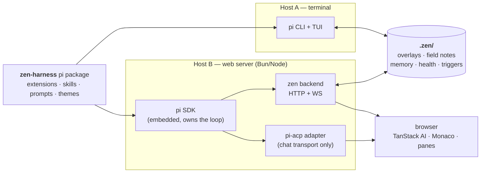
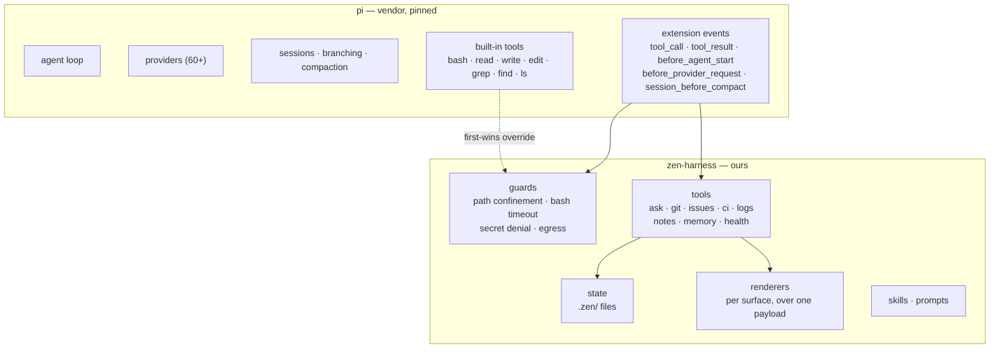
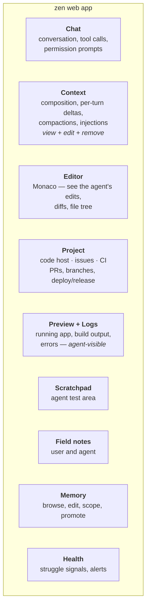
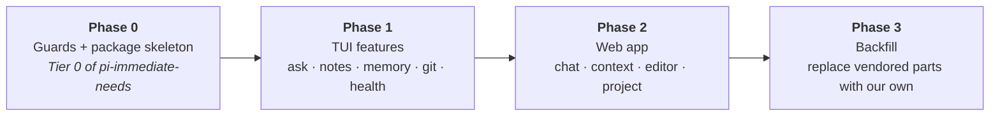
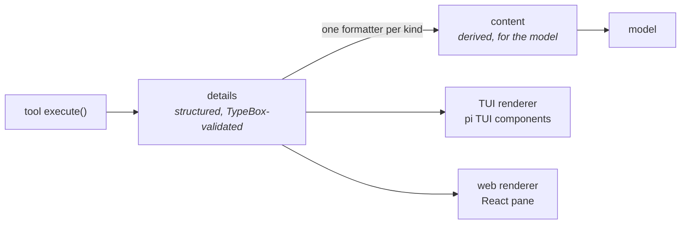

# zen-harness — vision and architecture

**Status:** foundational. Written 2026-09-03. This is the document a fresh session reads first.

Research that informs these decisions lives in [`concepts/`](./concepts/) — eight documents on
boundaries, tooling, failure modes, prompt caching, support systems, and what to harvest from prior
projects. This document is the *shape*; those are the *why*.

---

## What this is, in one paragraph

zen-harness is a **pi package** that provides **two surfaces over one agent loop**. pi owns the loop,
the providers, sessions, and compaction. zen-harness adds tools, guards, state, and skills as
extensions, and presents them through a terminal UI and a web application. Neither surface has its own
brain; both are clients of the same package running against the same pi.

---

## The stance that everything else follows from

**pi owns the loop. There is no second agent.**

Every temptation to build a competing loop — in the web backend, in a worker, in the chat framework —
is refused. The web app is a client. The TUI is a client. An extension is a participant in pi's loop,
never a replacement for it.

This is what makes the whole plan tractable: features are written once as extensions and work in both
surfaces, because they talk to pi's event and tool APIs rather than to a UI.

---

## Runtime shape

Two hosts, one package, shared on-disk state.



**Why the web host embeds the SDK rather than driving pi over ACP.** The context pane has to read and
modify the message array. ACP carries chat, tool calls, and permission prompts — not "show me the
entries and drop these three." So the backend embeds pi directly, and ACP is used *only* as the chat
transport, where it is sufficient and saves building one.

**Why state is files, not a service.** Both hosts read the same `.zen/` directory, so the TUI and the
web app see the same overlays, notes, and memory from day one with no server between them. A service
later becomes an optimisation for push (live alerts) rather than a migration.

---

## Ownership boundary



**Guards override built-ins by name.** pi resolves tools **first-wins** (`runner.ts`,
`getAllRegisteredTools`), so a guarded `write` declared before any vendor extension cannot be silently
replaced. Load order is therefore a security property — see *Decided constraints*.

---

## The end state we are building toward

Two surfaces. The TUI reaches parity with what pi, Claude Code and omp already give. The web app is the
reason the project exists.



Pane provenance, so intent is not lost: **Chat** takes its shape from deepseek-harness. **Context** takes
its interface from `dsh-context` and its data from our own backend, with editing added. **Health** takes
its signal catalogue from Magpie (`concepts/magpie-harvest.md`), carrying the field verdicts rather than
the weights. **Project** is three interfaces, not one.

---

## Phasing

The sequence is deliberate: assemble from what exists, then replace what we outgrow.



**Phase 0–2 lean on off-the-shelf parts wherever they fit** — vendor extensions, `pi-acp` for chat
transport, omp code where it lifts cleanly (`conflict-detect.ts` at 815 lines and two local imports is
the cheap one; `ast-edit.ts` at 27 imports including the Rust core is not). The goal is a whole system
early, accepting that pieces will change underneath.

**Phase 3 is the backfill.** Once feature-rich, replace vendored extensions with our own, ending at an
omp-like capability set that composes onto pi rather than forking it. That distinction is the whole
reason for starting as a package: omp forked, which is exactly why its features are hard to lift.

---

## Package structure

One package, many extensions. Some ours, some vendored.

```
zen-harness/
  package.json              # pi manifest: extensions declared EXPLICITLY, guards first
  packages/
    core/                   # @zen/core — all TypeBox schemas + shared types
    extensions/
      guards/               # Tier 0: confinement, timeouts, secret denial, egress
      ask/                  # the escalation channel pi lacks
      git/                  # code host · issues · CI (three interfaces)
      logs/                 # log wiring (later phase)
      memory/               # memory manager
      notes/                # field notes
      health/               # struggle signals + collection
    skills/
    prompts/
    web/                    # the web app — outside the pi manifest
  docs/
    architecture.md         # this file
    concepts/               # the research
  .zen/                     # runtime state (gitignored per-project)
```

`web/` sits outside the manifest deliberately: pi packages carry only `extensions`, `skills`, `prompts`
and `themes`, and pi does nothing with a frontend. Settings likewise live outside — see `pi-share` for
the pattern of exporting and importing a settings bundle.

---

## The shared core

**All schemas are TypeBox, in `@zen/core`.** One schema library, no bridge, no conversion step.

The reason is not preference — it is where schemas have to travel. Three destinations:

| Destination | Requirement |
|---|---|
| pi's tool API | `registerTool<TParams extends TSchema>` — **TypeBox is mandatory**, pi does not depend on Zod at all |
| HTTP contract, backend to browser, OpenAPI | JSON Schema is the wire format, and **a TypeBox schema literally is a JSON Schema object** |
| SQL queries, if state graduates from files | **Kysely** needs only TypeScript types, and TypeBox produces them via `Static<>` — derived, not duplicated |

TypeBox 1.3.x is zero-dependency, `Schema.Compile()` produces a JIT validator that accepts TypeBox types
or native JSON Schema, and `Parse()` is the equivalent of Zod's `.parse()`.

**Adapter boundaries use explicit mapping, not schema transforms.** A GitHub response is validated for
shape, then translated by a named function — `toIssue(raw): Issue` — rather than transformed inside the
schema. Zod's `.transform()` is convenient and it buries the translation in the schema definition, which
is the wrong place for it when the entire point of the interface is a swappable provider. Validation and
translation stay separate.

⚠ **Unverified, check before relying on it.** TypeBox's handling of coercion, custom error messages and
refinements was not confirmed when this was written; the package exports a `./value` entry point that
likely covers coercion and decode. If one of those becomes load-bearing, confirm rather than assume.

### Persistence, when state outgrows files

**Kysely**, not an ORM and not a schema-first generator. It is a typed SQL query builder that needs only
TypeScript types, which means TypeBox remains the single source for shape:

```ts
// @zen/core — the shape, once
export const SessionRow = Type.Object({ id: Type.String(), started_at: Type.String(), /* … */ })

// the query layer consumes the derived type
interface Database { sessions: Static<typeof SessionRow> }
```

Three artefacts, and only one of them is authored twice — which is the point:

| Concern | Source | Duplicated? |
|---|---|---|
| Shape | TypeBox schema in `@zen/core` | no |
| Query types | `Static<typeof Schema>` fed to Kysely's `Database` | derived |
| DDL / migrations | hand-written SQL via Kysely migrations | **yes, deliberately** |
| Runtime row validation | TypeBox `Parse()` at boundaries where rows arrive from outside | optional |

⚠ Not entirely friction-free: columns with defaults or differing insert-vs-select types need Kysely's
`Generated<T>` / `ColumnType<S, I, U>` wrappers, so the derived interface is annotated rather than a
bare `Static<>`. Small, and local to the `Database` interface.

**Why this beats the schema-first alternative** (`zqlite`, previously top of the harvest list): generated
DDL is the part that fails first. It is fine until the first migration that needs a backfill, a column
rename with data movement, or an index built concurrently — at which point you are hand-writing SQL
anyway, against a generator that thinks it owns the schema. Kysely treats migrations as hand-written from
the start, which is honest about where control is actually needed.

### Tool results: one payload, many renderers

pi's tool contract already separates data from presentation — `{ content, details, isError, usage }`
plus optional `renderCall` / `renderResult`. That is what makes a single feature work in both surfaces.



Three rules:

1. **`details` is the contract; `content` is derived from it, never authored separately.** One formatter
   per kind. Otherwise a tool reports "3 open PRs" while `details` holds four, and nothing catches it.
   This also covers the unattended surface, where no renderer exists and `content` is the only channel.
2. **A discriminator on `details` from day one** — `kind`, an open string, no union behind it yet.
   Adding schemas per kind later is additive; retrofitting a discriminator across twenty tools is not.
3. **Every entity carries `id` and `url`.** `url` makes "open the real thing" one click; `id` lets a
   renderer key and diff across updates. And **`truncated` is explicit** whenever a result is bounded —
   a bounded result that does not say so produces confident wrong claims
   (`concepts/agent-failure-modes.md`).

---

## Decided constraints

Settled. Each carries its reason so a later session can tell when the reason has expired.

| Decision | Reason |
|---|---|
| pi owns the loop; both surfaces are clients | One brain. Features written once work in both. |
| Start as a **package**, never a fork | A package cannot entangle. omp forked and its features are now hard to lift. |
| **One package, multiple extensions** | Vendored and custom side by side, one install, one version. |
| Extensions **enumerated explicitly**, guards first | Load order is first-wins, so it is a security property. A directory glob orders by filename, which is incidental. |
| Assert guard integrity at startup | `write`/`bash`/`read` must resolve to our implementations, failing loudly otherwise. |
| **All schemas TypeBox in `@zen/core`** | One library, no bridge. TypeBox is mandatory at pi's tool API and *is* JSON Schema at the HTTP boundary — two of three destinations, zero conversion. |
| Adapter boundaries map explicitly, never via schema transforms | Keeps validation separate from translation, which is what makes a provider swappable. |
| **State in `.zen/` files, never process memory only** | Keeps shared state between surfaces free, and a service later optional. |
| Web app **embeds the pi SDK**; ACP is chat transport only | The context pane needs the message array; ACP does not carry it. |
| Context overlays keyed by **entry id**, persisted via `appendEntry()` | Survives restarts and compaction; `session_before_compact` hands `branchEntries`. |
| ⚠ Context edits are **batched, tail-biased** | Prefix-match caching: editing an early entry invalidates everything after it. Measured elsewhere at ~37 reads per cached token. See `concepts/prompt-cache-architecture.md`. |
| **Three git interfaces**, not one — code host · issues · CI | Teams split these routinely. GitHub only now, swappable later. |
| Nothing outside the GitHub adapter imports Octokit types | The only discipline that keeps swappability real. |
| Log wiring ships with **explicit per-source consent**, no filtering | Redaction damages troubleshooting and costs on hot paths. Consent is honest; a partial filter is not. |
| Ingested logs **do not persist in the transcript** by default | The exposure is not the agent seeing a line, it is the line landing in the transcript, the cache, and any session store. |
| Re-anchoring uses a **turn-scoped system message**, never a system-prompt rewrite | Rewriting the prompt per turn invalidates the entire cache. |

---

## Deferred, deliberately

| Deferred | Why, and what would change it |
|---|---|
| Cross-surface **push** (live alerts, shared presence) | Files give shared *state*; push needs a service. Un-deferred when alerts have to arrive rather than be polled. |
| The **obligation queue** | Design preserved in `concepts/agent-support-systems.md` Part 6. Un-deferred once the tool surface is stable enough to accrue against. |
| A fork of `pi-acp` for custom commands | TanStack's `acpCompatible` does not implement `available_commands_update`, so the fork buys nothing today. |
| **Command classification** (argument-level policy) | With confinement and recoverability in place it is friction optimisation, not safety. Accretes from real incidents. |
| Log wiring itself | A later phase. The consent model is decided; the ingestion shape is not. |

---

## Open questions

1. **Log source shape** — user points at a file we tail, harness launches the process and owns
   stdout/stderr, or the app posts to an endpoint we expose. Different designs; not yet chosen.
2. **The unattended render target.** A tool needs to know it is running with no operator, where the
   answer is "halt" rather than any UI. Third target alongside TUI and web.
3. **Health collection across subagents.** Subagent transcripts are separate files
   (`<session>/subagents/agent-*.jsonl`), so collection must handle both levels.
4. **TypeBox's coercion / error-message / refinement surface** — unconfirmed, and it is the area Zod is
   strongest in. Confirm if a boundary needs it.

---

## Reading order for a fresh session

1. This document.
2. [`concepts/pi-immediate-needs.md`](./concepts/pi-immediate-needs.md) — what pi lacks, ranked, with
   seams and effort. Phase 0 comes straight from its Tier 0.
3. [`concepts/agent-boundaries.md`](./concepts/agent-boundaries.md) — the boundary model and why
   enforcement location matters more than rule content.
4. [`concepts/harness-design-principles.md`](./concepts/harness-design-principles.md) — progressive
   disclosure, applied seven times.
5. The rest of `concepts/` as needed.
