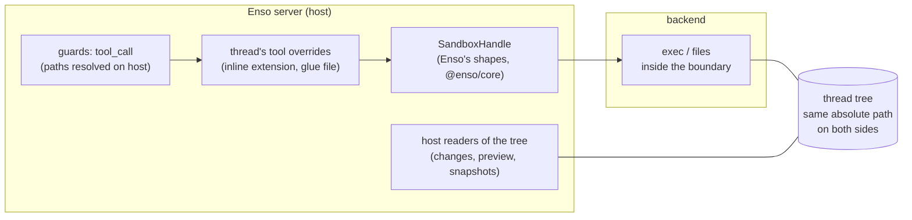

# Sandbox seam — a plan for #896

**Written** 2026-10-13 by Claude (Opus 5.5) at Daniel's request, for the Enso project.

A plan, not a decision and not a build. #896 asks whether Enso should own one seam that several
sandboxes plug into, each proving what it confines. This page answers *what that seam would be in
this codebase*: where it attaches, what it must carry, what has to change before any sandbox is
worth turning on, and the order to build it in. #896's six questions stay open. Where this page leans
toward an answer, it says so and gives the reason.

Evidence is this repository at `68a2a435` and the installed pi-coding-agent **1.1.0**
(`node_modules/@earendil-works/pi-coding-agent`). Two throwaway git repros were run on 2026-10-13 and
are described where they are used. Where a claim rests on reasoning, not on a read or a run, it says
**[inference]**. No sandbox was started.

## What the plan rests on

| # | Fact | Evidence |
|---|---|---|
| 1 | pi has an operations interface for each of its seven tools. Each tool's factory takes `cwd` and `{ operations }`. Paths reach the operations already absolute. | `dist/core/tools/{bash,read,write,edit,grep,find,ls}.d.ts` |
| 2 | **`grep` always spawns `rg` on the host.** `GrepOperations` supplies only `isDirectory` and the `readFile` used for context lines; the search itself never goes through it. Unchanged in pi 1.2.0. Upstream declined a hook for now, saying the operations interfaces will change (#902 quotes it). | `dist/core/tools/grep.js:52` (`ensureTool("rg")`), `:101` (`spawn(rgPath, …)`); earendil-works/pi#5354 |
| 3 | `find` does go through its operations: a custom `glob` replaces `fd`. | `dist/core/tools/find.js:68-69` |
| 4 | `BashOperations.exec(command, cwd, { onData, signal, timeout, env })`. `timeout` is in **seconds**; an abort rejects with `aborted`, a timeout with `timeout:<n>`. | `bash.d.ts`; pi's `examples/extensions/ssh.ts` is the reference implementation |
| 5 | A host-owned extension can replace a built-in tool by registering one with the same name. pi's `ssh.ts` does this for `read`/`write`/`edit`/`bash`. | `examples/extensions/ssh.ts` |
| 6 | Enso already has the place for a per-thread, host-owned extension: `extensionFactories`, loaded after the harness manifest. | `packages/web/src/host/hosted-thread.ts#buildHostedThread` (its `createAgentSessionServices` call) |
| 7 | A thread's pi session is **rebuilt** on its tree at the first run. The checkout session is disposed. | `packages/web/src/host/thread-on-tree.ts#moveOntoTree` (mint, log on the tree, `buildHosted`) |
| 8 | The guards decide every call on the host, before execute, by resolving paths against the **host** filesystem: `resolveAgainstCwd`, then realpath of the nearest existing ancestor. | `packages/harness/core/paths.ts#resolveAgainstCwd`, `packages/harness/core/paths.ts#realpathOfNearestExisting`; `packages/harness/core/guard-session.ts#decide` |
| 9 | `bash` inherits the server's environment after `quarantineSecrets` removes secret-shaped names once at startup. | `packages/core/src/secrets.ts#quarantineSecrets` |
| 10 | **#539 gap 1 still reproduces.** Enso's changes reader runs a clean filter the agent configured, on the host: both the tracked diff and the untracked `--no-index` diff. Filed as **#901**. | Repro in #901: a repo with `filter.pwn.clean` in `.git/config` and a `.gitattributes` line, run with `git.ts`'s `GIT_READ_ONLY_CONFIG` and `DIFF_OPTIONS`; the marker file appeared for both. The calls: `packages/core/src/git.ts#trackedChanges` and `packages/core/src/git.ts#readUntracked` |
| 11 | **A worktree tree writes the user's checkout config.** `git config` run in a worktree writes the main repository's `.git/config`. Already recorded in #564 (closed by design) and decided in #147: *"worktree when bash runs on the host; a copy when #539's container is on"*. | Re-run 2026-10-13: `git worktree add`, then `git config filter.pwn.clean evil` in the worktree; `git config --get` in the main checkout returned `evil` |
| 12 | The snapshot store's and the tree-minting gits force `core.hooksPath=/dev/null` and `core.fsmonitor=false`. Their configs live outside the tree. | `packages/core/src/snapshot-store.ts#SNAPSHOT_CONFIG`; `packages/core/src/thread-tree.ts#TREE_CONFIG` |
| 13 | pi's types may be named only in listed glue files under `packages/web/src/host` and `packages/harness/extensions`. | `test/vendor-gate.test.ts#VENDOR_ROOTS`, `test/vendor-gate.test.ts#VENDOR_IMPORTERS_ALLOWED_INSIDE_ROOTS` |

Facts 2 and 10 change the plan: grep needs more than operations, and the changes reader is a host
execution path today. Fact 11 confirms a decision #147 already made: a sandbox gets a copy, never a worktree.

## The shape



- **The guards stay where they are.** They run on `tool_call`, before any execute, so replacing a
  tool's definition doesn't bypass them [inference: pi fires `tool_call` for an overriding
  definition as for the built-in; a slice-1 test pins it]. Because they resolve paths on the host
  (fact 8), a backend must show the tree **at the same absolute path** as the host. That rules out
  clone-into-the-VM backends for now (sbx clone mode); see *Open decisions*.
- **The contract is Enso's, in `@enso/core`.** The vendor gate (fact 13) keeps pi's
  `BashOperations` and friends out of it. A single new glue file in `packages/web/src/host/` adapts the
  handle to pi's seven `*Operations` and registers the overrides. It is added to
  `VENDOR_IMPORTERS_ALLOWED_INSIDE_ROOTS` with its reason, as the gate asks.
- **Same tool names.** Overrides keep pi's names, because the guards key on them (leak L5, kept by
  decision).

### The contract (sketch, not source)

```ts
/** One way to run a thread's tools. Stateless; opens one handle per thread. */
interface SandboxBackend {
  readonly id: string // 'host' | 'container' | 'container-gvisor' | 'sbx' | …
  /** What this backend claims to confine. Shown only once a conformance run proved it. */
  readonly declares: SandboxCapabilities
  /** Can it run here, now? Never throws; a missing daemon or KVM is a reason. */
  probe(): Promise<{ kind: 'ready' } | { kind: 'unavailable'; reason: string }>
  open(request: SandboxOpen): Promise<{ kind: 'opened'; handle: SandboxHandle } | { kind: 'refused'; reason: string }>
}

interface SandboxOpen {
  readonly threadId: string
  readonly tree: string // absolute; mounted at this same path
  readonly environment: Readonly<Record<string, string>> // an allowlist, never process.env
  readonly network: 'off' | { readonly allow: readonly string[] }
}

interface SandboxHandle {
  exec(command: string, cwd: string, options: ExecOptions): Promise<{ exitCode: number | null }>
  readFile(path: string): Promise<Uint8Array>
  writeFile(path: string, content: string): Promise<void>
  mkdir(path: string): Promise<void>
  access(path: string): Promise<void>
  stat(path: string): Promise<{ readonly isDirectory: boolean } | undefined>
  readdir(path: string): Promise<readonly string[]>
  glob(pattern: string, cwd: string, options: { readonly ignore: readonly string[]; readonly limit: number }): Promise<readonly string[]>
  /** `rg --json` run inside the boundary: what pi's grep spawns on the host today (fact 2). */
  search(args: readonly string[], options: ExecOptions): Promise<{ exitCode: number | null }>
  /** Kill everything the thread left running, between calls and on abort. */
  reset(): Promise<void>
  /** Called when the tree is disposed or the server stops. Idempotent. */
  close(): Promise<void>
}

interface SandboxCapabilities {
  readonly filesystem: 'host' | 'tree-only'
  readonly kernel: 'host' | 'host-namespaced' | 'user-space' | 'vm' | 'remote'
  readonly network: 'host' | 'off' | 'allowlist'
  readonly credentials: 'inherited' | 'none' | 'injected-at-egress'
  readonly processes: 'host-visible' | 'isolated'
}
```

`host` is a backend too. It declares `host` everywhere and implements the handle with today's
calls, which makes slice 1 a pure refactor.

### Where it attaches in the thread's lifecycle

| Moment | Code | The seam |
|---|---|---|
| Thread created, before a run | `agent-host.ts` `createSession` | nothing: no tree yet, and today's `host` behaviour |
| **First run moves onto the tree** | `thread-on-tree.ts` `moveOntoTree` → `buildHosted` | `backend.open({ tree })`; the session is built with the handle's overrides. A refusal fails closed (#60): the run is refused with the reason, never run on the host |
| Each tool call | pi `execute` → handle | exec/files; `reset()` after an abort |
| Abort | `thread-registry.ts` → `runtime.abort()` → pi's `signal` | the handle kills the process **inside** the boundary. Killing a `docker exec` client leaves its process running [inference; #539 used `kill -9 -1` as the thread user for this] |
| Fork | `thread-fork.ts` → `mintThreadTree` | a new handle for the fork's own tree |
| Undo a failed move | `thread-on-tree.ts` `undoMove` | `close()` |
| Delete | `thread-delete.ts` → `disposeThreadTree` | `close()` before the tree is removed |
| Idle eviction, server stop | `thread-registry.ts` dispose | `close()`; a backend may keep a warm sandbox, keyed by tree |

### What has to change that isn't a backend

1. **The changes reader must stop running repository-configured programs on the host** (fact 10,
   **#901**). This is true with or without a sandbox: today a `git config filter.x.clean …` run through
   `bash` executes later, when the changes view opens, outside any `tool_call`, guard or receipt. #901
   has a candidate fix tested by hand: `--attr-source=<empty tree>`, so git reads no attributes from
   the worktree. It lands ahead of this work.
2. **Sandboxed threads run on copy trees only** (fact 11; #147's decision, #564). A worktree's git
   data is the user's checkout. Mounted writable, the agent could plant config that runs on the
   user's own git commands; left out, git inside the sandbox breaks. `treeKindOf` already picks the
   kind per project (`thread-tree-making.ts`), and sandboxing forces `copy`.
3. **grep needs its own route** (fact 2, **#902**). Upstream has declined a hook for now. #902 weighs
   five options:
   - Enso's grep running `rg` inside the boundary, built on pi's exported helpers as pi's own
     `gondolin` example does;
   - a file walk through the handle;
   - pi's grep kept on the host, with its path confined to the tree by realpath;
   - no grep when sandboxed;
   - waiting for upstream.

   Its lean is the host-confined option first, since it needs no copy of pi's code.
4. **An environment allowlist** in place of the quarantine's deny-by-shape (fact 9), for anything but
   `host`. #397 proposed it; #397's closing comment listed it among the portable pieces.

## Capabilities and conformance

A backend's `declares` is a claim. A claim is shown to the user only after a **conformance run**
proves it on this machine, for this backend version.

- **The suite is #539's probe script, ported to `bun test`,** one test per probe, grouped by
  capability:
  - **filesystem:** F1–F6;
  - **processes:** P1–P9;
  - **network:** N1–N9;
  - **host crossings:** H1–H4;
  - **credentials:** new probes: no provider key visible in env, files or `/proc`; egress injection
    where declared.
- **One suite for every backend.** Each test asserts the declared value. Run against `host`, it
  proves `host` claims nothing it doesn't have: it expects host reachability, so the suite can fail
  in both directions.
- **Where the infrastructure is missing,** a test is skipped with its reason (`test.skipIf`, as the
  git-dependent tests in `packages/harness/extensions/guards/__tests__/guards.test.ts` do). Nothing
  fakes a sandbox: a mocked boundary proves nothing.
- **Where the proof lives:** the suite's result per backend, version and platform is written under
  `ENSO_HOME`. The thread shows the proven capabilities and names the unproven ones. A backend with no
  passing run shows as **unconfined**, whatever it declares.
- **Latency is part of the run:** the median and p95 per tool call, recorded beside the result. File
  tools go from in-process calls to one round trip each (#539: 83–90 ms median for `docker exec`).

Credentials and egress may collapse into one capability (#896, decision 3). The contract keeps them
separate until a second backend shows whether they ever differ.

## Slices

Each slice leaves `main` working and passes the full gate.

| # | Slice | Acceptance |
|---|---|---|
| 0 | **Prerequisites** (separate): the changes reader's host execution, **#901**; how grep runs when sandboxed, **#902**. The worktree crossing is already decided (#147, #564) | #901 fixed with its failing-before test; #902 decided |
| 1 | **The seam and `host` backend.** Contract in `@enso/core`; one glue file overriding all seven tools through the handle; `host` implements it with today's calls | Full suite passes unchanged. New tests: a tool call goes through the handle; the guards still refuse what they refused (an override doesn't bypass `tool_call`); an abort reaches `exec`'s signal |
| 2 | **Conformance suite** against `host` | Every probe runs; `host` passes as unconfined; a deliberately wrong declaration fails |
| 3 | **Container backend** (Docker or Podman, #539's flags: `--network none --cap-drop ALL --security-opt no-new-privileges --pids-limit 256 --read-only --tmpfs /tmp --memory`). Copy trees only; opened in `moveOntoTree`, closed on delete, undo and stop; fail closed | Conformance passes for its declarations on Linux; latency recorded; two threads in two trees confined at once; an abort kills the process inside |
| 4 | **Showing it.** A per-thread indicator of the backend and its proven capabilities; a config section (on/off, which backend) | The indicator matches the last conformance run; a backend that can't start shows its reason on the thread |
| 5 | **gVisor mode** of the container backend (`--runtime=runsc`) | Conformance rerun; `kernel: user-space` proven; latency compared with slice 3 |
| 6 | **A second, non-Docker backend** (sbx direct mount, or SSH) | The contract needed no change, or the change is recorded here |

`docs/seams/sandbox.md` is written in slice 1, once the contract exists: the docs gate checks a
seam page's fences against real declarations. `docs/seams/guards.md` then states the two layers.

## Open decisions

Questions #896 already asks are referenced by number; questions new here are marked.

1. **Build it at all** (#896 q1). The plan assumes yes; slices 0 and 1 are worth doing either way.
   Slice 0 closes host execution paths that exist today; slice 1 makes the tools testable through
   one handle.
2. **Clone-mode backends (new).** Same-path mounting is forced by the guards resolving on the host.
   Supporting sbx clone mode would mean the guards resolve paths through the handle. That is a
   change to the guards, not to the backend.
3. **grep** (new; **#902**).
4. **Where conformance results live, and when they expire (new):** per backend version, per
   platform, and re-run on a pi upgrade?
5. **Worktree threads when sandboxing is on** (#896 q6). Decided by #147: copies only. #896's table
   still lists the alternative, a read-only `.git` mount, which breaks commits inside the sandbox.
6. **One warm sandbox per tree, or per call (new).** #539's design kept one container per thread and
   reset processes between calls. Cost per idle thread is unmeasured.

## Risks

- **pi's operations interfaces will change.** pi's author said so when declining a grep hook
  (earendil-works/pi#5354, quoted in #902). When they do, the glue file breaks. The contract is Enso's own (`@enso/core`)
  so the break stays in that one file. The pin and its supported range already gate pi upgrades
  (`test/vendor-gate.test.ts#VENDOR_IMPORT_ALLOWED`), and the conformance suite catches a behavioural change.
- **pi touches files outside the seven tools:** resource loading, AGENTS.md and skills, image MIME
  detection. These read the tree on the host. They read content and run nothing [inference], so the
  host's view of the tree must stay the same as the sandbox's, which same-path mounting gives.
- **Host readers follow the tree on the host:** preview, snapshots, changes. The preview route and
  the snapshot store check symlinks against the tree (scouted, not re-read for this page).
  Slice 3's H-probes re-check them.
- **Latency** could make a sandboxed read-heavy run noticeably slower. Slice 3 measures it before
  slice 4 makes it a user-facing option.

Refs #9, #60, #147, #189, #397, #466, #539, #551, #564, #577, #896, #901, #902.
