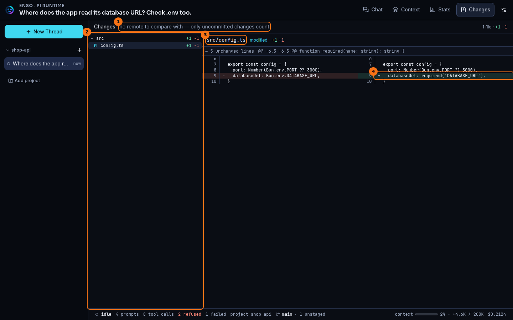

# Changes

## What it shows

The **Changes** tab shows every file in the thread's project that differs from the last push, and what changed in it. The files are on the left as a tree, and the one you pick is on the right, side by side: the file at the last push on the left, the file now on the right.

When the project is a folder inside a larger repository, only that folder's files are compared, and the header says `in <folder>/`. Files elsewhere in the repository are never listed or read. The status bar's counts cover the same folder, while its commits ahead and behind are the whole repository's.

It reads git, not pi's tool calls. So a change shows up however it was made: an `edit`, a `write`, a `sed -i` or a formatter run through `bash`, or your own editor. Commits you have not pushed yet count, and so do staged and unstaged edits, deletions, renames and new files.

## How to open it

- The **Changes** tab at the top of a thread.
- It reads again whenever a tool call finishes and when a run ends, so you can leave it open while pi works.

## What it looks like

1. What the files are compared with. Here, `no remote to compare with — only uncommitted changes count`, because the demo project has no remote.
2. The tree of changed files. Each file shows its status letter (`A` added, `M` modified, `D` deleted, `R` renamed, `C` copied, `T` type changed, such as a file that became a symlink, `U` new and untracked) and the lines added and removed. A folder shows the total for the files under it, and folds away when clicked.
3. The file on screen, with its status and counts.
4. The change itself: the removed line on the left, the added line on the right, each with its line number.

## What to look for

pi changed one line of `src/config.ts`: `Bun.env.DATABASE_URL` became `required('DATABASE_URL')`. The tree has that one file, and the diff pairs the old line with the new one, so an edit reads as one row, not a deletion and an addition.

The row above the lines, `5 unchanged lines`, is git's summary of what it left out before this part of the file. git sends three lines of context around each change. The tab shows those and counts the rest, rather than reading the whole file.

Hover the comparison line at the top to see that it is what this copy of the repository last saw of the remote. The status bar says the same in short: `main · 1 unstaged`.

## What it doesn't do

- It never fetches, pushes or changes anything in git. "The last push" is what this copy last saw of the remote; run `git fetch` yourself to update it. How the baseline is chosen is in [Sessions and projects](./sessions-and-projects.md).
- It shows what differs, not who changed it. An edit you made before the session appears beside pi's.
- A binary file, one too large to send to the page, or one git did not produce a diff for is listed without a diff, and says why. Past 500 files the list stops and says so.
- It can't expand the unchanged lines between two parts of a file. Run `git diff` for the whole file.

## Go deeper

- [Routes](../reference/routes.md): `GET /api/threads/:threadId/changes`, and `GET /api/threads/:threadId/git` for the state the status bar shows.
- [Sessions and projects](./sessions-and-projects.md): the git readout in the status bar, and what "last push" means.
