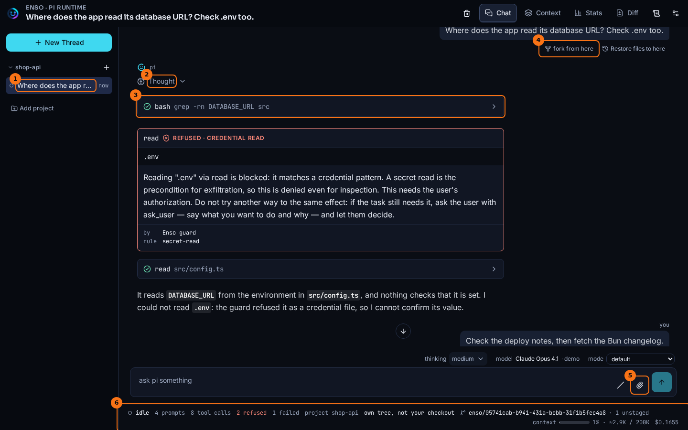
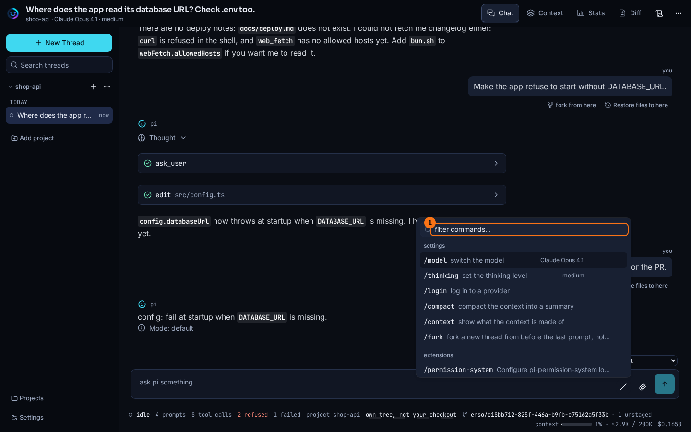

# Chat

## What it shows

A thread is one conversation with pi. The reply streams in as pi writes it. Each tool call pi makes is a row you can open, and pi's thinking is a block you can expand. You can attach images to a prompt, and run commands from a palette.

The thread's id is in the page URL, so a reload shows the same thread, and the browser's back and forward buttons move between the threads you opened.

## How to open it

- Start the web app with `bun run dev` and open `http://127.0.0.1:5178`.
- **New Thread** in the rail starts a thread. A thread you opened before is listed under its project. Click it to open it again.
- The **Chat** tab shows the conversation. **Context** and **Stats** are the other two views of the same thread.
- The URL names the thread as `?thread=<id>`.
- To add an image, use the **attach an image** button, paste the image, or drop it on the composer.
- The **commands** button (the `/` icon in the composer) opens the command palette.

## What it looks like

1. The thread in the rail. Its title is its first prompt.
2. pi's thinking, folded. **Thought** opens it.
3. A tool call as one row: the tool, what it was given, and a check when it finished. Click the row to see **in** and **out**.
4. **fork from here** starts a new thread with everything before this prompt, and puts the prompt back in the composer. See [Forks and lineage](./lineage.md).
5. **attach an image**.
6. The status bar: whether pi is working, then prompts, tool calls, refusals, failures, and the thread's cost.

1. **filter commands…** narrows the list as you type. The **settings** group comes first (`/model`, `/thinking`, `/login`, `/compact`, `/context`, `/fork`, and `/logout` once a login is stored), then **extensions**, **prompts** and **skills**.

## What to look for

In the thread above, the first reply shows pi working: it thinks, runs `grep` in the shell, tries to read `.env`, and is refused. The refusal is a card of its own, not a failed row (see [Guards and receipts](./guards-and-receipts.md)). pi then reads `src/config.ts` instead, and its answer says what it could not check.

Most rows stay folded, and that is the point of the layout. A call that finished shows a check and nothing else. A call that failed opens itself, with a red border, so a failure is never behind a click. The status bar counts both kinds: this thread has `2 refused` and `1 failed`, and they are different things.

In the palette, a command runs at once, but a prompt or a skill is only inserted into the composer as `/name `, for you to finish and send.

While `/login` waits for the provider (a device code to enter, a browser page to finish), the composer shows the stop button, labelled `cancel the login to <provider>`. It cancels the login, and nothing is stored. After `/compact`, or a compaction pi runs on its own when the context fills, the transcript is re-read once the thread is idle, so it shows the compacted history without a reload.

## What it doesn't do

- An image in pi's reply that lives on another host is not loaded until you click it. The button names the host first. A reply is untrusted text, and loading an image is a request to whoever wrote its URL.
- An attached image can be at most 5 MB, and a prompt can carry at most 20. A file that is not an image is refused with a notice, never dropped silently.
- The thread URL is for you, on this machine. The server listens on `127.0.0.1` only, so the link does not work from another computer.

## Go deeper

- [Prompt, run, settle](../flows/prompt-run-settle.md): what happens between Send and the settled reply.
- [Follow, snapshot and frames](../flows/follow-snapshot-frames.md): how the page stays in step with the thread.
- [Presentation seam](../seams/presentation.md) and [Tool result seam](../seams/tool-result.md): how a tool call becomes a row.
- [HTTP routes](../reference/routes.md): every route the page calls.
