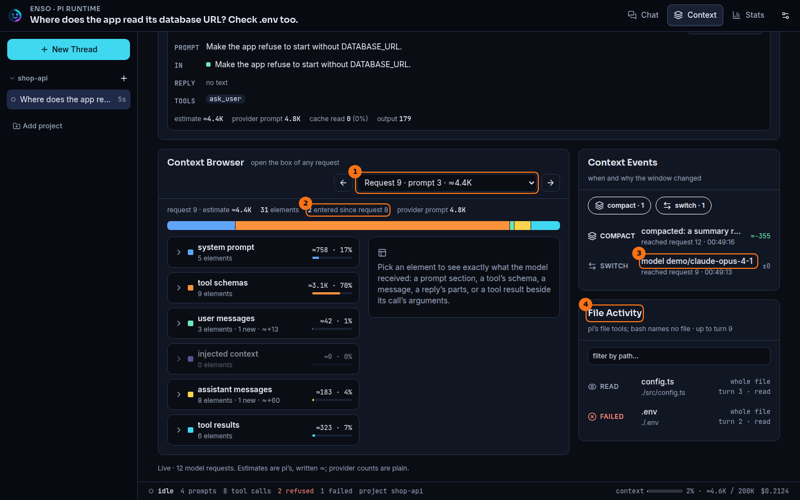
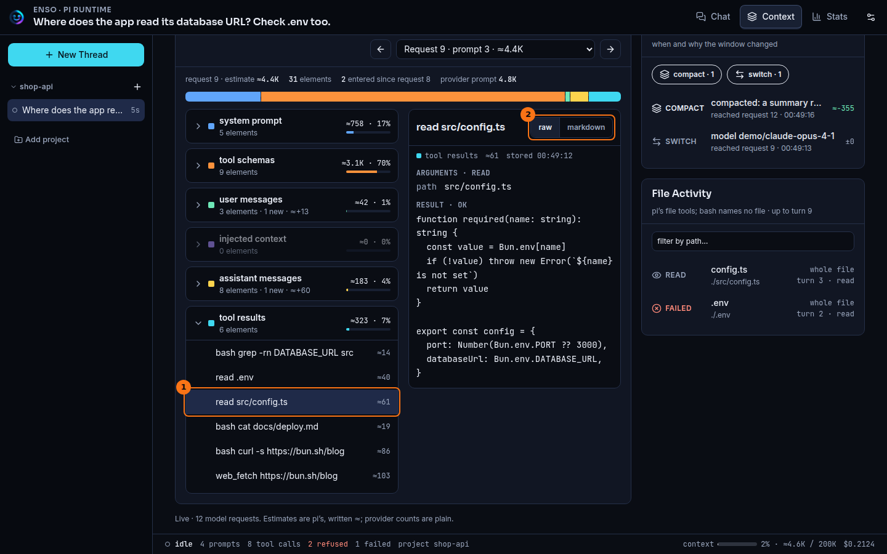

# Context browser

## What it shows

The Context Browser opens one model request and shows what the model received, element by element: each prompt section, each tool's schema, each message, each reply, and each tool result beside the call that produced it. Pick an element to read it exactly as it was sent.

Beside it, **Context Events** lists what changed the context other than the conversation, and **File Activity** lists what pi's file tools touched.

## How to open it

- On the **Context** tab, pick a bar in **Trend**, then **Open in browser**.
- **Open next request** on the **Now** card opens the request that has not been sent yet.
- Once it is open, the arrows and the request picker move between requests.

## What it looks like

1. The request picker. Each request shows its prompt and pi's estimate.
2. What entered since the request before. In a category, a row marked **+ new** is one of them.
3. A `switch` event in **Context Events**: the model changed here.
4. **File Activity**: every read, write and search by pi's file tools, and the ones that failed.

1. The element: the `read` of `src/config.ts`, under **tool results**. The panel shows the call's arguments, then the result as the model received it.
2. **raw** or **markdown**: the text as sent, or rendered.

## What to look for

Open the request after a model switch. In the thread above, request 9 entered only two elements since request 8, yet on the **Stats** tab it is the most expensive turn. **Context Events** has the reason: a `switch` event at request 9, to `claude-opus-4-1`. The context was the same; the cache was not.

**Context Events** shows five kinds of event: `inject` (a section or message added to the context), `compact`, `prune` (part of the context edited out), `switch` (the model or the thinking level) and `mode`. The figure on an event is the change in pi's estimate across it. Click an event to open the first request it reached.

**File Activity** follows the bar you pick in **Trend**, so it shows the files touched up to that request. Above, the read of `.env` is marked **failed**: the guard refused it. The `grep` and `cat` pi ran in the shell are not listed at all (see below). Click a row to open its tool result.

## What it doesn't do

- **File Activity** covers pi's file tools only: `read`, `write`, `edit`, `grep`, `find` and `ls`. A file touched through `bash` is not listed, because a shell command names no file Enso can trust.
- The sizes are pi's estimate. The provider's count for the whole request is in the summary line, and is not split.
- An image in a request shows as a preview, and as a note instead of a preview when it is too large.

## Go deeper

- [Context](./context.md): the tab this opens from.
- [Prompt cache architecture](../concepts/prompt-cache-architecture.md): why a switch costs more than its content.
- [HTTP routes](../reference/routes.md): `GET /api/threads/:threadId/context/:request`, which serves each request.
- [Observation seam](../seams/observation.md).
