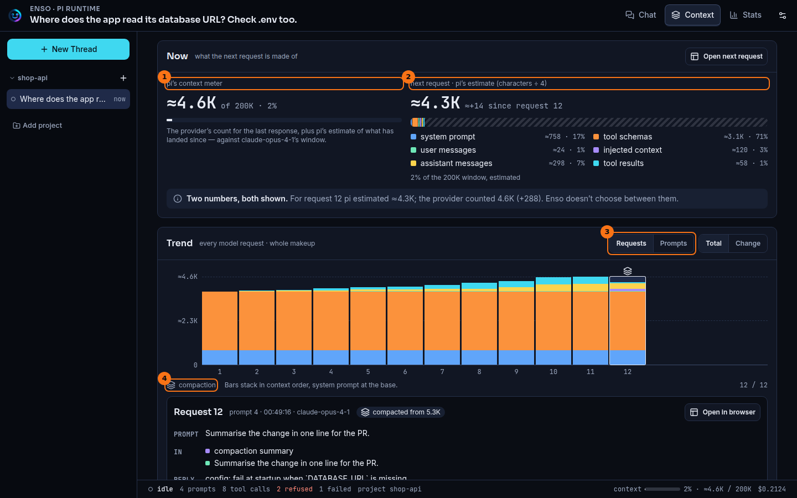

# Context

## What it shows

Everything pi sends the model with each request is its context: the system prompt, the tool schemas, the conversation so far and every tool result. The **Context** tab shows what the next request will be made of, and how that grew request by request.

It gives you two numbers, and does not choose between them:

- *pi's estimate*, written with `≈`. pi counts characters and divides by four. It can be split by category, so the breakdown uses it.
- *The provider's count*, written plain. It is exact, but only exists for a request that was sent, and comes as one total.

## How to open it

- The **Context** tab at the top of a thread.
- Or `/context` in the chat, which opens the **Now** card and the Context Browser in a dialog.

## What it looks like

1. pi's context meter: the provider's count for the last response, plus pi's estimate of what has landed since, against the model's window. On a thread with nothing running, this side shows the provider's count alone.
2. pi's estimate of the next request, as a bar split into categories: **system prompt**, **tool schemas**, **user messages**, **injected context**, **assistant messages** and **tool results**.
3. **Trend**: one bar per model request (**Requests**) or per prompt (**Prompts**). **Total** shows each bar's whole makeup, **Change** shows what it added and removed.
4. The **compaction** mark on a bar. The bar after a compaction is short, because a summary replaced what came before.

The card under the chart is the request you picked. Its **In** row lists what entered since the request before, and **Open in browser** opens it in the [Context browser](./context-browser.md).

## What to look for

Look for requests that are almost all cache *write*. In the thread above, request 9 is the first one after the switch from `claude-sonnet-4-5` to `claude-opus-4-1`. Its bar is no taller than request 8's, but a new model has no cache, so the whole prefix was written again at the higher price: its card reads `cache read 0 (0%)`. On the **Stats** tab, turn 9 is a solid cache-write bar and the peak of **Cost per turn**. In the Context Browser's **Context Events**, the same request carries a `switch` event. Three views, one cause.

The compaction at request 12 is the other pattern. Its card says `compacted from 5.3K`, and **In** shows a **compaction summary** where the conversation used to be. Its bar barely drops, and the breakdown says why: in this small thread most of the context is **tool schemas** and the **system prompt**, and a compaction summarises the conversation only. When a compaction frees less than you expected, look at what it cannot touch.

Expect the two numbers to differ. The provider counts real tokens and adds its own framing around the tools; pi counts characters. Compare each number with itself from request to request, rather than one with the other.

## What it doesn't do

- The breakdown divides pi's estimate, not the provider's count. A provider gives one total per request, so no split of it exists to show.
- An estimate is characters divided by four. It is good for comparing requests with each other, not for predicting a bill.
- It shows the current branch. A request on a branch you forked away from is not here.

## Go deeper

- [Context browser](./context-browser.md): open any one request.
- [Stats](./stats.md): the same requests as tokens and cost.
- [Prompt cache architecture](../concepts/prompt-cache-architecture.md): why a model switch rewrites the cache.
- [Observation seam](../seams/observation.md) and [HTTP routes](../reference/routes.md): where the numbers come from.
