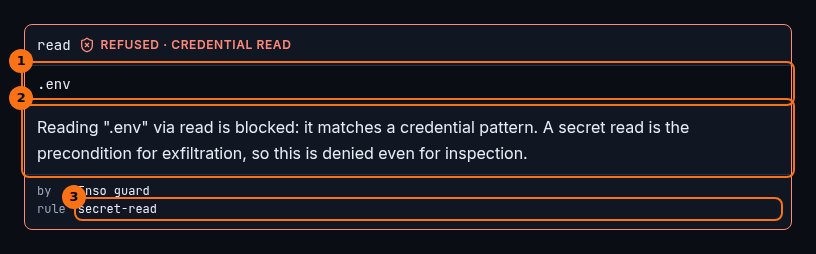
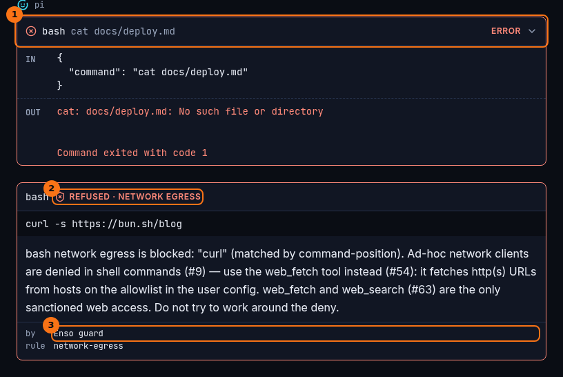

# Guards and receipts

## What it shows

Enso's guards check every tool call before it runs, and refuse the ones that break a rule. A refused call does not run at all. It shows in the chat as a receipt that names the guard and the rule, beside the reason pi was given.

The guards refuse, by rule:

| Rule | Refuses |
|---|---|
| `secret-read` | Reading credential material: `~/.ssh/`, `~/.aws/`, `~/.gnupg/`, `.env` files, private keys, `ENSO_HOME` itself. |
| `secret-path` | A shell command that names a credential path. |
| `environment-dump` | Listing the environment, or expanding a secret-shaped variable. |
| `network-egress` | Network clients in the shell (`curl`, `wget`, `ssh`, `nc` and others). `web_fetch` is the way to the web. |
| `cc-safety-net` | Destructive shell commands, such as `git reset --hard` or `rm -rf` on a protected path. |
| `write-confinement` | A write outside the workspace. |
| `protected-internals` | A write into `.git/`. |
| `persistence-write` | A write to something that runs later: shell profiles, `.gitconfig`, editor and agent config folders. |
| `secret-write` | A write to a file that looks like a credential. |
| `stale-write` | An edit to a file that changed on disk since pi last read it. |
| `read-before-write` | Overwriting an existing file pi never read. |
| `policy-mismatch` | Everything, when the policy names a tool pi does not have. It fails closed. |

## How to open it

There is nothing to open. A refusal appears in the chat where the call would have been, and the status bar counts it as `refused`. The **Stats** tab counts refusals apart from failures.

## What it looks like

1. What pi asked for: a read of `.env`.
2. The reason, word for word as pi received it.
3. The rule that refused it, `secret-read`. The header above says the same thing in words: **credential read**.

1. A failed call: `cat docs/deploy.md` ran, and the file does not exist. The row opens itself and shows **error**.
2. A refused call: `curl` never ran. The header reads **network egress**, and the reason names `web_fetch` as the way to the web.
3. **Enso guard**: who refused it.

## What to look for

Three outcomes look alike to pi, and Enso keeps them apart for you:

- *Refused*: an Enso guard stopped the call before it ran. You get a receipt with the rule. pi sees an error result carrying the reason.
- *Failed*: the call ran and did not succeed, like the `cat` above. It is a red row with **in** and **out**.
- *Provider-refused*: the model provider turned the request down, for example because of a rate limit or a missing login. It shows as a line naming the model and the class, such as `rate-limited (429)`.

pi's own record makes no difference between the first two: both are error results. Enso records every refusal next to the call, so the receipt is still there after a reload, and **Stats** says `2 refused by a guard — not failures` instead of counting three failures.

A good refusal is one pi recovers from. In the thread above, pi reads `src/config.ts` instead of `.env`, tells you it could not confirm the value, and after the `curl` refusal it tries `web_fetch`, as the reason told it to.

## What it doesn't do

- The guards are not a sandbox. They refuse known kinds of calls. They do not confine the process. `git push`, interpreters such as `python -c`, and writes made through the shell (`echo x >> ~/.bashrc`) are not checked.
- A refusal is not an error in Enso. pi is not stopped: it reads the reason and carries on.
- The guards apply to pi's tools. They do not check what you type yourself in a terminal.

## Go deeper

- [Guards seam](../seams/guards.md): the policy and each rule.
- [A guarded tool call](../flows/guarded-tool-call.md): step by step, from the call to the receipt.
- [Glossary](../glossary.md): the difference between a bar and a boundary.
- [pi's immediate needs](../concepts/pi-immediate-needs.md): why these rules come first.
