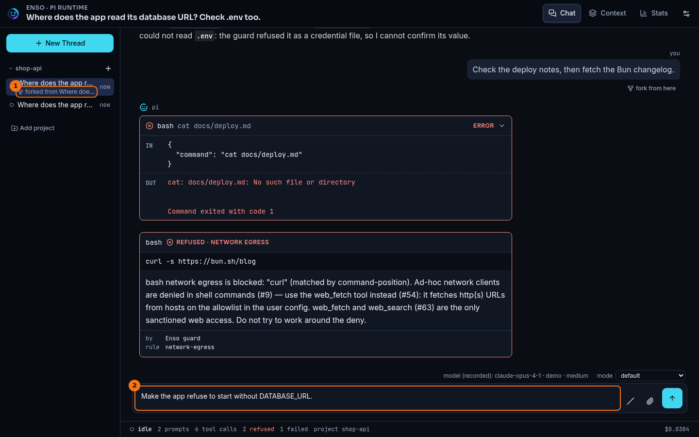
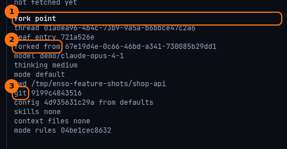

# Forks and lineage

## What it shows

A fork is a new thread that starts from a point in another one: everything before a prompt you pick, with that prompt back in the composer, ready to send again as it is or changed. The fork is its own thread, with its own id and its own session file. The one it came from is left exactly as it was, and the rail says which thread each fork came from.

Every thread also carries a record of the conditions it ran under, its *fork point*. That makes two forks comparable: the same history, and a list of what differed.

- *What pi records:* the model, the thinking level, and the permission mode.
- *What Enso adds at the start of a run:* the project's git revision and whether the tree was dirty, a hash of the resolved Enso config and the files it came from, the loaded skills, the context files the model received (such as `AGENTS.md`), and a hash of the mode's rules.

## How to open it

- **fork from here**, under any prompt you sent, forks the thread before that prompt.
- `/fork` in the command palette forks before the last prompt.
- The new thread opens straight away. In the rail, it shows `forked from` and the title of the thread it came from.
- Add `?debug` to a thread's URL to see its **fork point** in the session debug drawer.
- A thread whose last run was cut off before pi answered shows a notice with **Continue**, which picks the run up from its stored state.

## What it looks like

1. The fork in the rail, under the thread it came from, and which one that is.
2. The prompt it was forked at, back in the composer. Nothing has been sent yet.

1. **fork point**: identity first (the thread, the entry its branch ends at, the thread it was forked from), then the conditions.
2. The parent thread's id.
3. The conditions Enso recorded at the last run start: `git` is the project's revision, `config` the hash of the resolved config and where it came from, then the skills, the context files and the mode's rules.

## What to look for

The thread above was forked before its third prompt, the one that asked pi to change `src/config.ts`. The fork holds the first two prompts and their answers, and nothing after. That is the point to fork from when you want to try the same request another way: on another model, in another mode, or after changing a context file.

Then compare the two fork points. Outside the identity rows, they should differ in exactly what you changed. If they differ in something else, such as a revision you didn't expect or a context file that changed under you, the two runs are not the comparison you meant.

The run context is written only when something in it changes. A thread that ran ten turns on an unchanged tree carries one record, not ten. A fork inherits the records on its branch, so its first run adds one only if a condition changed.

A thread you open after a restart shows the model it last ran on, marked `model (recorded):`, before anything runs. See [Sessions and projects](./sessions-and-projects.md).

## What it doesn't do

- It records hashes and paths, never the contents of a config value or a context file. It can tell you that `AGENTS.md` changed, not what changed in it.
- Forking doesn't copy files. The project's working tree is shared, so a fork that edits a file edits it for every thread in that project.
- The browser forks at a prompt, as pi's `/fork` does. Moving inside one thread's tree (pi's `/tree` and `/branch`) is not in the browser.
- There is no side-by-side comparison view. You compare the two fork points yourself, or with [Session eval](./session-eval.md).
- **Continue** doesn't run pi's start-of-prompt hooks, so the continued turn gets no mode reminder and no fresh run-context check.

## Go deeper

- [Storage seam](../seams/storage.md): how a fork's session file is written, and why the source is never touched.
- [Resume](../flows/resume.md): how a stored thread opens cold.
- [Glossary](../glossary.md): *fork point* and *run provenance*.
- [HTTP routes](../reference/routes.md): `POST /api/threads/:threadId/fork`, `GET /api/threads/:threadId/manifest` and `POST /api/threads/:threadId/continue`.
