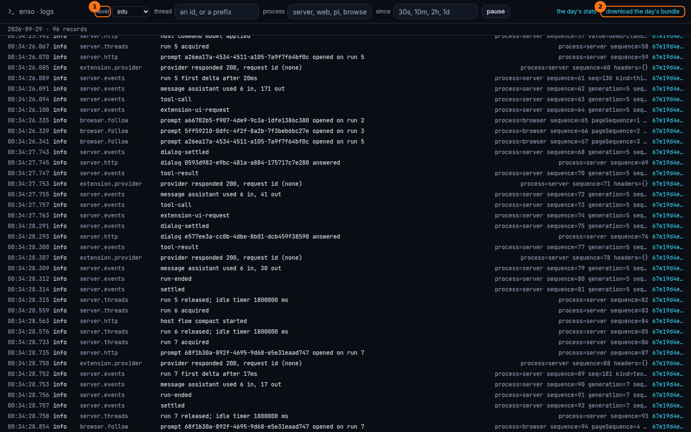
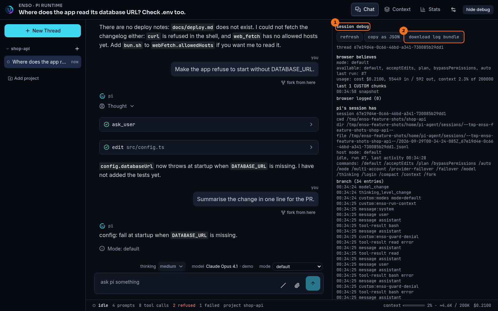

# Logs and debugging

## What it shows

Every Enso process writes one log file per day under `ENSO_HOME/logs`: the server, the web proxy and pi itself. You can read that log in the terminal, watch it in a browser, or see one thread's state from inside the chat. When something goes wrong, a bundle collects the day's records into one file you can attach to an issue.

## How to open it

In a terminal:

```bash
bun run logs                     # today, info and up, every thread
bun run logs --follow            # keep printing as records land
bun run logs --thread 01a0ea     # one thread, by id or a prefix of it
bun run logs --since 10m         # the last ten minutes
bun run logs --json | jq .       # the raw lines
bun run logs bundle > bundle.md  # a bundle from the running server
```

`--level`, `--process` (`server`, `web` or `pi`) and `--date` narrow it further. `--file` reads a bundle someone sent you as if it were today's log.

In the browser:

- `http://127.0.0.1:5178/debug` is the day's log, live.
- Add `?debug` to a thread's URL to open the **session debug** drawer beside the chat.

## What it looks like



1. **level** and the other filters: thread, process, and how far back.
2. **download the day's bundle**.



1. **session debug**: what the page believes about the thread, what pi's session holds, what the server sent, and its **fork point** (see [Forks and lineage](./lineage.md)).
2. **download log bundle**: the server's bundle with this page's own log added.

## What to look for

When the page and pi seem to disagree, open the drawer. **browser believes** is the page's view: the mode, the last run, the cost. **pi's session has** is pi's: where its session file is, its mode, its commands, and the branch entry by entry. In the thread above you can read the refusals as `custom:enso-guard-denial` entries, each just before the error result it explains. On a thread with nothing running, this section says there is no live session, and that is the answer to "why is nothing running?".

A bundle is safe to read before you share it, and you should read it. Secrets are removed when a record is written, not when the bundle is made: a field whose name looks secret is replaced with `[REDACTED]`, and any known secret value, wherever it appears, with `[REDACTED:value]`. The bundle's `## redacted` section counts both.

## What it doesn't do

- A bundle covers today's file only, at most the newest 5000 records. A thread that crossed midnight says so in the bundle.
- `bun run logs bundle` needs the server running. Without it, `bun run logs --json` is the file alone.
- Nothing is uploaded. The bundle is a file; you decide where it goes.
- The log keeps 14 days.
- pi cannot read the logs itself. They are under `ENSO_HOME`, which the guards keep pi out of.

## Go deeper

- [Logging seam](../seams/logging.md): the day file, redaction and the bundle.
- [Observation seam](../seams/observation.md) and [Observations reference](../reference/observations.md): every record Enso writes.
- [HTTP routes](../reference/routes.md): `/api/logs/bundle` and the log tail.
