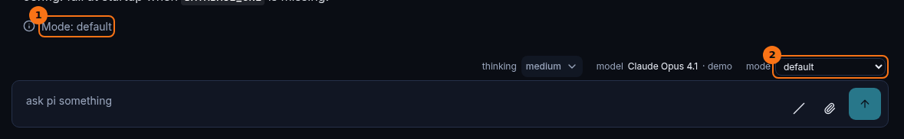

# Permission modes

## What it shows

A permission mode says how much pi may do before it asks you. Each thread has one mode at a time, and you can change it while the thread is open. The modes come from the permission-modes extension Enso loads, not from Enso itself:

| Mode | pi may, without asking |
|---|---|
| `default` | Read inside the project, and run read-only shell commands. Edits and writes ask first. |
| `acceptEdits` | Also edit inside the project, and run `mkdir`, `touch`, `rm`, `rmdir`, `mv`, `cp` and `sed`. Anything else asks. |
| `plan` | Write its plan file. Other edits ask, as in `default`. |
| `bypassPermissions` | Everything, except a list of dangerous paths such as `.gitconfig`, `.bashrc`, `.git/` and `.claude/`. |
| `auto` | Reads, and edits inside the project. Anything else is judged by a model, and asks you when that model is unavailable. |

When pi needs to ask, the question appears in the chat. See [Questions and dialogs](./questions-and-dialogs.md).

Within a mode, your permission rules decide what else runs without asking, what always asks, and what is refused. They live in `~/.enso/permissions.json` (`ENSO_HOME/permissions.json`), in the extension's `allow`, `deny` and `ask` lists, for example `"deny": ["Bash(npm publish*)"]`. A new `ENSO_HOME` starts with Enso's deny rules only: no `git commit --no-verify` or `-n`, and no `git push --delete`. The launch log says which file was used, and how many rules of each kind it holds.

## How to open it

- The **mode** selector sits above the composer. Pick a mode to change it.
- Or type `/mode` in the chat to choose from a list, or `/mode <name>`. `/default`, `/acceptEdits`, `/plan`, `/bypassPermissions` and `/auto` switch directly.
- A new thread's mode is picked in **Start a session**.

## What it looks like

1. The mode, as a line in the chat. Every change adds one, so the transcript shows when each mode started.
2. The **mode** selector. It lists the modes this thread offers.

## What to look for

Read the mode lines with the tool calls around them. A run of edits that went through without a question is expected under `acceptEdits`, and worth a look under `default`.

A change you make is not applied by the click. The server asks the thread to change, and the new mode arrives back on the thread's feed like any other event. So the selector always shows the mode pi is actually in, and a change refused because the thread is busy leaves it as it was.

A new thread shows the mode as `unknown` until its first prompt has run. It starts in `default`.

## What it doesn't do

- A mode is not a guard. The guards apply in every mode, `bypassPermissions` included. See [Guards and receipts](./guards-and-receipts.md).
- The terminal's print variant (`bun run enso -p "…"`) has no permission modes. There is nobody to ask, so the extension would refuse every edit. Only Enso's guards apply there, and `bash` is not confined.
- Enso does not read Claude Code's permission rules (`~/.claude/settings.json`). Copy the ones you want into `permissions.json` yourself.
- A file with no rules left in it is filled with Enso's deny rules again at the next launch. Otherwise the extension would import Claude Code's rules into it.
- An edit to `permissions.json` applies to sessions started after it. A running thread keeps the rules it started with.
- A file that is not plain JSON stops the launch, and the error names the file. Comments are not allowed.
- A mode the thread does not offer is refused, and so is a change while the thread is running.

## Go deeper

- [Permission mode seam](../seams/permission-mode.md): how a mode change travels, and why the selector follows the feed.
- [Boot and launchers](../flows/boot-and-launchers.md): the print variant.
- [Terminal](./terminal.md).
