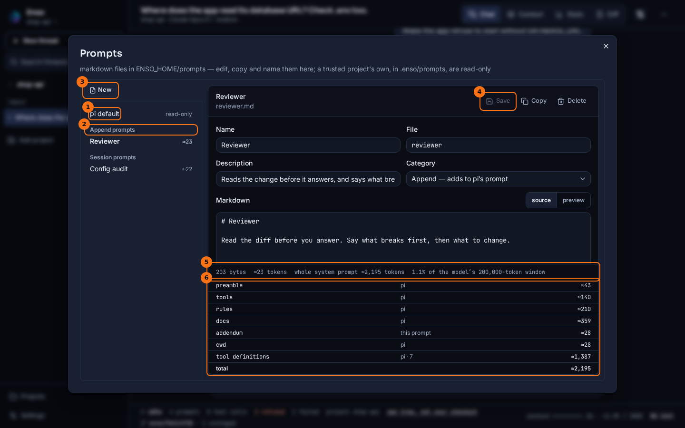

# Prompts

## What it shows

Your prompt library: markdown files you write once and start sessions with. Each prompt is one file, `ENSO_HOME/prompts/<id>.md`, with a short frontmatter block (`name`, `description`, `category`) and the text under it. The category says where the text goes:

- A *system* prompt replaces the opening of pi's system prompt, and pi then leaves out its own sections on tools, rules and docs. Your project's context, skills and working folder are still pi's, and the tool definitions are sent either way.
- An *append* prompt is added to the end of pi's.
- A *session* prompt is a first message you use often. It fills the prompt box in the start dialog.

The prompt manager is where you read, write and organise them. While you write, it shows what the prompt costs and what the model will receive with it.

## How to open it

- The **prompts** button, the scroll icon in the header, beside **settings**, opens **Prompts**.
- **New Thread** opens **Start a session**, where **System prompt** and **Saved prompt** pick from the library. See [Sessions and projects](./sessions-and-projects.md).
- The files are plain markdown, so you can also edit them in any editor. The manager and the start dialog read the folder again each time they open.

A file looks like this:

```markdown
---
name: Reviewer
description: Reads the change before it answers, and says what breaks
category: append
---
# Reviewer

Read the diff before you answer. Say what breaks first, then what to change.
```

## What it looks like



1. **pi default**: the system prompt pi builds for the thread on screen, marked **read-only**. **Copy as a new prompt** starts a prompt from it.
2. The library, by category: **System prompts**, **Append prompts** and **Session prompts**, each with its size in tokens. A file that cannot be read as a prompt is listed under them by name, with the reason.
3. **New** starts a blank prompt. **Copy** in the editor starts one from the prompt that is open.
4. **Save** writes the file. **Delete** asks again, naming the file, before it removes it. The editor also has the file's **Name**, **File**, **Description** and **Category**, and shows the markdown as `source` or `preview`.
5. The size bar: the file's bytes, the text's tokens, and the share of the model's context window. For a system or append prompt it also gives the whole system prompt's tokens, since that is what the model is sent.
6. What the model receives: pi's sections of the system prompt, which of them come from this prompt, the **tool definitions** pi sends beside them, and the **total**.

## What to look for

The numbers are the ones the rest of the app uses. The tokens are the same estimate the Context tab gives system text, and the breakdown is pi's own rendering on the thread on screen. So the total here is what the Context tab counts, for the first request of a thread started with this prompt, across its system prompt and tool schemas — and, for an append prompt, the addendum, which the Context tab files under injected context. A system prompt can come out well under pi's default, because pi leaves out its own tools, rules and docs sections. An append prompt always costs pi's whole prompt plus its own text.

A prompt with changes you have not saved says `● unsaved` beside its name. Opening another prompt, starting a new one, or closing the dialog asks first: **Discard them** or **Keep editing**.

The files can change under you: another tab, or an editor open on the same file. **Save** only replaces the version you opened. If the file changed on disk since, nothing is written, and the editor says so with two choices: **Reload from disk**, which drops your edits for the file as it is now, or **Overwrite with mine**. A new prompt, or a rename, is never saved over a file that is already there, even one the library could not read. **Delete** likewise removes only the version you opened.

In the start dialog, **System prompt** lists `pi default` and every system and append prompt, each with its size. It is **fixed for the whole session**. **Saved prompt** lists the session prompts and puts the one you pick into the prompt box, where you can still change it before you send it.

Once a thread has started, the Context tab names its system prompt on the system row: `system prompt · Reviewer`, or `system prompt · pi default`.

## What it doesn't do

- There is one library, in `ENSO_HOME`. A project cannot have prompts of its own yet.
- A thread's system prompt cannot change after its first request. To run the same work with another one, start a new thread. A fork, a resume and a restart keep the prompt the thread started with, even if the file has been edited or deleted since.
- These are not pi's prompt templates, the `/name` commands under **prompts** in the command palette (see [Chat](./chat.md)). Those are pi's own and are not listed here.

## Go deeper

- [Environment and configuration](../reference/env-and-config.md): `ENSO_HOME/prompts` among the other files in `ENSO_HOME`.
- [HTTP routes](../reference/routes.md): `/api/prompts`, and the configure route the start dialog sends the system prompt through.
- [Context](./context.md): how the system prompt is counted in each request.
- [Glossary](../glossary.md): *library prompt* and the system-prompt modes.
