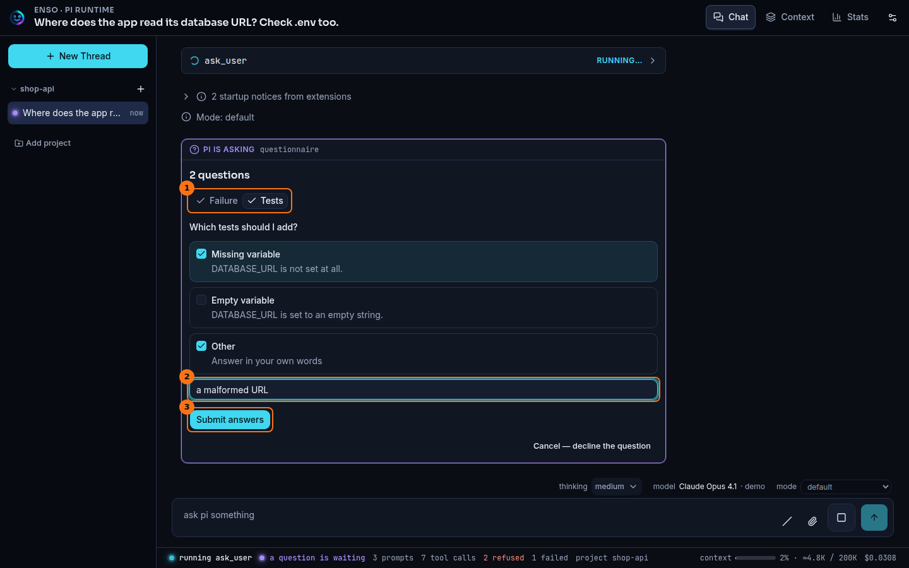
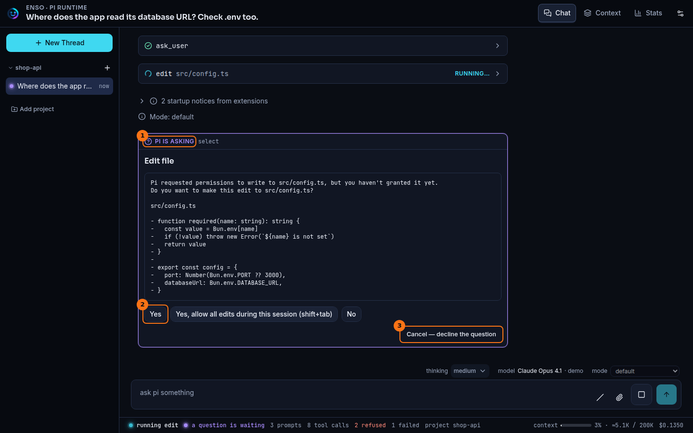

# Questions and dialogs

## What it shows

Sometimes pi needs an answer from you before it can go on. Enso shows the question as a card in the chat, and your answer goes back to pi. There are two kinds:

- *A questionnaire*, when pi calls the `ask_user` tool. It holds one or more questions, each with options, and you answer all of them at once.
- *pi's own prompts*: a choice, a yes or no, or a line of text. The permission-modes extension asks this way before an edit, and so does `/login`.

While a question is waiting, pi waits too. The status bar says `a question is waiting`.

## How to open it

There is nothing to open. The card appears at the end of the chat when pi asks. It also appears in any other tab that has the same thread open, and whichever answers first wins.

## What it looks like

1. One tab per question, named by its header. A tab gets a check once it is answered. A single-choice question moves you to the next tab when you choose.
2. **Other** opens a field for your own answer. Here it adds a third test to the two offered.
3. **Submit answers** sends every answer together. It stays disabled until each question has one.

1. **pi is asking**, then what kind of question it is.
2. The options, exactly as the extension offered them. The text above them is the extension's own: the file, and what the edit touches.
3. **Cancel — decline the question**.

## What to look for

Read the detail before you answer. A permission prompt shows the file and the change, or the command, that pi wants to run. For a file inside the project, the second option, `Yes, allow all edits during this session`, is a mode change: it moves the thread to `acceptEdits`, and you will see that as a mode line in the chat.

In the thread above, pi asks both before it edits anything, and each question is its own card with its own answer. While a card waits, the status bar reads `running ask_user` or `running edit` beside `a question is waiting`: the tool call is open until you answer.

If you open a thread and find a card already waiting, that question was asked while you were away. It is still live, and answering it now lets pi continue.

## What it doesn't do

- A question lives only while the thread runs. A thread opened from its file, with nothing running, has no questions to answer.
- A question can end without you: when pi is stopped, or when the extension that asked gives up after its own timeout.
- The questionnaire has no notes field. The only free text is **Other**.
- A choice outside the options offered is refused by the server. The browser cannot answer with an option pi never offered.

## Go deeper

- [Dialog seam](../seams/dialog.md): the question kinds and the rule that an answer must match its question.
- [Ask, answer, settled](../flows/dialog-ask-answer-settled.md): a question from pi to the card and back.
- [Permission modes](./permission-modes.md).
