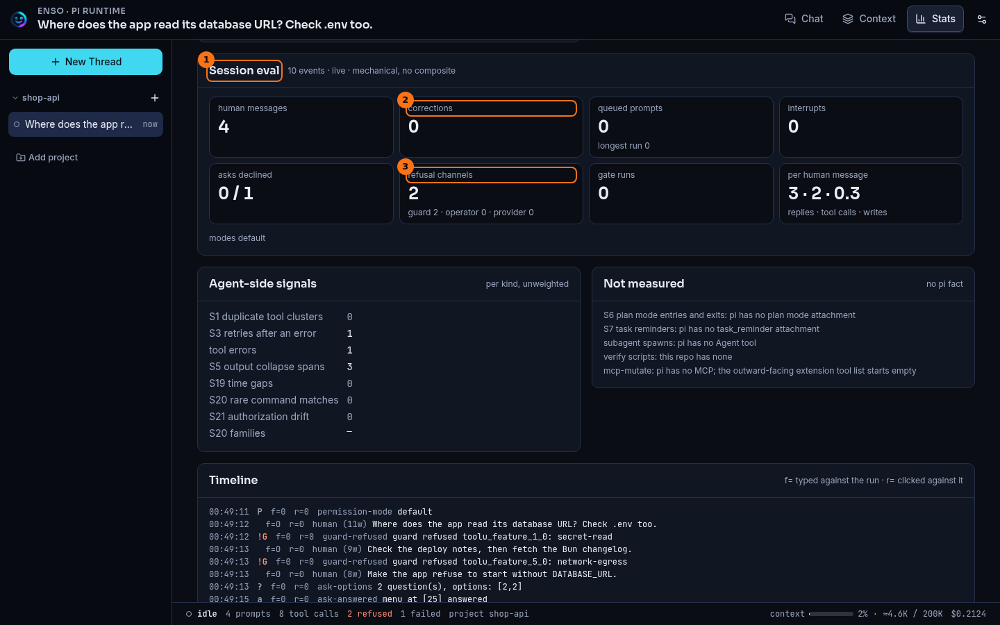
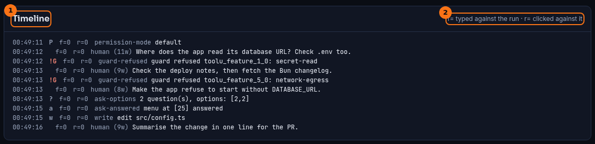

# Session eval

## What it shows

A session eval is a thread's scorecard and timeline, computed only from what the session recorded. It counts what the person running the thread did (messages, corrections, queued prompts, interrupts, answers to questions, denials) and what the agent did (tool calls, writes, refusals, test and build runs and their outcomes). It lists the counts side by side and never combines them into a single score.

Use it to check a claim about a run ("it never needed correcting") or to compare two runs of the same task, such as the two sides of a [fork](./lineage.md).

## How to open it

- On the **Stats** tab, below the stats: the **Session eval** card, then **Agent-side signals**, **Not measured** and the **Timeline**. It reads again whenever the thread's usage changes.
- From the command line, with the web app running (`bun run dev`):

  ```bash
  bun run eval <thread>              # scorecard, agent-side signals, timeline
  bun run eval <thread-a> <thread-b> # each, then a table comparing them
  bun run eval <thread> --json       # the raw payload, for jq
  bun run eval <thread> --row        # one tab-separated row, for sampling over time
  bun run eval --row-header          # the row's column names
  ```

  A thread id is the `?thread=` value in the page URL. The command reads the same server route as the tab, so the two cannot disagree.

## What it looks like



1. **Session eval**: how many events it read, whether the thread is live or read from its file, and a reminder that nothing here is a composite score.
2. **corrections**, with the person's other counts beside it: **human messages**, **queued prompts**, **interrupts**, **asks declined**.
3. **refusal channels**: who refused, split three ways (guard, operator, provider) and never mixed.

Below the scorecard, **Agent-side signals** lists the agent's own patterns, one count per kind and unweighted. **Not measured** lists what pi records nothing for, so a missing metric never reads as zero.



1. **Timeline**: one line per event, with a time, a marker, the two running counters, the kind of event and what it was.
2. The counters: `f=` for what the person typed against the run, `r=` for what they clicked against it.

## What to look for

Watch the two counters. `f=` counts friction, what the person *typed* against the run: corrections, queued prompts, confused messages and interrupts. `r=` counts refusals the person *clicked*: declined questions, and **No** on a permission prompt. They are kept apart because they move at different times. The line where either one starts climbing is where the run went wrong.

In the thread above, both stay at `0` all the way down. The only marked lines are the two guard refusals, flagged `!G`, and **refusal channels** reads `guard 2 · operator 0 · provider 0`. The guards refused twice and the person refused nothing: a run that needed no correcting, with two calls stopped by policy. The command line's `refusalsTotal` is `0` for the same reason: it counts only the person's refusals, the `r=` column.

Compare the ratios under **per human message** (replies, tool calls and writes for each message the person sent) between two runs of the same task. A run that needs many more of them to finish is doing more work per instruction, and the timeline shows where.

## What it doesn't do

- It gives no single score. Every number traces back to something in the session, and weighing the numbers is up to you.
- It covers the current branch only, as the rest of the Stats tab does.
- Queued prompts and interrupts come from the log, which keeps 14 days. For an older thread they read as `—` (unknown), never as `0`, and the card says why.
- Corrections and confusion are found with fixed word lists. They miss what the lists don't name, and a message that happens to match one can count by mistake.
- The comparison table for several threads is in the command line only. The tab shows one thread at a time.

## Go deeper

- [Glossary](../glossary.md): *session eval*, *friction*, *refusal channel* and *operator denial*.
- [HTTP routes](../reference/routes.md): `GET /api/threads/:threadId/eval`.
- [Stats](./stats.md): what the same thread cost.
- [Forks and lineage](./lineage.md): making two runs comparable in the first place.
