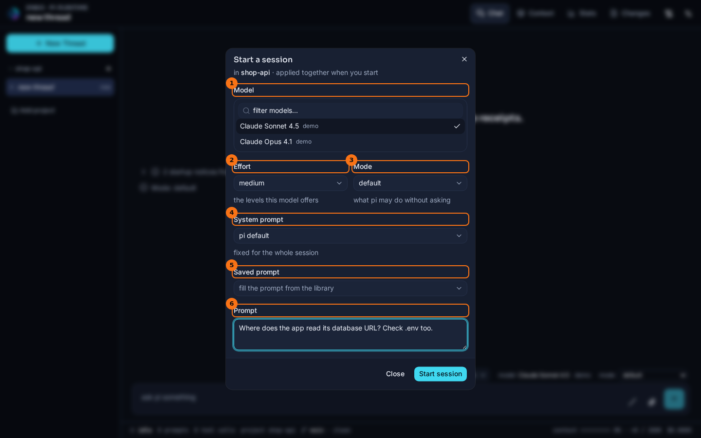
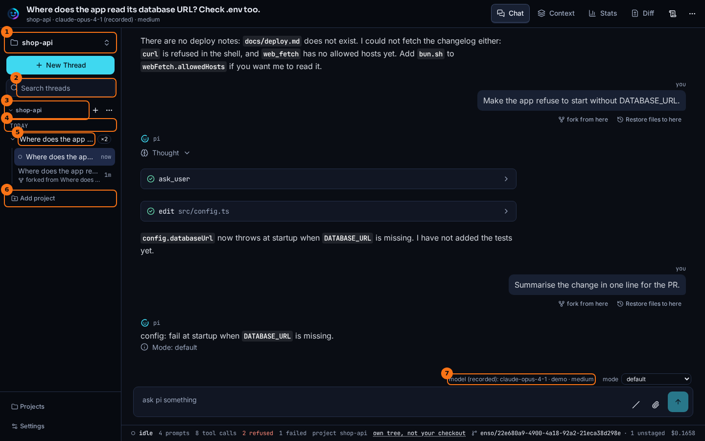

# Sessions and projects

## What it shows

A project is a folder pi works in. The rail lists your projects, and each project's threads under it. A new thread asks how to start: which model, how much effort, which permission mode, which system prompt, and the first prompt. They are applied together when you start.

A thread you ran before is still there after a restart. Until you run it again it is *cold*: Enso reads it from pi's session file, and nothing is running.

## How to open it

- The folder you ran `bun run dev` in is always a project.
- **Add project** in the rail adds another folder. The folder must be inside a root your config declares, in `ENSO_HOME/config.json`:

  ```json
  { "projects": { "roots": ["~/code"] } }
  ```

  With no roots declared, the launch folder is the only project.
- **New Thread**, or the **+** beside a project, opens **Start a session**.
- Click a thread in the rail to open it. A cold thread opens from its file straight away.

## What it looks like



1. **Model**: the models your login gives you. **filter models…** narrows the list. (The screenshots use a scripted stand-in, listed as `demo`.)
2. **Effort**: the thinking levels this model offers.
3. **Mode**: what pi may do without asking. See [Permission modes](./permission-modes.md).
4. **System prompt**: `pi default`, or a system or append prompt from your library, with its size in tokens. It is **fixed for the whole session**. A library file that cannot be read is listed under the field by name. See [Prompts](./prompts.md).
5. **Saved prompt**: fills the prompt box from one of your session prompts. It is there only when the library has one.
6. **Prompt**: the first message. Enter starts the session, Shift+Enter adds a line.



1. The project, with its threads under it.
2. A stored thread. Hover it to see when it last ran.
3. **Add project**.
4. The model the thread last ran on, marked `model (recorded):` because nothing is running yet.

## What to look for

Nothing in the dialog changes anything until you press **Start session**. Then the system prompt, the model, the effort and the mode are sent in one request, in that order. If one of them is refused, the dialog stays open and says which one, and the prompt is not sent. So you never get a session that runs your prompt on the wrong model, or under the wrong system prompt.

The thread above was opened after a restart of the app, so it is cold. Its last run was on `claude-opus-4-1`, which the composer shows as `model (recorded):`. The thinking selector is hidden, because there is no live session to change. Sending a prompt starts the session again under the same id, and the chip becomes the live model.

If a thread's last run was cut off before pi answered, the thread shows a notice with a **Continue** button. Continue picks up from the stored state without a new message. See [Forks and lineage](./lineage.md), which also covers what a thread records about the conditions it ran under.

The status bar also says where the project stands in git. It shows the branch, `↑` for commits not pushed yet, `↓` for commits on the remote this branch doesn't have, and the files that changed: `main ↑2 · 1 staged · 3 unstaged`. The file counts are the project folder's own, even when the folder sits inside a larger repository; the commits are the whole repository's. Hover it to see what it is measured from. That is the last push to the branch's upstream if it has one. A branch pushed without an upstream is measured from its copy on the remote. A branch never pushed is measured from where it branched off the remote's default branch, such as `origin/main`. A project with no remote counts only uncommitted changes. The readout updates when a tool call finishes, so a commit or a push by pi shows up straight away. A project outside git says `no git`. The same state is served at `GET /api/threads/:threadId/git`.

## What it doesn't do

- A project must be strictly inside a declared root. Hidden folders, and links that lead out of a root, are not offered.
- Removing a project only forgets the registration. Its threads stay on disk, and come back if you add the folder again.
- A thread is stored once pi has answered at least once. A thread closed before its first reply is not kept.
- Enso never fetches, pushes or changes anything in git. "Last push" is what this copy of the repository last saw of the remote; run `git fetch` yourself to update it.

## Go deeper

- [Resume](../flows/resume.md): how a stored thread is opened again, and what a cold thread can and can't do.
- [Thread runtime seam](../seams/thread-runtime.md) and [Storage seam](../seams/storage.md).
- [Environment and configuration](../reference/env-and-config.md): `projects.roots` and the rest of `config.json`.
