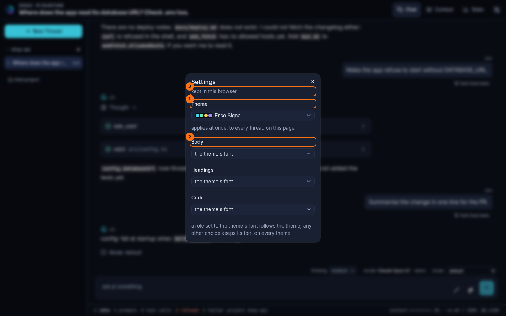

# Settings

## What it shows

The look of the page: a colour theme, and a font for each of three roles. Enso Signal is the default theme, and the others include Kanagawa, Catppuccin, Dracula, Everforest, Gruvbox, Nord, One Dark, Rosé Pine, SynthWave '84 and Tokyo Dark, in dark and light variants.

## How to open it

The **settings** button, the sliders icon at the right of the header.

## What it looks like

1. **Theme**. It applies at once, to every thread on the page.
2. The font roles: **Body**, **Headings** and **Code**. **the theme's font** follows the theme. Any other choice keeps its font on every theme.
3. **kept in this browser**: settings are saved in this browser only.

## What to look for

Pick the code font with the tool rows in mind. Commands, paths, tool input and output, and the debug drawer all use it, so it is the font you read most of a run in.

A font is loaded the first time something uses it. Choosing a font you haven't used yet can take a moment to show.

## What it doesn't do

- Settings are not stored on the server or in `ENSO_HOME`. Another browser, or a private window, starts from the default.
- They change only how the page looks. Nothing here changes what pi does.
- The terminal is not affected. It uses pi's own theme.

## Go deeper

- [Presentation seam](../seams/presentation.md): how the page renders what the thread sends it.
- [Chat](./chat.md).
