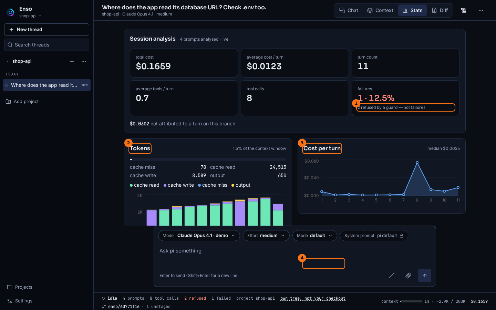

# Stats

## What it shows

The **Stats** tab analyses one thread: what it cost, how the cache behaved, which turns were expensive, and which tools did the most. Every figure comes from pi's own session file, so a thread from last month gives the same answer as one from a minute ago.

## How to open it

- The **Stats** tab at the top of a thread.
- A point on a chart, a call or a prompt in a list opens that spot in the chat.

## What it looks like

1. **failures**, and under it the refusals, counted apart: `2 refused by a guard — not failures`.
2. **Tokens**: each turn's **cache read**, **cache write**, **cache miss** and **output**, as a stacked bar.
3. **Cost per turn**, with the median beside the title.
4. **Costliest calls**: the tool calls ranked by input, output, time or failures.

Further down: **Cumulative usage by tool**, **Distribution**, **Costliest prompts** and **Latency**, then the thread's [Session eval](./session-eval.md).

## What to look for

The thread above cost about 21 cents. Three things stand out.

Turn 9 is one solid cache-write bar in **Tokens**, and the peak of **Cost per turn**. It is the first turn after the switch to `claude-opus-4-1`: the new model had no cache, so the whole prefix was written again, at that model's price. Most other turns are almost all cache read. If you see a lone cache-write bar in a thread of your own, look for a model switch or a compaction just before it. [Context Events](./context-browser.md) names which.

The line under the metrics, about 3 cents `not attributed to a turn on this branch`, is the compaction. Its summary was a model call of its own, but not a turn of the conversation, so the tab names the cost instead of hiding it in a turn.

**failures** reads `1`, not `3`. pi records a guard's refusal as an error, just like a real failure. Enso keeps a record of each refusal, so the tab counts the failed `cat` as a failure and the two refused calls apart. A refusal is the guard working, not the tool breaking.

## What it doesn't do

- It covers the current branch only. Cost spent on a branch you forked away from, or on a compaction, is named as not attributed to a turn, rather than spread over the turns you see.
- Times come from the log, which keeps 14 days. An older thread still has every token and cost figure, but its **Latency** says no day file covers it.
- Tool figures are in characters, not tokens. A tool's cost is the tokens its result adds to later requests, which the **Context** tab shows.

## Go deeper

- [Context](./context.md): the same requests, by what they were made of.
- [Guards and receipts](./guards-and-receipts.md): what a refusal is.
- [Observation seam](../seams/observation.md) and [Logging seam](../seams/logging.md): where the numbers and the times come from.
- [Prompt cache architecture](../concepts/prompt-cache-architecture.md).
