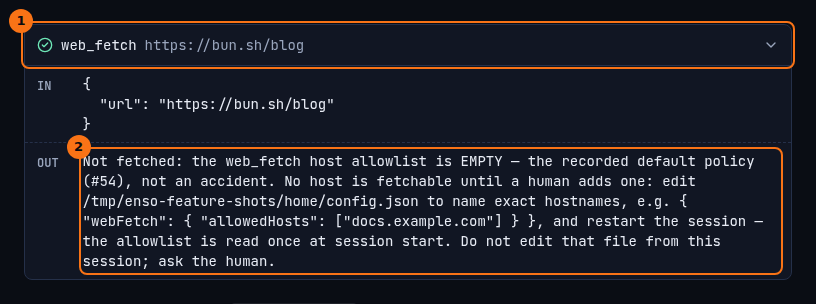

# Web access

## What it shows

pi reaches the web through two tools Enso adds, and through nothing else:

- `web_fetch` fetches one URL and returns the page as text. It fetches only hosts you have allowed.
- `web_search` searches the web. It uses the current model's own search when the model has one, and can fall back to Tavily.

`curl`, `wget` and other network clients in the shell are refused by a guard, and the refusal tells pi to use `web_fetch` instead.

## How to open it

The allowlist lives in your config, `ENSO_HOME/config.json` (`~/.enso/config.json` by default). Name each host exactly:

```json
{ "webFetch": { "allowedHosts": ["docs.example.com"] } }
```

A project you trust can add hosts for its own threads in its `.enso/config.json`. Either way, the list is read when a session starts, so restart the thread after you change it.

For the Tavily fallback, put `TAVILY_API_KEY` in `ENSO_HOME/secrets.env`. It is read on every call, so no restart is needed.

## What it looks like



1. The `web_fetch` call, and the URL pi asked for.
2. The answer pi got. It says why nothing was fetched, which file to edit, and the JSON to put in it.

## What to look for

In the thread above, pi first tried `curl https://bun.sh/blog` and the `network-egress` guard refused it. pi then used `web_fetch`, which fetched nothing either, because the allowlist is empty. That is the default, not a mistake: until you add a host, nothing is fetchable. pi's answer passes the fix on to you (`Add bun.sh to webFetch.allowedHosts`) instead of trying another way round.

Note the difference in the chat. The `curl` refusal is a guard receipt. The `web_fetch` refusal is an ordinary result with a check mark: the tool worked, and its answer is "not fetched".

A host that is not on the list gets its own answer, naming the hosts that are. Matching is exact: allowing `example.com` does not allow `docs.example.com`.

For `web_search`, the first line of every result names the backend that answered and, when it fell back to Tavily, why. When a model answers without searching and Tavily is not set up, the result says `no web search was performed`.

## What it doesn't do

- `web_fetch` never follows a redirect. It reports where the redirect points, so you can allow that host too.
- It fetches text only, at most 512 KB, within 30 seconds, over `http` or `https`, and never a URL with a password in it.
- pi cannot widen its own allowlist. Writes into `ENSO_HOME` and into a project's `.enso/` are refused by the guards, shell redirects included.
- A page's text is marked as untrusted before pi reads it. That is a warning to the model, not a filter: a fetched page can still try to give pi instructions.
- The check that a host resolves to a public address is advisory. It is not a network boundary.

## Go deeper

- [Web providers seam](../seams/web-providers.md): the backends behind `web_search`, and when each is chosen.
- [A web_search call](../flows/web-search-call.md): step by step.
- [Environment and configuration](../reference/env-and-config.md): `webFetch` and `webSearch` in `config.json`.
- [Guards and receipts](./guards-and-receipts.md): the `network-egress` rule.
