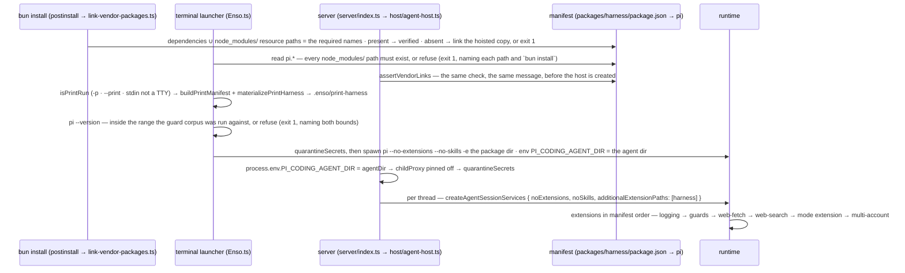

# Flow: boot and launchers — the manifest, the isolation triple, the print mirror, the vendor links

Two launchers start the runtime with only this harness loaded: the terminal launcher (`scripts/enso.ts`)
spawns it as a child; the server (`startEnsoServer` → `createAgentHost`) runs it in-process (#69). Both
read one manifest, `packages/harness/package.json` → `pi`, and enforce the same preconditions before any
of the runtime is imported — vendor links present, the isolation triple applied, secrets out of the
environment (#89). What differs is flags on a spawn versus loader options, and the print variant (#20).

## The sequence



## The invariants it shows

1. **Load order is the manifest, enumerated by hand, never a glob.** `pi.extensions` is declaration
   order, never sorted: the four repository extensions, then the two vendor ones. The runtime resolves
   *tools* first-wins, so a registered tool name shadows every later registration of that name — which
   is why the guards are declared ahead of both vendor extensions, and why a directory glob (ordering
   by filename) is not acceptable. It is *not* what makes the guard hold: the guard registers no tool
   and participates through a `tool_call` handler instead — additive, first `block` final whatever the
   order — and that hook's two handlers are guards, then the mode extension. A third is #4's trigger.
   What the order does decide is the configurator in invariant 2.
2. **Logging is first, and configures only when nothing has.** As a child of the terminal launcher
   nothing has configured, so the extension does — the same day's file, `process: "pi"`, no console
   sink. In-process the server's launcher configured first and it configures nothing; a second
   `configure` throws by design. Why first: the sink is configured at load, and no extension writes
   a record before `session_start` today, so the position decides nothing yet — it is first so that
   stays true when one does (`extensions/logging/index.ts` header, *Why first in the manifest*).
3. **Isolation is three mechanisms, each closing a different hole — the same three at both launch
   points.** `PI_CODING_AGENT_DIR` points the runtime at `.enso/pi-agent`: none of the user's packages,
   settings or credentials are visible. `--no-extensions` turns discovery off — including this repo's
   own `.pi/settings.json`, which installs the package and would load it twice. `--no-skills` is required
   and covered by neither: `~/.agents/skills/` is outside the agent dir. The host applies the same triple
   as loader options and sets the env at creation, before the first services — read at module import.
4. **`-e` receives the package directory, never extension files.** Loaded by package rules, the manifest
   drives every resource kind — extensions, skills, prompts and themes; files passed individually loaded
   the extensions and silently dropped everything else.
5. **A missing vendor path is a refusal at both launch points, naming the path and the fix.** The
   runtime skips a missing manifest resource path without a word (the symptom, once, was an HTTP 400
   several layers away). Only `node_modules/` paths are checked; `./extensions/…` is our own source.
   Upstream, `link-vendor-packages.ts` runs from the root `postinstall` as verify-or-fix over every
   `dependencies` entry plus the `node_modules/` paths — `@enso/core` is only an import, and was unlinked.
   One precondition, and since #221 one IMPLEMENTATION: `@enso/core/pi-manifest` owns both pi assumptions
   (a `pi.*` value is a path or an array of them; a `node_modules/` path is literal, not a specifier),
   and all three readers call it. It was written three times before, with the prefix spelled as a
   constant twice and a bare literal once — which is why the duplicate-shape gate never named them.
6. **A print run loads a generated mirror, not a flag.** The trigger is "this run cannot prompt". The
   mode extension fails closed when it cannot prompt, the runtime has no per-extension exclusion, and
   invariant 4 forbids passing files — so the variant is a package under `.enso/print-harness`: the
   filtered manifest (the fence below) plus a symlink for EVERY package-root entry, by `readdir`, since
   extensions import siblings by relative path. `enso.config.json` is not mirrored and must not be:
   `findRepoRoot` realpaths out of the mirror first. A print run has our guards only — `bash` unconfined (#9).
7. **The terminal launcher refuses a `pi` it was not pinned against (#217).** The two surfaces resolve
   pi differently and only one was bounded: in-process imports the WORKSPACE copy, while the terminal
   launcher spawns the first `pi` on `PATH`. The guard REPLICATES pi's path resolver (`resolveToCwd` is
   not on pi's export map) and the corpus that keeps the copy honest reads the workspace copy — so on
   the terminal surface the guard could resolve a path differently from the tool it gates, and compute
   a deny against the wrong target, with the whole suite green (reproduced with a shim printing
   `0.85.0` earlier on `PATH`). So `enso.ts` reads `pi --version` before the spawn and refuses outside
   `enso-launch.ts#SUPPORTED_PI_VERSIONS` — no override flag, because the range means "the corpus has
   been run against this", and `packages/harness/package.json` → `peerDependencies` states the same
   bound. The probe fails closed three ways beside the range: it is bounded at 5s (a wedged
   `pi --version` used to park the launcher silently — worse than the refusal it exists to print,
   and arming a kill is not enough, since a shell shim's own child holds the pipe open, so the
   deadline races the READ), a non-zero exit is refused rather than parsed, and a banner carrying
   no pi version is no version claim. What it does NOT cover: the versions of the libraries inside
   the pi binary's own tree.

## The print-variant contract

<!-- source: scripts/print-harness.ts#buildPrintManifest -->
```ts
/**
 * The harness manifest with picc-permission-modes removed from `pi.extensions`.
 * Everything else — skills, prompts, themes, dependencies — is carried verbatim.
 */
export function buildPrintManifest(manifest: HarnessManifest): PrintManifest {
  const extensions = manifest?.pi?.extensions
  if (!Array.isArray(extensions)) {
    throw new PrintHarnessShapeError('pi.extensions is not an array')
  }
  const keptExtensions = extensions.filter(
    (extensionPath) => typeof extensionPath !== 'string' || !extensionPath.includes(PICC_EXTENSION_FRAGMENT),
  )
  if (keptExtensions.length === extensions.length) {
    throw new PrintHarnessShapeError(`no extension entry contains "${PICC_EXTENSION_FRAGMENT}" — the filter is stale`)
  }
  if (keptExtensions.length === 0) {
    throw new PrintHarnessShapeError('the filter removed every extension')
  }
  return {
    ...manifest,
    name: `${manifest.name}-print`,
    pi: { ...manifest.pi, extensions: keptExtensions },
  }
}
```

## The tests that pin it

Each marker below is checked by `test/docs-gate.test.ts`: the file must declare a test with exactly
that title, so a renamed or deleted pin fails this page.

<!-- test: packages/web/src/host/__tests__/agent-host.test.ts#exactly the manifest's six extensions load, in order, with no load errors -->
- **Invariant 1, in-process** — [`agent-host.test.ts`](../../packages/web/src/host/__tests__/agent-host.test.ts):
  the loaded paths equal the manifest, in its order, no load error.
<!-- test: packages/harness/extensions/__tests__/tool-call-participants.test.ts#⚠ exactly the two known tool_call participants — a third means #4's arbiter is due -->
- **Invariant 1, the hook** — [`tool-call-participants.test.ts`](../../packages/harness/extensions/__tests__/tool-call-participants.test.ts):
  the `tool_call` participants, by name and set equality, over every declared extension tree.
<!-- test: test/fallow-config.test.ts#⚠ every repository extension in the harness manifest is a fallow entry, and only those (#163) -->
- **Invariant 1, the manifest's other reader** — [`fallow-config.test.ts`](../../test/fallow-config.test.ts):
  the repository entries of `pi.extensions` and fallow's hand-written entry list, held equal both ways.
<!-- test: packages/harness/extensions/logging/__tests__/logging.test.ts#⚠ pi as a child: nothing has configured, so the extension does — its own record lands as process pi, and session_shutdown flushes -->
- **Invariant 2** — [`logging.test.ts`](../../packages/harness/extensions/logging/__tests__/logging.test.ts): the child branch.
<!-- test: packages/web/src/host/__tests__/agent-host.test.ts#⚠ multi-account resolved its config inside the scratch agent dir, not ~/.pi/agent — the env was set first -->
- **Invariant 3, the env half** — the startup notify names a config path inside the scratch agent dir.
<!-- test: packages/web/src/server/__tests__/vendor-links.test.ts#refuses to start when a vendor manifest path is missing -->
- **Invariant 5** — [`vendor-links.test.ts`](../../packages/web/src/server/__tests__/vendor-links.test.ts): the server's refusal.
<!-- test: scripts/__tests__/print-harness.test.ts#the real harness manifest matches the shape the print filter expects -->
- **Invariant 6, the contract test** — [`print-harness.test.ts`](../../scripts/__tests__/print-harness.test.ts):
  the filter against the REAL manifest, so a rename there goes red here, not at a print launch.
<!-- test: scripts/__tests__/print-harness.test.ts#materializePrintHarness writes the filtered manifest and symlinks into the real package -->
- **Invariant 6, the mirror** — every sibling linked, idempotent, a dead link removed.

<!-- test: scripts/__tests__/enso-launch.test.ts#pi is launched with --no-extensions, --no-skills and -e <package>, ahead of the user’s arguments -->
- **Invariants 3 and 4, the launcher's own decisions** — [`enso-launch.test.ts`](../../scripts/__tests__/enso-launch.test.ts):
  the isolation triple's two argument legs, in order, ahead of the user's; the print-run trigger.
  (`enso.ts` spawns; `enso-launch.ts` decides, and is what is pinned.)
<!-- test: scripts/__tests__/link-vendor-packages.test.ts#verify-or-fix: a present package is verified, an absent one is linked from the hoisted copy, and the link resolves -->
- **Invariant 5, the linker** — [`link-vendor-packages.test.ts`](../../scripts/__tests__/link-vendor-packages.test.ts):
  both sources of required packages; verify-or-fix; a broken link replaced; a missing package named.
<!-- test: packages/core/src/__tests__/pi-manifest.test.ts#the vendor paths a manifest declares that are not under the package root are named, and only those -->
- **Invariant 5, the precondition itself** — [`pi-manifest.test.ts`](../../packages/core/src/__tests__/pi-manifest.test.ts):
  the flatten (arrays, singles, a non-string dropped) and the vendor-path check, at the one owner the
  launcher, the linker and the server all read.
<!-- test: scripts/__tests__/pi-version-parity.test.ts#⚠ the pi the guard corpus pins against is a pi the terminal launcher will run (#217) -->
- **Invariant 7, the two resolutions** — [`pi-version-parity.test.ts`](../../scripts/__tests__/pi-version-parity.test.ts):
  the workspace pi the guard corpus resolves is inside the range the launcher enforces, and the
  harness's `peerDependencies` states that same bound.
<!-- test: scripts/__tests__/enso-launch.test.ts#the tested pi range includes its minimum and excludes the version it stops below -->
- **Invariant 7, the range itself** — the boundaries of `piVersionSupported`, and its fail-closed
  reading of a version it cannot parse.

## Where it is stated

The terminal launcher: [`scripts/enso.ts`](../../scripts/enso.ts) (header). The mirror:
[`scripts/print-harness.ts`](../../scripts/print-harness.ts) (header, `materializePrintHarness`). The
linker: [`scripts/link-vendor-packages.ts`](../../scripts/link-vendor-packages.ts) (`requiredPackageNames`).
pi's manifest-resource layout, for all three readers: `packages/core/src/pi-manifest.ts` (header).
In-process: `packages/web/src/host/agent-host.ts` (header ⚠⚠ items, `createSession`), `server/index.ts#assertVendorLinks`.
Why the guards precede every vendor extension, and why a denial does not depend on that: `packages/harness/extensions/guards/index.ts` (header), [`seams/guards.md`](../seams/guards.md);
the configurators: [`seams/logging.md`](../seams/logging.md); why logging is first:
[`extensions/logging/index.ts`](../../packages/harness/extensions/logging/index.ts) (header, *Why first in the manifest*); the manifest as a table: [`reference/env-and-config.md`](../reference/env-and-config.md).
