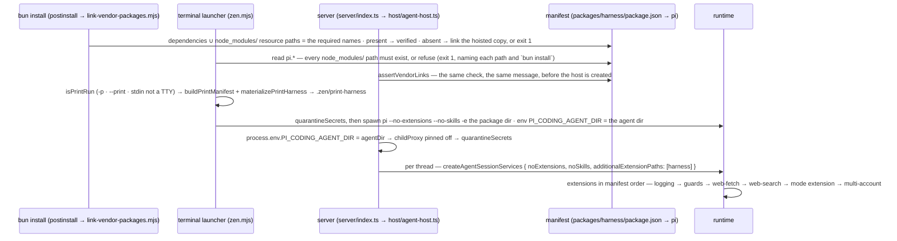

# Flow: boot and launchers — the manifest, the isolation triple, the print mirror, the vendor links

Two launchers start the runtime with only this harness loaded: the terminal launcher (`scripts/zen.mjs`)
spawns it as a child; the server (`startZenServer` → `createAgentHost`) runs it in-process (#69). Both
read one manifest, `packages/harness/package.json` → `pi`, and enforce the same preconditions before any
of the runtime is imported — vendor links present, the isolation triple applied, secrets out of the
environment (#89). What differs is flags on a spawn versus loader options, and the print variant (#20).

## The sequence



## The invariants it shows

1. **Load order is the manifest, enumerated by hand, and it is a security property.** `pi.extensions`
   is declaration order, never sorted: the four repository extensions, then the two vendor ones. The
   runtime resolves tools first-wins, so an override of a tool would be safe only while this package
   loads first; the guard is a `tool_call` handler instead — additive, first `block` final whatever the
   order — and that hook's two handlers are guards, then the mode extension. A third is #4's trigger.
2. **Logging is first, and configures only when nothing has.** As a child of the terminal launcher
   nothing has configured, so the extension does — the same day's file, `process: "pi"`, no console
   sink. In-process the server's launcher configured first and it configures nothing; a second
   `configure` throws by design. *Stated gap:* no file read for this page says why the entry is first.
3. **Isolation is three mechanisms, each closing a different hole — the same three at both launch
   points.** `PI_CODING_AGENT_DIR` points the runtime at `.zen/pi-agent`: none of the user's packages,
   settings or credentials are visible. `--no-extensions` turns discovery off — including this repo's
   own `.pi/settings.json`, which installs the package and would load it twice. `--no-skills` is required
   and covered by neither: `~/.agents/skills/` is outside the agent dir. The host applies the same triple
   as loader options and sets the env at creation, before the first services — read at module import.
4. **`-e` receives the package directory, never extension files.** Loaded by package rules, the manifest
   drives every resource kind — extensions, skills, prompts and themes; files passed individually loaded
   the extensions and silently dropped everything else.
5. **A missing vendor path is a refusal at both launch points, naming the path and the fix.** The
   runtime skips a missing manifest resource path without a word (the symptom, once, was an HTTP 400
   several layers away). Only `node_modules/` paths are checked; `./extensions/…` is our own source.
   Upstream, `link-vendor-packages.mjs` runs from the root `postinstall` as verify-or-fix over every
   `dependencies` entry plus the `node_modules/` paths — `@zen/core` is only an import, and was unlinked.
6. **A print run loads a generated mirror, not a flag.** The trigger is "this run cannot prompt". The
   mode extension fails closed when it cannot prompt, the runtime has no per-extension exclusion, and
   invariant 4 forbids passing files — so the variant is a package under `.zen/print-harness`: the
   filtered manifest (the fence below) plus a symlink for EVERY package-root entry, by `readdir`, since
   extensions import siblings by relative path. `zen.config.json` is not mirrored and must not be:
   `findRepoRoot` realpaths out of the mirror first. A print run has our guards only — `bash` unconfined (#9).

## The print-variant contract

<!-- source: scripts/print-harness.mjs#buildPrintManifest -->
```ts
/**
 * The harness manifest with picc-permission-modes removed from `pi.extensions`.
 * Everything else — skills, prompts, themes, dependencies — is carried verbatim.
 * @param {HarnessManifest} manifest
 * @returns {HarnessManifest & { pi: NonNullable<HarnessManifest["pi"]> & { extensions: string[] } }}
 */
export function buildPrintManifest(manifest) {
  const extensions = manifest?.pi?.extensions
  if (!Array.isArray(extensions)) {
    throw new PrintHarnessShapeError('pi.extensions is not an array')
  }
  const keptExtensions = extensions.filter(
    (extensionPath) => typeof extensionPath !== 'string' || !extensionPath.includes(PICC_EXTENSION_FRAGMENT),
  )
  if (keptExtensions.length === extensions.length) {
    throw new PrintHarnessShapeError(`no extension entry contains "${PICC_EXTENSION_FRAGMENT}" — the filter is stale`)
  }
  if (keptExtensions.length === 0) {
    throw new PrintHarnessShapeError('the filter removed every extension')
  }
  return {
    ...manifest,
    name: `${manifest.name}-print`,
    pi: { ...manifest.pi, extensions: keptExtensions },
  }
}
```

## The tests that pin it

Each marker below is checked by `test/docs-gate.test.ts`: the file must declare a test with exactly
that title, so a renamed or deleted pin fails this page.

<!-- test: packages/web/src/host/__tests__/agent-host.test.ts#exactly the manifest's six extensions load, in order, with no load errors -->
- **Invariant 1, in-process** — [`agent-host.test.ts`](../../packages/web/src/host/__tests__/agent-host.test.ts):
  the loaded paths equal the manifest, in its order, no load error.
<!-- test: packages/harness/extensions/__tests__/tool-call-participants.test.ts#⚠ exactly the two known tool_call participants — a third means #4's arbiter is due -->
- **Invariant 1, the hook** — [`tool-call-participants.test.ts`](../../packages/harness/extensions/__tests__/tool-call-participants.test.ts):
  the `tool_call` participants, by name and set equality, over every declared extension tree.
<!-- test: test/fallow-config.test.ts#⚠ every repository extension in the harness manifest is a fallow entry, and only those (#163) -->
- **Invariant 1, the manifest's other reader** — [`fallow-config.test.ts`](../../test/fallow-config.test.ts):
  the repository entries of `pi.extensions` and fallow's hand-written entry list, held equal both ways.
<!-- test: packages/harness/extensions/logging/__tests__/logging.test.ts#⚠ pi as a child: nothing has configured, so the extension does — its own record lands as process pi, and session_shutdown flushes -->
- **Invariant 2** — [`logging.test.ts`](../../packages/harness/extensions/logging/__tests__/logging.test.ts): the child branch.
<!-- test: packages/web/src/host/__tests__/agent-host.test.ts#⚠ multi-account resolved its config inside the scratch agent dir, not ~/.pi/agent — the env was set first -->
- **Invariant 3, the env half** — the startup notify names a config path inside the scratch agent dir.
<!-- test: packages/web/src/server/__tests__/vendor-links.test.ts#refuses to start when a vendor manifest path is missing -->
- **Invariant 5** — [`vendor-links.test.ts`](../../packages/web/src/server/__tests__/vendor-links.test.ts): the server's refusal.
<!-- test: scripts/__tests__/print-harness.test.ts#the real harness manifest matches the shape the print filter expects -->
- **Invariant 6, the contract test** — [`print-harness.test.ts`](../../scripts/__tests__/print-harness.test.ts):
  the filter against the REAL manifest, so a rename there goes red here, not at a print launch.
<!-- test: scripts/__tests__/print-harness.test.ts#materializePrintHarness writes the filtered manifest and symlinks into the real package -->
- **Invariant 6, the mirror** — every sibling linked, idempotent, a dead link removed.

*Not pinned:* the terminal launcher itself. `scripts/zen.mjs` spawns at top level and has no test — its
flags (invariants 3 and 4), print-run trigger and vendor refusal are stated in its header and mirrored by
the host's and the server's tested copies above. `link-vendor-packages.mjs` has no test either.

## Where it is stated

The terminal launcher: [`scripts/zen.mjs`](../../scripts/zen.mjs) (header). The mirror:
[`scripts/print-harness.mjs`](../../scripts/print-harness.mjs) (header, `materializePrintHarness`). The
linker: [`scripts/link-vendor-packages.mjs`](../../scripts/link-vendor-packages.mjs) (`requiredPackageNames`).
In-process: `packages/web/src/host/agent-host.ts` (header ⚠⚠ items, `createSession`), `server/index.ts#assertVendorLinks`.
Load order as a security property: `packages/harness/extensions/guards/index.ts` (header), [`seams/guards.md`](../seams/guards.md);
the configurators: [`seams/logging.md`](../seams/logging.md); the manifest as a table: [`reference/env-and-config.md`](../reference/env-and-config.md).
