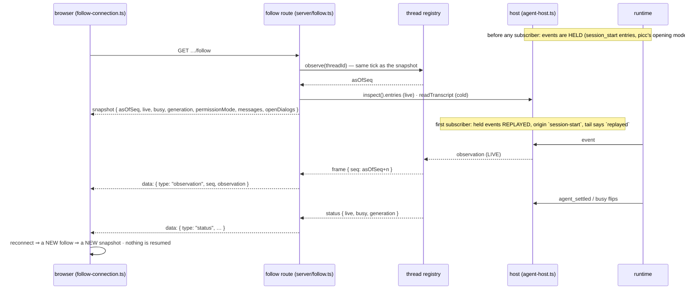

# Flow: the follow — snapshot, then frames; held, replayed, live

A browser's view of a thread is one `GET /api/threads/:id/follow`: a **snapshot** exact as of a
sequence number, then every later **observation** with a greater one, and **status** frames as the
thread's busy flag and generation move. There is no cursor to resume from, because the snapshot *is*
the resync: a reconnect is a new follow and a new snapshot (#112, #114). Beneath the wire, the host
holds events that happen before anyone subscribes and replays them to the first subscriber, and its
tail records how each was delivered — `held`, `replayed`, `live`, `dropped` — which is the ordering
evidence #88 and #69 were reconstructed without (#97).

## The sequence



## The invariants it shows

1. **The snapshot is exact as of `asOfSeq`, and no observation falls between the two.** The route
   subscribes and reads the state in the same tick (`server/follow.ts#followThread`); every later
   frame's `seq` is greater. Two followers of one thread see every frame with the same `seq`.
2. **A cold thread is an empty snapshot, not a 404.** Observation may precede the first prompt, and
   must — or the prompt's opening events would have no follower. The cold read is awaited *before*
   subscribing, so a thread built during the read is then seen live.
3. **Held until the first subscriber; never held after.** Events before anyone listens are kept and
   replayed to the first subscriber with origin `session-start`; once a subscriber has existed, an
   event with nobody listening is `dropped`, not queued for the next one. This is what closed #88
   (an entry emitted to nobody) without reopening #69 (a settle replayed into the next run's pump).
4. **Provenance is recorded, coalesced, in a ring.** The host's tail names each delivery `held`,
   `replayed`, `live` or `dropped`; consecutive events of one type and provenance fold into one row
   with an exact count; old rows fall off the front.
5. **The snapshot's lists are complete, so the browser replaces rather than appends.** `openDialogs`
   is every question the thread is blocked on now — an empty list clears a card for a question that
   settled while the page was away.

## The frame contract

<!-- source: packages/core/src/follow.ts#EnsoFollowSnapshot -->
```ts
/**
 * The server↔browser wire (#112): a thread's feed, as the follow route serves it.
 *
 * Every follow opens with exactly one `snapshot` — the thread as of `asOfSeq` — and then
 * carries only `observation` frames (each `seq` greater than the last) and `status`
 * frames (the thread's lifecycle as the server sees it). A reconnect is a new follow and
 * a new snapshot; there is no cursor to resume from, because the snapshot IS the resync
 * (deepseek-harness: one complete snapshot per generation, then only deltas).
 *
 * The payload is `EnsoObservation` — the same layer the event tails and the debug pane
 * reason in. AG-UI is not on this wire; a browser adapter derives it if a renderer wants it
 * (`docs/architecture.md`, decided constraints).
 */
export const EnsoFollowSnapshot = Type.Object(
  {
    type: Type.Literal('snapshot'),
    threadId: Type.String(),
    /** The feed's position this snapshot is exact as of; every later observation's `seq` is greater. */
    asOfSeq: Type.Integer({ minimum: 0 }),
    /** A pi session exists for the thread on this server. False: served cold from the file, or empty. */
    live: Type.Boolean(),
    busy: Type.Boolean(),
    /** See `EnsoThreadSummary.generation`. */
    generation: Type.Integer({ minimum: 0 }),
    permissionMode: EnsoPermissionModeState,
    /** The session's model and thinking level (#338 slice 2); `null` when the thread is not live — a stored thread does not say. */
    model: Type.Union([EnsoModelState, Type.Null()]),
    /** The branch as TanStack `UIMessage`s — `Unknown` because the shape is the renderer's, not enso's. */
    messages: Type.Array(Type.Unknown()),
    /** Every question pi is blocked on right now, oldest first (#114). Empty when not live. */
    openDialogs: Type.Array(EnsoOpenDialog),
    interrupted: Type.Optional(EnsoInterruptedTail),
  },
  { additionalProperties: false },
)
```

## The tests that pin it

Each marker below is checked by `test/docs-gate.test.ts`: the file must declare a test with exactly
that title, so a renamed or deleted pin fails this page.

<!-- test: packages/web/src/server/__tests__/follow.test.ts#⚠ two followers share one feed: both see every frame with the same seq, and one leaving detaches nothing -->
- **Invariant 1** — [`follow.test.ts`](../../packages/web/src/server/__tests__/follow.test.ts): two
  followers share one feed with the same `seq`; one leaving detaches nothing.
<!-- test: packages/web/src/server/__tests__/follow.test.ts#⚠ a question answered in one tab is settled on every follower's feed, and a follow opened under it gets it in the snapshot (#114) -->
- **Invariants 1 and 5** — a follow opened under an open question gets it in the snapshot; the
  settle reaches every follower.
<!-- test: packages/web/src/host/__tests__/agent-host.test.ts#⚠ an entry an extension persists during session_start reaches the first subscriber (#88) -->
- **Invariant 3, the #88 half** — [`agent-host.test.ts`](../../packages/web/src/host/__tests__/agent-host.test.ts):
  an entry persisted during `session_start` reaches the first subscriber.
<!-- test: packages/web/src/host/__tests__/agent-host.test.ts#⚠ events are held only until the FIRST subscriber; with nobody listening afterwards they are dropped, not replayed -->
- **Invariant 3, the #69 half** — held only until the first subscriber; afterwards dropped, not
  replayed.
<!-- test: packages/web/src/host/__tests__/agent-host.test.ts#⚠ the emitted tail records each event's provenance: held at startup, replayed to the first subscriber, live, dropped (#97) -->
- **Invariant 4** — the tail records `held`, `replayed`, `live`, `dropped`.
<!-- test: packages/web/src/host/__tests__/agent-host.test.ts#⚠ subscribe delivers startup records with origin `session-start` and a run's with `run` (#96) -->
- **Invariant 3, as the browser sees it** — a replayed observation carries origin `session-start`;
  a run's carries `run`.
<!-- test: packages/web/src/host/__tests__/event-tail.test.ts#⚠ a change of provenance or name starts a new row — held vs replayed is the ordering evidence -->
- **Invariant 4, the coalescing rule** — [`event-tail.test.ts`](../../packages/web/src/host/__tests__/event-tail.test.ts):
  a change of provenance or name starts a new row.
<!-- test: packages/web/src/__tests__/follow-connection.test.ts#the snapshot becomes the mode, open-question and run receipts the stores already read -->
- **The browser's side** — [`follow-connection.test.ts`](../../packages/web/src/__tests__/follow-connection.test.ts):
  the snapshot crosses whole, named by its type, and the router reads mode, open questions and
  generation off it (#162 workstream 5).

## Where it is stated

The wire: [`seams/observation.md`](../seams/observation.md). The host's delivery and the tail:
`packages/web/src/host/event-tail.ts` (header) and `agent-host.ts#subscribe`. The route:
`packages/web/src/server/follow.ts#followThread`. The decision that AG-UI is derived in the browser
and never on the wire: `architecture.md` → *Decided constraints*.
