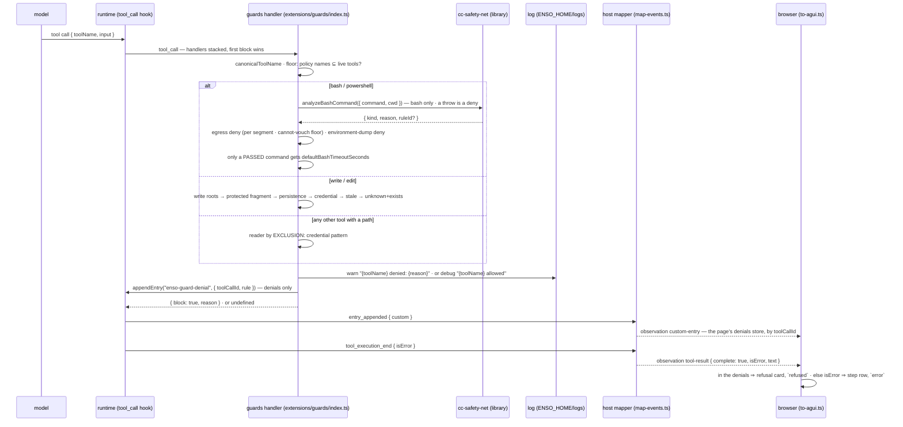

# Flow: a tool call through the guard — one verdict, first block wins, always a record

Before any tool runs, the runtime raises `tool_call` and every extension's handler answers in load
order; the first `{ block: true, reason }` ends the call, and nothing after it can un-block
(`guards/index.ts` header). Our guard is one handler with an ordered `decide` inside it — the
fail-closed floor, the shell denies, the write gates, then every other path-bearing tool as a reader —
and the bash analyzer is a library under that handler, not a participant of its own, so the count
stays at two (#4, #9). Every answer is a log record. A refused call reaches the browser as a result
flagged `isError` — the runtime's shape for any failure — and beside it the guard's own custom entry
naming the call and the rule, which is what the page draws a refusal from, live and on resume (#387).

## The sequence

## The invariants it shows

1. **The verdict is a denial with its reason, or nothing.** `decide` returns
   `ToolCallEventResult | undefined`: every refusal is `{ block: true, reason }`, every pass is
   `undefined`. Refusing is final — handlers are additive and the runtime returns on the first
   `block`, whatever loads after (header, lines 20–25).
2. **The floor comes first and fails closed.** A policy naming a tool the runtime does not register,
   or a tool list that cannot be read, denies *every* call with the mismatch in the reason — by
   variable, never a throw, because a throwing `session_start` wedges print mode. It runs lazily on
   the first `tool_call` if `session_start` has not fired (`#verifyPolicyToolNames`, `#decide`).
3. **Shell: deny first, patch last; the analyzer is a library.** For `bash` the cc-safety-net verdict
   is read first — a throw is a deny per its contract — then the network deny by name at command
   position per segment, with a *cannot vouch* refusal for a construct it cannot resolve, then the
   environment-dump deny (`#shellCommandDenial`). `powershell` skips the analyzer for the coarse raw
   scan. Only a command that passed all three gets the default timeout, so no denied command has
   mutated input.
4. **Writes are an inclusion list; readers are everything else.** `write` and `edit` are claimed
   before the reader fall-through and checked in order: outside the write roots (the cwd when none
   are configured), a protected fragment, a persistence target, a credential pattern, then the
   thread's knowledge of the file — *stale* refuses both tools, *unknown and existing* refuses `write`
   only, and so does *partial*: a `read` that returned part of the file (pi's own cut, an `offset`, or
   any `limit`) stamps it for *stale* but is not the whole-file knowledge a `write` needs (#10, #11,
   #57 S2). Every other tool carrying a `path` is a reader and a credential pattern denies it:
   exclusion, because an inclusion list naming only `read` once let `grep` over `~/.aws` through.
   A reader is also refused when its path holds a credential location beneath it — `grep` over `~`
   or `/` recurses into `~/.aws` the same way (#160 §4, `#secretLocationBeneath`) — except `ls` and
   `find`, which return names, never contents. The locations are the fragments placed in home, and,
   where they exist, in the workspace and the harness's own root (a pre-#421 `.enso/` the migration
   left behind: a `.gitignore` does not keep ripgrep out — it is ignored outside a git work tree,
   and the agent may edit it). `~/.enso` is in home, so it is always covered; once the checkout's
   `.enso/` is migrated, `grep path=.` at the root of the Enso checkout itself passes. Not seen: a
   fragment's location anywhere else, and a basename-class file (`.env`) beneath the path, which
   only a walk would find.
5. **Every verdict is a record** (#132): a denial at `warn` with `toolCallId`, `toolName`, the path
   and the reason; an allow at `debug` — never silent (`#guardsWithDependencies`).
6. **Knowledge comes from results, never from calls.** The `tool_result` handler records a file as
   seen only when `isError` is false; a blocked call produces no `tool_result` at all.
7. **Two participants, structurally.** The manifest loads guards before the mode extension
   (`packages/harness/package.json`, `pi.extensions`); the tripwire scans every declared extension
   tree for a `tool_call` registration and asserts set equality with those two. A third is #4's
   arbiter trigger, and the test says not to add yourself to the list.
8. **A refusal is an error result on the wire.** `isError` is the only signal pi gives a refused call
   (`map-events.ts`, `tool_execution_end`); the AG-UI derivation adds `state: "output-error"` so the
   state layer marks the call and its result `error` with the text as the message — the same shape
   the transcript rebuild produces on resume, and the same shape a command that ran and failed has.
9. **The guard says it refused, in the log pi keeps** (#387). pi discards the block marker and a
   blocked call never reaches a `tool_result` hook, so the guard appends a custom entry —
   `ENSO_GUARD_DENIAL_ENTRY`, `{ toolCallId, rule }` — before returning the verdict. Live it crosses as
   a `custom-entry` observation into the thread's `guardDenials` store; on a cold read
   `transcript-to-messages.ts` joins it onto its result as `enso:guardDenial` metadata, and adopting
   the history seeds the same store. The tool row and the status bar read only that store: a
   refusal is never recognised by its wording. pi's context builder skips `custom` entries, so the
   model's view is unchanged.

**What is pinned where.** A guard's `{ block, reason }` becomes an error result in the runtime's own
loop — `pi-agent-core/dist/agent-loop.js`, the `beforeResult?.block` branch: `createErrorToolResult(reason)`,
`isError: true` — which is the vendor's code, verified by reading it (the mapper's comment cites it).
What is ours is pinned through the runtime's hook runner: `HostedThread.probeToolCall` asks the real
runner, with the real load order and participants, what a call would meet — the guards' refusal with
its reason, and *first block wins*: a later extension cannot un-block, and its own block stands.

## The tests that pin it

Each marker below is checked by `test/docs-gate.test.ts`: the file must declare a test with exactly
that title, so a renamed or deleted pin fails this page.

<!-- test: packages/harness/extensions/guards/__tests__/guards.test.ts#⚠ every verdict is a record: a denial at warn with the tool, the path and the reason; an allow at debug — never silent (#132) -->
- **Invariant 5** — [`guards.test.ts`](../../packages/harness/extensions/guards/__tests__/guards.test.ts):
  the log recorder is the file; a denial and an allow each leave their line.
<!-- test: packages/harness/extensions/guards/__tests__/guards.test.ts#a mismatch denies the FIRST tool_call even when session_start never fired -->
- **Invariant 2, the lazy leg** — the floor holds through the pre-`session_start` window.
<!-- test: packages/harness/extensions/guards/__tests__/guards.test.ts#an analyzer THROW is a deny, per its contract -->
- **Invariant 3, the library's contract** — a throwing analyzer blocks the command.
<!-- test: packages/harness/extensions/guards/__tests__/guards.test.ts#a DENIED bash command does not receive the timeout patch -->
- **Invariant 3, deny first, patch last** — a refused command's input is untouched.
<!-- test: packages/harness/extensions/guards/__tests__/guards.test.ts#an unknown path-bearing tool is gated as a reader -->
- **Invariant 4, exclusion** — a tool the guard has never heard of is still a reader.
<!-- test: packages/harness/extensions/guards/__tests__/guards.test.ts#a failed read confers no knowledge -->
- **Invariant 6** — a result with `isError` records nothing.
<!-- test: packages/harness/extensions/guards/__tests__/guards.test.ts#write to a file that changed after the session read it is blocked as CHANGED -->
- **Invariant 4, stale is distinct from unknown** — the reason says changed, not never read.
<!-- test: packages/harness/extensions/guards/__tests__/cc-safety-net-contract.test.ts#allows a shell redirect into its own config dir — why .cc-safety-net is OUR persistence target -->
- **Invariant 3, the division of labour** — [`cc-safety-net-contract.test.ts`](../../packages/harness/extensions/guards/__tests__/cc-safety-net-contract.test.ts):
  the real analyzer, pinned against defaults; what it allows is our layers' job.
<!-- test: packages/harness/extensions/__tests__/tool-call-participants.test.ts#⚠ exactly the two known tool_call participants — a third means #4's arbiter is due -->
- **Invariant 7** — [`tool-call-participants.test.ts`](../../packages/harness/extensions/__tests__/tool-call-participants.test.ts):
  set equality with the two named participants, in load order.
<!-- test: packages/web/src/__tests__/to-agui.test.ts#an errored result carries the state TanStack reads, so a denial cannot render as success -->
- **Invariant 8, live** — [`to-agui.test.ts`](../../packages/web/src/__tests__/to-agui.test.ts):
  an errored result carries `output-error`; a fine one carries no state.
<!-- test: packages/web/src/server/__tests__/transcript-to-messages.test.ts#a refused tool call (isError) reads as an error on both the call and the result — a denial must not render as success -->
- **Invariant 8, resumed** — [`transcript-to-messages.test.ts`](../../packages/web/src/server/__tests__/transcript-to-messages.test.ts):
  the rebuilt branch agrees with the live derivation.
<!-- test: packages/harness/extensions/guards/__tests__/guards.test.ts#⚠ a denial appends one guard-denial entry naming the call and the rule; an allow appends none -->
- **Invariant 9, the entry** — the guard appends one entry per denial, naming the call and the rule.
<!-- test: packages/web/src/__tests__/custom-event-router.test.ts#a guard-denial custom-entry marks its call refused; any other entry marks nothing (#387) -->
- **Invariant 9, live** — [`custom-event-router.test.ts`](../../packages/web/src/__tests__/custom-event-router.test.ts):
  the entry's chunk lands in the denials store; another extension's entry does not.
<!-- test: packages/web/src/server/__tests__/transcript-to-messages.test.ts#⚠ a guard refusal rides its own result as metadata; a failed call with the same shape carries none (#387) -->
- **Invariant 9, resumed** — the same `bash` call refused and failing: only the refusal carries the mark.
<!-- test: packages/web/src/__tests__/selected-message-part.test.tsx#⚠ a refused call renders as the refusal card; the same error result without a denial is an error row -->
- **Invariant 9, drawn** — [`selected-message-part.test.tsx`](../../packages/web/src/__tests__/selected-message-part.test.tsx):
  a refused call is the refusal card, never the word `error`.

<!-- test: packages/web/src/host/__tests__/agent-loop-contract.test.ts#⚠ CONTRACT: pi-agent-core@${version} turns a blocking tool_call verdict into an error result carrying the reason -->
- **Invariant 8, the vendor's half** — [`agent-loop-contract.test.ts`](../../packages/web/src/host/__tests__/agent-loop-contract.test.ts):
  the installed runtime's loop turns a block into an error result carrying the reason; a bump that
  moves it goes red here.
<!-- test: packages/web/src/host/__tests__/agent-host.test.ts#⚠ through the runtime, the real guards refuse a write outside the workspace with their reason; a read inside passes -->
- **Through the real runner** — [`agent-host.test.ts`](../../packages/web/src/host/__tests__/agent-host.test.ts):
  the loaded guards, asked through the runtime's hook runner, refuse with their reason and pass a read.
<!-- test: packages/web/src/host/__tests__/agent-host.test.ts#⚠ first block is final: a later extension cannot un-block the guards, and its own block on an allowed call stands -->
- **Invariant 1, first block wins** — a later participant cannot un-block; its own block stands.

## Where it is stated

The seam: [`seams/guards.md`](../seams/guards.md) — the policy, the dependencies, `decide`'s order
and the L5 crossing. The handler: `packages/harness/extensions/guards/index.ts` (header,
`#shellCommandDenial`, `#guardsWithDependencies`). The bar, and what it does not cover:
`packages/harness/core/network-egress.ts` (header). The vocabulary — guard, verdict, policy, rule,
participant, arbiter, boundary vs bar: [`glossary.md`](../glossary.md) → *Permission*.
