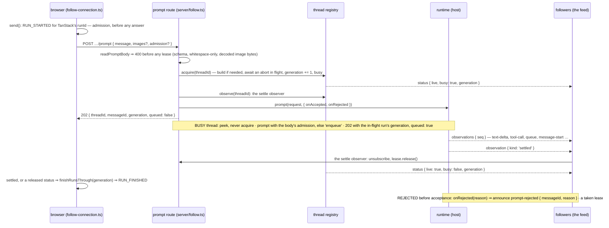

# Flow: prompt → run → settle — admitted on the POST, ended on the follow

A prompt from the browser is one `POST /api/threads/:id/prompt`, and the route's whole job is
**admission**: check the body, take the thread or queue behind the run that holds it, answer 202
with a receipt. Nothing of the run is an HTTP response (#112): the run lives on the follow —
observations, `settled`, then a released `status` — and the thread's own `settled`, read off the feed
by the route, gives the lease back. Busy is queued, not refused (#75); a late refusal is an observation.

## The sequence



## The invariants it shows

1. **Admission is the answer; the run is not an HTTP response.** `promptThread` returns its 202
   the moment `runtime.prompt` has been fired; the run's end is read the way any follower reads
   it — the route subscribes to the thread's feed and releases the lease on `settled`
   (`server/follow.ts#promptThread`). The receipt's ids are the admission record's ids.
2. **Acceptance and completion are separate signals.** `onAccepted` is the runtime's preflight —
   taken, not finished (`thread-runtime.ts`, the contract's header). One exception is deliberate:
   an extension command's acceptance *is* its completion, so a slash prompt releases on
   `onAccepted` and never `settled`s. The browser therefore ends a run on either signal — the
   thread's `settled`, or a `status` that says released (`follow-connection.ts#observeStatus`).
3. **The generation is the run's number and the join key.** `acquire` increments it, marks the
   thread busy and publishes the status before the lease is handed out (`thread-registry.ts#acquire`);
   a `release` through a stale lease is a reported no-op. The browser closes only runs whose
   generation it knows and the server has moved past (`follow-connection.ts#finishRunsThrough`).
4. **Busy is queued, not refused and not re-acquired.** A busy thread is read with `peek`; the
   message goes to the runtime with the caller's streaming behavior or `followUp`, and the receipt
   names the run in flight with `queued: true`. That run keeps its lease; its `settled` releases
   the thread once everything queued has run. The browser's `prompt()` opens no run of its own.
5. **Refusals fall before the lease where they can; after the receipt they are observations.**
   A whitespace-only body is a 400 from `readPromptBody` before any lease or session exists; a
   slash command the runtime does not list is a 400 that took the lease and gives it back. Once
   the 202 is out the feed is the only channel: `onRejected` announces `prompt-rejected` in
   sequence with the runtime's observations (`thread-registry.ts#announce`), and the browser closes
   the run it names — holding a rejection that arrives before its own receipt names that run.
6. **A settled run releases; it never disposes.** `release` arms the idle timer and publishes
   `busy: false` (`thread-registry.ts#release`); the session survives into the next run (#43).

## The receipt contract

<!-- source: packages/core/src/follow.ts#ZenPromptReceipt -->
```ts
/**
 * What `POST /api/threads/:id/prompt` answers with: ADMISSION, not a result.
 *
 * A run is not one prompt's reply — interrupting prompts, enqueued ones and retries can all
 * land inside it — so the receipt names the message and the acquisition it took or queued
 * behind, and the follow carries everything after (deepseek-harness: `followup()` returns
 * void).
 *
 * @group Follow wire
 */
export const ZenPromptReceipt = Type.Object(
  {
    threadId: Type.String(),
    /** Minted at admission — the identity a client correlates this message by. */
    messageId: Type.String(),
    /** The acquisition this prompt took, or the one it queued behind. */
    generation: Type.Integer({ minimum: 0 }),
    /** The thread was busy: pi queued the message behind the run in flight (#75). */
    queued: Type.Boolean(),
  },
  { additionalProperties: false },
)
```

## The tests that pin it

Each marker below is checked by `test/docs-gate.test.ts`: the file must declare a test with exactly
that title, so a renamed or deleted pin fails this page.

<!-- test: packages/web/src/server/__tests__/follow.test.ts#prompt answers at admission with a message id; the run is released by pi's settle, no HTTP response in between -->
- **Invariants 1 and 3, server side** — [`follow.test.ts`](../../packages/web/src/server/__tests__/follow.test.ts):
  the receipt, the two status frames of acquisition, then delta, `settled`, released — and the
  `info` spine that records each step.
<!-- test: packages/web/src/server/__tests__/follow.test.ts#a prompt on a busy thread is enqueued through the runtime, not refused and not re-acquired -->
- **Invariant 4, server side** — the second prompt's receipt and what the runtime was handed.
<!-- test: packages/web/src/server/__tests__/follow.test.ts#an unknown slash command is a 400 at admission and releases the thread -->
- **Invariant 5, the lease-then-400 half** — the runtime is handed nothing and the thread is idle.
<!-- test: packages/web/src/server/__tests__/server-handler.test.ts#⚠ two prompts on one thread reuse ONE session; a second thread gets its own (#43 over HTTP) -->
- **Invariant 6** — [`server-handler.test.ts`](../../packages/web/src/server/__tests__/server-handler.test.ts):
  one build for two prompts, no abort and no dispose after a settle.
<!-- test: packages/web/src/__tests__/follow-connection.test.ts#send opens TanStack's own run at admission; the thread's settle closes it -->
- **Invariant 1, browser side** — [`follow-connection.test.ts`](../../packages/web/src/__tests__/follow-connection.test.ts):
  `RUN_STARTED` before the receipt; the status for this tab's own generation opens no second run.
<!-- test: packages/web/src/__tests__/follow-connection.test.ts#⚠ a released status ends the run — the slash-command case, which never settles -->
- **Invariant 2** — the run that ends without a `settled`.
<!-- test: packages/web/src/__tests__/follow-connection.test.ts#⚠ an earlier run's ending frames cannot close a run whose receipt is still pending; the receipt closes it if the server already moved past it -->
- **Invariant 3, browser side** — the receipt arriving after the status that would have closed it.
<!-- test: packages/web/src/__tests__/follow-connection.test.ts#⚠ a prompt pi rejects after admission reaches the run as an error, by the receipt's message id -->
- **Invariant 5, browser side** — the rejection observation matched to its run.
<!-- test: packages/web/src/__tests__/follow-connection.test.ts#⚠ a rejection that beats its own receipt is held and still ends the run with its reason -->
- **Invariant 5, the ordering case** — nothing closes until the receipt names the run.

**Stated, by design.** A rejection the runtime raises *after* acceptance never reaches the feed: the
host drops it on purpose (`agent-host.ts`, the `prompt` implementation's comment) — the run ends
through `settled`, the reason is lost. The server half of a rejection *before* acceptance — `onRejected`
→ `announce` → every follower, and the lease released or the run left open — is pinned below for both
paths, the idle thread's and the queued prompt's.

<!-- test: packages/web/src/server/__tests__/follow.test.ts#⚠ a prompt the runtime REJECTS after the 202 is said on the follow with the receipt's message id, and the thread is released -->
- **The rejected case, the server's half** — `onRejected` → `announce` → the follower, by the
  receipt's message id; the lease released.
<!-- test: packages/web/src/server/__tests__/follow.test.ts#⚠ a QUEUED prompt the runtime rejects is said on the follow too, and the run it queued behind stays open -->
- **The rejected case, queued** — said on the feed; the run in flight untouched.

## Where it is stated

The route table: [`reference/routes.md`](../reference/routes.md). The split: `packages/web/src/server/follow.ts`
(header, `#promptThread`); the admission record: `server/index.ts#respondToPrompt`. The lease, the
generation and the feed: `packages/web/src/server/thread-registry.ts` (header, `ThreadLease`, `acquire`,
`release`, `announce`). Acceptance versus completion: [`seams/thread-runtime.md`](../seams/thread-runtime.md).
The browser's runs: `follow-connection.ts` (header, *RUNS*; `send`, `observeStatus`, `finishRunsThrough`,
`prompt`). The words: [`glossary.md`](../glossary.md) → *Thread* and *Control*.
