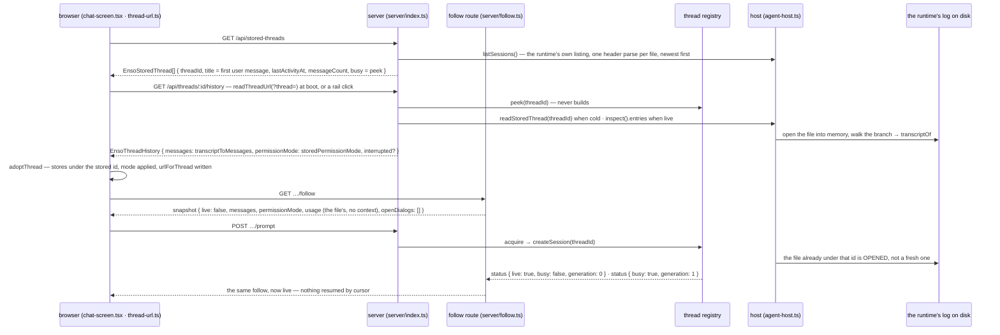

# Flow: resume — a stored thread, from the rail to live

A **stored thread** is one whose log the runtime has flushed — nothing reaches disk before the first
assistant message, so a thread that has only run slash commands has nothing to come back to
(`agent-host.ts#listSessions`, its comment). Resume is not a code identifier (glossary, *Thread* →
states): the rail's listing, the URL naming the thread, `GET …/history` read cold from the file,
adoption in the browser under the **same id**, then the first prompt building the runtime over that
file. The thread id *is* the runtime's session id (#95): no mapping, no index file, across a restart.

## The sequence



## The invariants it shows

1. **One id, end to end.** `createSession` resolves the thread id through the same listing
   `readStoredThread` uses: a file under that id is opened, none means one is created under it, so
   the file it later flushes is found next time. The browser adopts under the history's `threadId`
   (`thread-stores.ts#adoptThread`), so its next prompt reopens the same file.
2. **Looking must not build (#86).** `readStoredThread` opens the file into memory and writes nothing
   until an append; the history route `peek`s the registry, and a thread neither live nor stored is
   a 404 — while the follow's cold read is an *empty* snapshot, so observation may precede the first
   prompt ([`follow-snapshot-frames.md`](./follow-snapshot-frames.md), invariant 2). A session file in
   a directory that is no project here is a **403 naming the directory**, not that 404 (#378). The
   page reads the three by where the id came from (`stored-threads.ts#createResumeRequests`): a 404
   for the URL's own thread — written before its first prompt, then lost to a restart — starts it
   under that id, said nowhere; a 404 for a rail row is a stale listing; either failure is said on
   the rail's "could not open the thread" line, never as the listing failing.
3. **The rail is the listing, newest first, titled by the first user message.** A blank first
   message is no title (`server/index.ts#respondWithStoredThreads`). `busy` marks a thread a run on
   *this* server holds; the row is shown, not locked (#114), and an idle thread the server still
   holds is resumable — held is not busy (PR #104 review).
4. **The opening mode is the branch's last `modes` custom entry, or the fresh state.**
   `storedPermissionModeState` walks the transcript from the end over `custom` entries and, building
   nothing, offers the full registered set; a live thread answers from the runtime, fresher than the file.
5. **The transcript is ours; the reader assembles and never decodes.** Below the seam
   `host/transcript.ts#transcriptOf` reads the runtime's stored entries defensively — same length,
   same order, an unmodelled kind is `other` with its `type`. Above it `transcriptToMessages` pairs a
   tool result into the assistant message holding its call, drops one whose call is not on the branch,
   skips `custom` and `other`; an image's bytes render as a data URL, never a fetch (`selected-message-part.tsx`).
   A refused attempt (#381) — pi keeps it on the branch with `stopReason: "error"` — is a message
   carrying its `refusal`, and its bubble says `<Provider> · <model> refused: <class> (<status>) — <reason>`
   where the reply would have been, not an empty bubble. The provider is pi's display name for it
   (#387), from pi-ai's built-in catalogue, since a cold read has no session to ask.
6. **The URL names the thread; the latest navigation wins.** `readThreadUrl`: a thread id resumes,
   none is fresh, a malformed one is fresh *and said*; `urlForThread` keeps every other parameter.
   The boot resumes with `pop` (no history written), a rail click pushes, and two guards drop a late
   answer whole: `createResumeRequests` (last click wins) and the page's `epoch` (a navigation since).
7. **Cold, then live, on one follow.** The pane's follow opens before any run and reads
   `live: false`; the first prompt acquires, `createSession` opens the file, and the same follow
   carries `status live: true` then `busy: true, generation: 1`.

## The transcript contract

What crosses the storage seam on every cold read, and what `inspect().entries` holds live:

<!-- source: packages/core/src/transcript.ts#EnsoTranscriptEntry -->
```ts
export const EnsoTranscriptEntry = Type.Union([
  EnsoTranscriptMessage,
  EnsoTranscriptToolResult,
  EnsoTranscriptCustom,
  EnsoTranscriptOther,
])
```

## The tests that pin it

Each marker below is checked by `test/docs-gate.test.ts`: the file must declare a test with exactly
that title, so a renamed or deleted pin fails this page.

<!-- test: packages/web/src/host/__tests__/agent-host.test.ts#listSessions names stored sessions newest first with the first user message; readStoredThread reads one without building pi -->
- **Invariants 2 and 3, at the seam** — [`agent-host.test.ts`](../../packages/web/src/host/__tests__/agent-host.test.ts),
  against the real session manager: order, first message, count, `undefined` for an id with no file.
<!-- test: packages/web/src/host/__tests__/agent-host.test.ts#⚠ createSession(threadId) OPENS the session file already under that id — the branch is the stored one, not a fresh file -->
- **Invariant 1, at the seam** — the inspection's `sessionFile` is the stored file; its entries, the file's.
<!-- test: packages/web/src/server/__tests__/server-handler.test.ts#GET /api/stored-threads lists stored threads with title, count and age, marking the ones a thread here is RUNNING -->
- **Invariant 3** — [`server-handler.test.ts`](../../packages/web/src/server/__tests__/server-handler.test.ts):
  the wire rows, a blank first message as no title, `busy` from the registry.
<!-- test: packages/web/src/server/__tests__/server-handler.test.ts#GET /api/threads/:id/history serves a STORED thread's branch as messages with its persisted mode, and builds no session -->
- **Invariants 2 and 4** — the cold history with `mode: plan`, nothing built; an unknown id a 404.
<!-- test: packages/web/src/server/__tests__/server-handler.test.ts#⚠ a thread this server holds IDLE is resumable — /history reads pi's memory, /sessions does not mark it busy -->
- **Invariants 3 and 4, the live side** — an idle held thread is not busy, and its history is the
  runtime's answer, not the file's.
<!-- test: packages/web/src/host/__tests__/permission-mode-adapter.test.ts#a stored thread answers from its transcript alone: the walk for the mode, the full registered set to offer -->
- **Invariant 4** — [`permission-mode-adapter.test.ts`](../../packages/web/src/host/__tests__/permission-mode-adapter.test.ts).
<!-- test: packages/web/src/server/__tests__/transcript-to-messages.test.ts#a user message pi stored with an image beside its text comes back as text + image parts (#68) — the bytes are in the file -->
- **Invariant 5, images** — [`transcript-to-messages.test.ts`](../../packages/web/src/server/__tests__/transcript-to-messages.test.ts):
  the file in, the parts out, an unknown kind a visible marker.
<!-- test: packages/web/src/__tests__/thread-url.test.ts#a URL that names a thread id resumes it; none is a fresh page; one that cannot be a thread id is fresh AND said -->
- **Invariant 6** — [`thread-url.test.ts`](../../packages/web/src/__tests__/thread-url.test.ts).
<!-- test: packages/web/src/__tests__/threads-rail.test.tsx#adopting stored history restores dates, title and mode under the stored thread id exactly once, and never asks to start a session (#391) -->
- **Invariant 1, in the browser** — [`threads-rail.test.tsx`](../../packages/web/src/__tests__/threads-rail.test.tsx):
  adopted under the stored id; a second adoption returns the same stores; a resumed thread never opens
  the Start-a-session dialog.
<!-- test: packages/web/src/server/__tests__/follow.test.ts#prompt answers at admission with a message id; the run is released by pi's settle, no HTTP response in between -->
- **Invariant 7** — [`follow.test.ts`](../../packages/web/src/server/__tests__/follow.test.ts): the
  empty cold snapshot, then the two status frames as the thread is built and taken.
<!-- test: packages/web/e2e/chat.e2e.ts#the URL names the thread (#142): reload keeps it, back/forward walk threads, a pasted link opens cold, a bad id says so -->
- **Invariants 4 and 6, end to end** — [`chat.e2e.ts`](../../packages/web/e2e/chat.e2e.ts): the
  persisted mode after a reload and on a pasted link.
<!-- test: packages/web/e2e/chat.e2e.ts#⚠ New Thread during a slow boot resume wins outright: URL and pane agree, the late history is dropped (PR #143 review) -->
- **Invariant 6, the slow boot** — the late history changes nothing.

**Where the messages come from.** The pane's messages come from `/history` (`adoptThread`); the snapshot
carries the same `messages`, and `custom-event-router.ts` reads one fact off them: whether the last
assistant message is a refused attempt, which sets the status bar's class word (#381) with the
snapshot's output as the mark a later reply must grow past. The image's rendering from a resumed
history is pinned at the page (below), beside the reader's pin. The host's name for the listing is
`listSessions`; there is no `listThreads`.

<!-- test: packages/web/src/__tests__/thread-pane.test.tsx#a resumed thread's image renders as an  from the stored history, bytes inline (#68, #95) -->
- **The image, at the page** — [`thread-pane.test.tsx`](../../packages/web/src/__tests__/thread-pane.test.tsx):
  a resumed history's image is an `` with the bytes inline.
<!-- test: packages/web/src/server/__tests__/transcript-to-messages.test.ts#a stored refused attempt, then the reply that got through: the refusal rides the attempt, not the reply (#381) -->
- **Invariant 5, a refused attempt** — the stored branch in, the refusal on the attempt's message, none on the reply.
<!-- test: packages/web/src/__tests__/thread-pane.test.tsx#a resumed thread's refused attempt says the refusal in its own bubble, before the reply (#381) -->
- **The refused attempt, at the page** — its line between the prompt and the reply.
<!-- test: packages/web/src/__tests__/custom-event-router.test.ts#a snapshot whose last reply is a refused attempt shows the word; one with a reply after it clears it (#381) -->
- **The status word on resume** — [`custom-event-router.test.ts`](../../packages/web/src/__tests__/custom-event-router.test.ts).

## Where it is stated

The seam: [`seams/storage.md`](../seams/storage.md) — the listing, the cold read, the open-or-create.
The mode walk: [`seams/permission-mode.md`](../seams/permission-mode.md). The words — *stored thread*,
*resume*, *live / cold*, *session* reserved for the log: [`glossary.md`](../glossary.md) → *Thread*.
The URL as source of truth: `thread-url.ts` (header) and `chat-screen.tsx` → `BOOT`, `navigate`.
