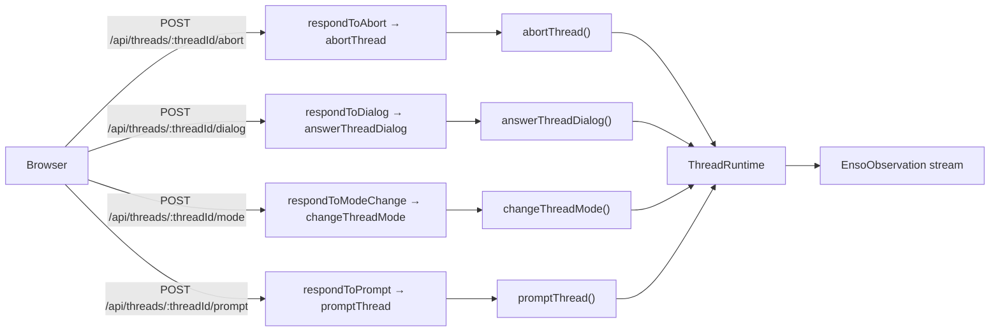
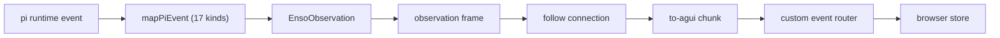

<!-- generated: scripts/docs/flow-diagrams.ts -->
# Generated flows

Every node below is read out of the source the flow runs through — the route table in `packages/web/src/server/index.ts` and the `EnsoObservation` union in `packages/core/src/observation.ts`. Nothing here is drawn by hand, so a route or a kind that moves changes this page or fails the docs gate.

## Control plane

The 4 control routes: what the browser can ask the runtime to do. Observation routes are the next diagram's first stage rather than a second copy of it.

| Node | Contract | Input | Source |
|---|---|---|---|
| `respondToAbort → abortThread` | [`POST /api/threads/:threadId/abort`](./routes.md) | path: `threadId`; no body | [`packages/web/src/server/index.ts:50`](../../packages/web/src/server/index.ts#L50) [`packages/web/src/server/follow.ts:420`](../../packages/web/src/server/follow.ts#L420) |
| `respondToDialog → answerThreadDialog` | [`POST /api/threads/:threadId/dialog`](./routes.md) | path: `threadId`; body: `DialogAnswer` | [`packages/web/src/server/index.ts:49`](../../packages/web/src/server/index.ts#L49) [`packages/web/src/server/follow.ts:331`](../../packages/web/src/server/follow.ts#L331) |
| `respondToModeChange → changeThreadMode` | [`POST /api/threads/:threadId/mode`](./routes.md) | path: `threadId`; body: `EnsoPermissionModeChange` | [`packages/web/src/server/index.ts:52`](../../packages/web/src/server/index.ts#L52) [`packages/web/src/server/follow.ts:367`](../../packages/web/src/server/follow.ts#L367) |
| `respondToPrompt → promptThread` | [`POST /api/threads/:threadId/prompt`](./routes.md) | path: `threadId`; body: `EnsoPromptBody` | [`packages/web/src/server/index.ts:48`](../../packages/web/src/server/index.ts#L48) [`packages/web/src/server/follow.ts:241`](../../packages/web/src/server/follow.ts#L241) |

## Observation pipeline

One pi event becomes one observation and crosses six stages to reach the browser store. The union declares 19 kinds; the mapper produces 17 of them, and the rest are produced by the prompt route (see [Observations](./observations.md) for the per-kind producer, carrier and consumer).

| Stage | Contract | Source |
|---|---|---|
| `mapPiEvent (17 kinds)` | [Observations](./observations.md) | [`packages/web/src/host/map-events.ts:233`](../../packages/web/src/host/map-events.ts#L233) |
| `EnsoObservation` | [Core exports](./core-exports.md) | [`packages/core/src/observation.ts:471`](../../packages/core/src/observation.ts#L471) |
| `observation frame` | [Observations](./observations.md) | [`packages/web/src/server/follow.ts:160`](../../packages/web/src/server/follow.ts#L160) |
| `follow connection` | [Routes](./routes.md) | [`packages/web/src/follow-connection.ts:390`](../../packages/web/src/follow-connection.ts#L390) |
| `to-agui chunk` | [Observations](./observations.md) | [`packages/web/src/to-agui.ts:76`](../../packages/web/src/to-agui.ts#L76) |
| `custom event router` | [Observations](./observations.md) | [`packages/web/src/custom-event-router.ts:125`](../../packages/web/src/custom-event-router.ts#L125) |

Kinds, in the union's order of declaration: `text-delta`, `thinking-delta`, `tool-call`, `tool-result`, `custom-entry`, `permission-mode`, `permission-mode-rejected`, `message-start`, `message-end`, `turn-start`, `turn-end`, `queue`, `prompt-rejected`, `extension-error`, `extension-ui-request`, `dialog-settled`, `run-ended`, `settled`, `unmapped`.
