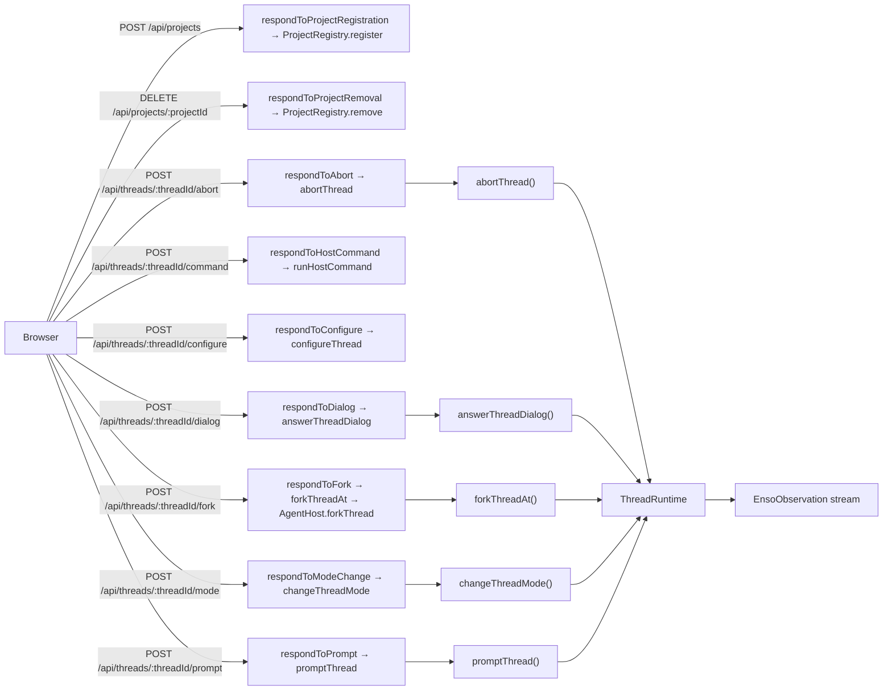
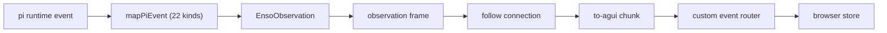

<!-- generated: scripts/docs/flow-diagrams.ts -->
# Generated flows

Every node below is read out of the source the flow runs through — the route table in `packages/web/src/server/index.ts` and the `EnsoObservation` union in `packages/core/src/observation.ts`. Nothing here is drawn by hand, so a route or a kind that moves changes this page or fails the docs gate.

## Control plane

The 9 control routes: what the browser can ask the runtime to do. Observation routes are the next diagram's first stage rather than a second copy of it.

| Node | Contract | Input | Source |
|---|---|---|---|
| `respondToProjectRegistration → ProjectRegistry.register` | [`POST /api/projects`](./routes.md) | body: `EnsoProjectRegistration` — an absolute `path` strictly under a root the ENSO_HOME config declares (`projects.roots`), optional `title` | [`packages/web/src/server/index.ts:1074`](../../packages/web/src/server/index.ts#L1074) |
| `respondToProjectRemoval → ProjectRegistry.remove` | [`DELETE /api/projects/:projectId`](./routes.md) | path: `projectId` (sixteen hex digits) | [`packages/web/src/server/index.ts:82`](../../packages/web/src/server/index.ts#L82) |
| `respondToAbort → abortThread` | [`POST /api/threads/:threadId/abort`](./routes.md) | path: `threadId`; no body | [`packages/web/src/server/index.ts:72`](../../packages/web/src/server/index.ts#L72) [`packages/web/src/server/follow.ts:716`](../../packages/web/src/server/follow.ts#L716) |
| `respondToHostCommand → runHostCommand` | [`POST /api/threads/:threadId/command`](./routes.md) | path: `threadId`; body: `EnsoHostCommandRun` — `model` with `provider/id`, `thinking` with a level, `login` with `provider/authType`, `logout` with a provider, `compact` with nothing; a `view` row (`context`, `fork`) is the page's to do, never run | [`packages/web/src/server/index.ts:76`](../../packages/web/src/server/index.ts#L76) |
| `respondToConfigure → configureThread` | [`POST /api/threads/:threadId/configure`](./routes.md) | path: `threadId`; body: `EnsoSessionConfiguration` — optional `model` (`provider/id`), `thinking` (a level that model supports) and `mode`; applied in that order under one lease, a value equal to the current one left alone | [`packages/web/src/server/index.ts:78`](../../packages/web/src/server/index.ts#L78) |
| `respondToDialog → answerThreadDialog` | [`POST /api/threads/:threadId/dialog`](./routes.md) | path: `threadId`; body: `DialogAnswer` | [`packages/web/src/server/index.ts:71`](../../packages/web/src/server/index.ts#L71) [`packages/web/src/server/follow.ts:381`](../../packages/web/src/server/follow.ts#L381) |
| `respondToFork → forkThreadAt → AgentHost.forkThread` | [`POST /api/threads/:threadId/fork`](./routes.md) | path: `threadId`; body: `EnsoForkRequest` — `entryId`, the pi entry id of one of the thread's user messages; the fork is pi's `/fork` at position `before`, taken from the session file | [`packages/web/src/server/index.ts:80`](../../packages/web/src/server/index.ts#L80) [`packages/web/src/server/follow.ts:688`](../../packages/web/src/server/follow.ts#L688) |
| `respondToModeChange → changeThreadMode` | [`POST /api/threads/:threadId/mode`](./routes.md) | path: `threadId`; body: `EnsoPermissionModeChange` | [`packages/web/src/server/index.ts:74`](../../packages/web/src/server/index.ts#L74) [`packages/web/src/server/follow.ts:417`](../../packages/web/src/server/follow.ts#L417) |
| `respondToPrompt → promptThread` | [`POST /api/threads/:threadId/prompt`](./routes.md) | path: `threadId`; body: `EnsoPromptBody` | [`packages/web/src/server/index.ts:70`](../../packages/web/src/server/index.ts#L70) [`packages/web/src/server/follow.ts:275`](../../packages/web/src/server/follow.ts#L275) |

## Observation pipeline

One pi event becomes one observation and crosses six stages to reach the browser store. The union declares 24 kinds; the mapper produces 22 of them, and the rest are produced by the prompt route (see [Observations](./observations.md) for the per-kind producer, carrier and consumer).

| Stage | Contract | Source |
|---|---|---|
| `mapPiEvent (22 kinds)` | [Observations](./observations.md) | [`packages/web/src/host/map-events.ts:283`](../../packages/web/src/host/map-events.ts#L283) |
| `EnsoObservation` | [Core exports](./core-exports.md) | [`packages/core/src/observation.ts:583`](../../packages/core/src/observation.ts#L583) |
| `observation frame` | [Observations](./observations.md) | [`packages/web/src/server/follow.ts:182`](../../packages/web/src/server/follow.ts#L182) |
| `follow connection` | [Routes](./routes.md) | [`packages/web/src/follow-connection.ts:465`](../../packages/web/src/follow-connection.ts#L465) |
| `to-agui chunk` | [Observations](./observations.md) | [`packages/web/src/to-agui.ts:76`](../../packages/web/src/to-agui.ts#L76) |
| `custom event router` | [Observations](./observations.md) | [`packages/web/src/custom-event-router.ts:208`](../../packages/web/src/custom-event-router.ts#L208) |

Kinds, in the union's order of declaration: `text-delta`, `thinking-delta`, `tool-call`, `tool-result`, `custom-entry`, `permission-mode`, `permission-mode-rejected`, `model`, `message-start`, `message-end`, `session-usage`, `turn-start`, `turn-end`, `provider-refused`, `provider-retry`, `provider-retry-ended`, `queue`, `prompt-rejected`, `extension-error`, `extension-ui-request`, `dialog-settled`, `run-ended`, `settled`, `unmapped`.
